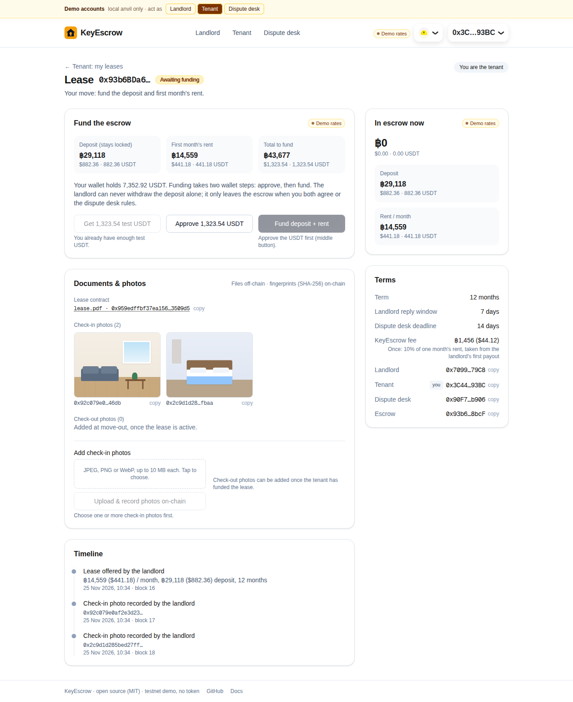
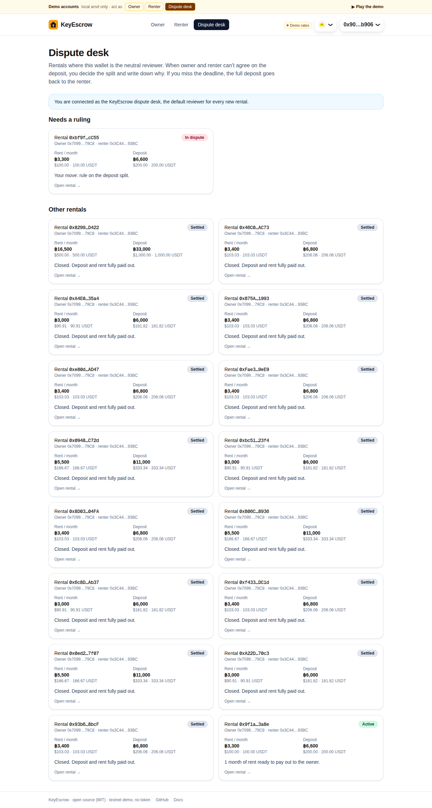
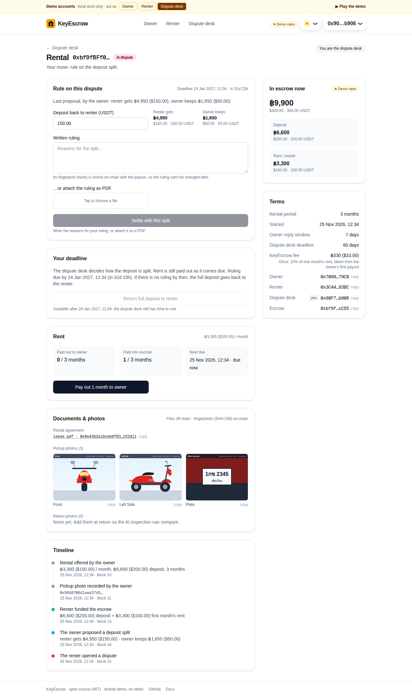

# KeyEscrow

**Rent a scooter in Thailand without leaving your passport.**
Tourists renting a scooter in Thailand usually leave their passport with the shop as the deposit, and bogus damage
claims at return are common. KeyEscrow keeps the deposit and rent in a per-rental smart contract on BNB Chain, not
with the shop. At return, an AI inspection compares pickup and return photos of the scooter and proposes the split,
the two sides agree on-chain, and the money settles instantly.

Built for BNB Bangkok 2026 (Developer Track + CoinMarketCap x Atlas). Open source (MIT), testnet only, no token.
The product spec and case study are in [docs/PRODUCT.md](docs/PRODUCT.md).


## How it works

1. **The shop offers the scooter:** monthly rent, deposit and rental period, priced in THB. The rental agreement
   and guided pickup photos (front, back, left, right, plate close-up) stay off-chain; only their SHA-256
   fingerprints go on-chain.
2. **The renter funds the escrow:** deposit plus the first month's rent go into that rental's own contract instead
   of a passport at the counter. Rent is paid out to the shop owner month by month.
3. **Return the scooter, settle in minutes:** an AI inspection compares pickup and return photos and proposes a
   split. One side proposes, the other accepts, and the money moves at once. If they disagree, the dispute desk
   rules.

**Fee:** 10 % of one month's rent, once per rental, paid by the owner from the first payout. A scooter at
3,400 THB a month pays ฿340 once.

In more detail: a rental shop owner creates a rental for the renter's wallet. The renter funds the deposit plus the
first month's rent in a stablecoin into a per-rental `RentalEscrow` contract. Rent is released monthly. At return,
an AI inspection compares pickup and return photos and proposes a deposit split. One party submits it on-chain,
the other accepts, and the deposit settles instantly. If they disagree, the arbiter (dispute desk) rules. If the
owner does not respond in time, the deposit goes back to the renter. **Neither party can move funds alone.**

> **Naming:** the UI and docs speak of the rental shop *owner*, the *renter*, the *scooter rental* and the
> *pickup* / *return* photos. The contracts, ABIs and APIs keep their original identifiers: `landlord` = owner,
> `tenant` = renter, `lease` = rental, `CheckIn` / `CheckOut` = pickup / return, `MoveOut` = return proposal.

## Features

- **One escrow per rental.** `EscrowFactory` clones a minimal, non-upgradeable `RentalEscrow` (EIP-1167) for
  each scooter rental. Funds are isolated per rental, and the platform has no admin key over them.
- **Scheduled rent.** Rent is released on a fixed 30-day schedule. Anyone can trigger a release once it is
  due, and the renter can release early. Prepaid rent that is not yet due goes back to the renter at
  settlement.
- **AI return inspection.** A vision LLM compares pickup and return photos of the scooter and returns
  `{tenantRefund, landlordClaim, reasons[]}`. When the other party accepts, settlement is instant.
- **Neutral arbitration.** The KeyEscrow dispute desk is the default arbiter. The owner may name another
  neutral arbiter, and the renter sees it before funding.
- **Renter-protecting timeouts.** If the owner stays silent on a proposal for 7 days, or the arbiter does
  not rule within 14 days, the full deposit goes back to the renter.
- **Evidence off-chain, hashes on-chain.** The rental agreement and photos go to BNB Greenfield, with a local
  fallback. Only content hashes are stored on-chain.
- **Prices in baht.** Every amount is shown THB first, then USD and the exact USDT, using the Atlas on-chain
  feed or the CoinMarketCap Pro API, both called server-side only and cached. A badge always says where the
  rate comes from: *Atlas feed*, *Live CoinMarketCap* or *Demo rates*.
- **Fair fee.** The protocol fee is 10 % of one month's rent, charged once per rental and taken from the
  owner's first rent release, never from the deposit.
- **No token.** KeyEscrow has no token of its own. MockUSDT stands in for a stablecoin on testnet.

> **Status:** everything above is on `main`: contracts with 80 Foundry tests, the AI / price / evidence
> routes, the full UI for owner, renter and dispute desk, local deploy + seed scripts, a scripted chain
> end-to-end run, a Playwright browser test of the whole rental flow, and a prepared (not yet broadcast) BSC
> testnet deploy path. The roadmap is in [docs/BUSINESS.md](docs/BUSINESS.md).

## Screenshots

| Owner: new rental | Renter: fund the escrow | AI return proposal |
| --- | --- | --- |
|  |  |  |

| Dispute desk | Ruling | Mobile (390 px) |
| --- | --- | --- |
|  |  |  |

More in [docs/screenshots](docs/screenshots/README.md).

## Quickstart

Requirements: [Foundry](https://book.getfoundry.sh/getting-started/installation), Node 22, pnpm.

```bash
git clone --recursive https://github.com/midego1/bnb-hackathon.git && cd bnb-hackathon && pnpm run setup
```

Then run the whole thing locally, with no wallet or keys:

```bash
pnpm chain:anvil                                     # terminal 1: anvil on 127.0.0.1:8545
pnpm chain:deploy && pnpm chain:seed                 # terminal 2: contracts + demo accounts and rentals
echo "NEXT_PUBLIC_DEV_ACCOUNTS=1" > web/.env.local   # "Demo accounts" bar: act as owner / renter / dispute desk
pnpm dev                                             # http://localhost:3000
```

[docs/DEMO.md](docs/DEMO.md) has the seeded accounts and rentals and a 3-minute demo script. In a local build the
landing page has a **▶ Play the demo** button that plays the whole story in one click (`/demo`).

Configuration: copy `.env.example` to `.env` / `web/.env.local` and fill in what you need. Every integration
falls back to a labelled local mock when its key is missing. See [docs/API.md](docs/API.md) for the server API
and [docs/DEPLOY.md](docs/DEPLOY.md) for the BSC testnet deploy.

## Sponsor integrations

Open **`/integrations`** in the running app: the risk engine on a sample deposit, each integration's state
(*Live*, *Not configured*, *Blocked*, *Live calls off*), the env var names it needs, and its recent calls
(endpoint, time, HTTP status, never a key). The same risk panel appears on the owner's create form and on the
renter's funding card. All sponsor calls are **server-side only** (`web/app/api/*`) and logged to
`web/.sponsor-logs/<sponsor>.jsonl` (gitignored). Tests never call a sponsor: they replay fixtures in
`web/tests/fixtures/` (see its README for which are recorded and which are synthetic).

Live calls only happen once the owner sets the key or flag below in `web/.env.local` (names in `.env.example`).

| Sponsor | What it does in KeyEscrow | Turn it on | State |
|---|---|---|---|
| CoinMarketCap | Volatility of USDT/BNB (`quotes/latest`, USD) sets the deposit buffer; THB quotes convert and display every amount | `CMC_API_KEY` | Built; no key yet, so it shows *not configured* and no numbers |
| Cournot | Probability that BNB breaks the deposit's coverage floor before the return date scales the buffer | `COURNOT_LIVE=1` | Built; no probability call made yet |
| Atlas | `latestRoundData()` with staleness check is the first price source | `ATLAS_RPC_URL`, `ATLAS_FEED_*` | Blocked: no BSC testnet feed addresses published |
| Living Brain | The AI inspector recalls a scooter's earlier inspections before judging and stores each new one | `LIVING_BRAIN_API_KEY`, `LIVING_BRAIN_SUBJECT_ID`, `LIVING_BRAIN_BRAIN_ID` | Built; local memory file until configured |

### CoinMarketCap

- `GET /api/risk?depositThb=3000&days=30` calls `GET /v2/cryptocurrency/quotes/latest?symbol=USDT,BNB&convert=USD`
  and `convert=THB` (1 credit each, cached `RISK_CACHE_TTL_SECONDS`, default 120 s). Daily volatility is the largest
  of `|24h|`, `|7d|/√7` and `|30d|/√30`; the buffer is `1.28 × σ × √days` (days capped at 30), 0 below 2 %
  (stablecoin), rejected above 60 %. Code: `web/lib/risk.ts`, `web/lib/server/risk/index.ts`,
  `web/lib/server/sponsors/cmc.ts`.
- `GET /api/price` uses the same client for the THB/USD display.
- Without `CMC_API_KEY` the risk panel says *CoinMarketCap is not configured* and shows no buffer.
- Evidence: `web/.sponsor-logs/cmc.jsonl`, e.g.
  `{"sponsor":"cmc","endpoint":"GET /v2/cryptocurrency/quotes/latest?symbol=USDT,BNB&convert=USD","status":200,"ok":true,"note":"credits=1",...}`.

### Atlas

`web/lib/server/price/index.ts` reads Atlas SingleFeed proxies (`decimals()` + `latestRoundData()`, AggregatorV3
compatible) and rejects never-updated (`answer == 0` / `updatedAt == 0`), negative and stale answers
(`now - updatedAt > ATLAS_MAX_AGE_SECONDS`, default 3600), as in Atlas's example code. When `ATLAS_RPC_URL`,
`ATLAS_FEED_USDT_USD` and `ATLAS_FEED_BNB_USD` are set it is the first price source for every THB/USD amount.
**Blocked:** docs.atlasoracle.io and `oracle-atlas/push-oracle-interfaces` publish no BSC testnet (or mainnet) feed
addresses; Atlas assigns them during onboarding. In whitelist mode plain EOA `eth_call` reads are allowed (our
server read works); a contract that reads the feed must be whitelisted by Atlas.

### Living Brain (ChatAndBuild)

`web/lib/server/sponsors/livingbrain.ts`: before judging, the AI inspector (`POST /api/settlement` and the agent)
searches the scooter's brain (`POST /v1/brains/{brainId}/search`, headers `x-api-key` + `x-subject-id`) and gets the
earlier inspections as notes ("damage listed here already existed: do not charge again"). After judging it stores the
inspection (`POST /v1/brains/{brainId}/captures`, `kind: "note"`, `originRef` = report hash for idempotency). The
recalled history is part of the hashed report and shown under the AI proposal ("Scooter memory"). The return
inspection form has a *Scooter plate or id* field (defaults to the rental address). Without `LIVING_BRAIN_*` a local
file (`web/.sponsor-logs/inspections.jsonl`) stands in, labelled as such.

One-time setup once you have a key (creates the brain; put the returned `id` in `LIVING_BRAIN_BRAIN_ID`):

```bash
curl -s -X POST https://api.livingbrain.com/v1/brains -H "x-api-key: $LIVING_BRAIN_API_KEY" \
  -H "x-subject-id: $LIVING_BRAIN_SUBJECT_ID" -H 'content-type: application/json' -d '{"name":"KeyEscrow scooters"}'
```

`LIVING_BRAIN_SUBJECT_ID` is any UUID you choose (e.g. `uuidgen`); it identifies the end user that owns the brain.

### BSC testnet addresses (chain 97)

| Contract | Address |
|---|---|
| EscrowFactory | [`0xdf3d62d64407ca5684425E17E78Cde26d3890eca`](https://testnet.bscscan.com/address/0xdf3d62d64407ca5684425E17E78Cde26d3890eca) |
| RentalEscrow implementation | [`0x3144c6C05018F376E545a60C1E8F3B6962D04C41`](https://testnet.bscscan.com/address/0x3144c6C05018F376E545a60C1E8F3B6962D04C41) |
| MockUSDT | [`0x7f3F2fE665B8ef85532A1Fa91DAB27fB41201F7B`](https://testnet.bscscan.com/address/0x7f3F2fE665B8ef85532A1Fa91DAB27fB41201F7B) |
| Inspector agent (ERC-8004 #2921, Identity Registry) | [`0x8004A818BFB912233c491871b3d84c89A494BD9e`](https://testnet.bscscan.com/address/0x8004A818BFB912233c491871b3d84c89A494BD9e) |

## Cournot Integration

- **Where and how we call it.** `web/lib/server/sponsors/cournot.ts` calls the official Cournot Intelligence Oracle
  exactly like the [Cournot skill's](https://github.com/Cournot-AI/cournot-skills) client:
  `POST https://interface.cournot.ai/intelligence/v1/resolve` `{message, limit}` to find the reference market (free),
  then `POST /intelligence/v1/probability` `{message, market_ids}`. No API key or wallet is needed for the first 3
  probability calls per IP; after that Cournot answers HTTP 402 (x402/b402 payment), which we surface and never pay.
  Live calls run only when the server has `COURNOT_LIVE=1`, at most `COURNOT_MAX_LIVE_CALLS` (default 3), and only
  from an explicit click (with a confirm) or this command:

  ```bash
  # web/.env.local: COURNOT_LIVE=1, then with the app running:
  curl -s -X POST http://localhost:3000/api/cournot -H 'content-type: application/json' \
    -d '{"claim":"Will BNB fall below $450 at any time before 2026-12-26 00:00 UTC?","confirm":true}'
  ```

  Every answer is stored (`web/.sponsor-logs/cournot-results.json`; answers worth keeping as proof go in
  `web/data/cournot-results.json`) and reused, so the same claim is never asked twice.
- **The claim.** Built per rental from live data: *"Will BNB fall below $<coverage floor> at any time before <return
  date> 00:00 UTC?"*, where the floor is the BNB price at which the buffered deposit stops covering the THB deposit.
- **How the probability is used.** BNB buffer = CMC volatility buffer × (1 + p). It is shown as "CMC 17 % + Cournot
  2.1 %" on the deposit card.
- **Where users see claim + evidence.** The *Cournot Intelligence Oracle* box in the deposit risk panel (`/integrations`,
  the owner's create form, the renter's funding card): the exact claim sent, the returned probability, the `result`
  fields, the full `basis` evidence verbatim, the request id (Cournot's `x-trace-id`), and a separate box labelled
  **"Explanation added by KeyEscrow (not from Cournot)"**.
- **Proof of a successful call.** _Pending: no probability call has been made yet (the owner decides when to spend one
  of the 3 free calls)._ One `resolve` call (free) succeeded on 2026-11-25 12:44:29 UTC, `x-trace-id`
  `4dbc8496d005d7971986d3123fe7dadd`; its response is `web/tests/fixtures/cournot/resolve.recorded-2026-11-25.json`.
  After the live probability call, paste its sanitized log line (`web/.sponsor-logs/cournot.jsonl`) and request id here.

## Tests

```bash
cd contracts && forge build && forge test   # 80 contract tests (unit + fuzz)
pnpm -C web lint && pnpm -C web test        # eslint + vitest (server routes, offline)
pnpm -C web build                           # production build
pnpm -C web test:e2e                        # Playwright: rental flow, guided demo, theme, /integrations; own anvil :28546
pnpm e2e:chain                              # every settlement path with real txs + time travel, own anvil :28545
```

## Networks

| Network | Chain ID | Use |
| --- | --- | --- |
| Anvil (local) | 31337 | development and scripted end-to-end tests |
| BSC testnet | 97 | hackathon deployment |
| opBNB testnet | 5611 | supported in the frontend |

Testnet only. MockUSDT is a test stablecoin stand-in; KeyEscrow has no token of its own.

## Repo layout

```
contracts/           Foundry project
  src/EscrowFactory.sol    creates one RentalEscrow clone per rental, indexes rentals, protocol fee config
  src/RentalEscrow.sol     per-rental escrow: deposit, rent schedule, evidence hashes, settlement
  src/mocks/MockUSDT.sol   testnet-only 6-decimal stablecoin with a capped faucet
  test/                    Foundry tests
web/                 Next.js (App Router) + TypeScript + Tailwind + wagmi/viem + RainbowKit
  app/                     pages: / /landlord (owner) /tenant (renter) /arbiter /lease/[address] (one rental)
  app/api/                 server routes: AI settlement, price (CMC/Atlas), evidence upload (Greenfield)
  components/              UI: role pages, rental detail panels (rent, return, evidence, ruling, timeline)
  lib/                     chain + wallet config, generated contract bindings, server services
  e2e/                     Playwright browser test
agent/               KeyEscrow Inspector: the AI inspection as a BNB Chain agent (ERC-8004 identity, A2A + MCP)
docs/                Architecture, business model, CMC x Atlas write-up, API, deploy, demo script, screenshots
```

## Docs

- [Architecture](docs/ARCHITECTURE.md): the components, the rental state machine, money flows, off-chain
  services and scalability.
- [Business model](docs/BUSINESS.md): the problem, users, the fee model with a THB example, the roadmap
  and risks.
- [CoinMarketCap x Atlas write-up](docs/WRITEUP.md): the one-page track write-up (problem, endpoints and feeds,
  contract addresses, next steps).
- [API](docs/API.md): the server routes (`/api/settlement`, `/api/price`, `/api/evidence`) and their fallbacks.
- [Deploy](docs/DEPLOY.md): the BSC testnet path: preflight, guarded broadcast, verification, rehearsal.
- [Demo script](docs/DEMO.md): the 3-minute local demo with the seeded accounts and rentals.
- [Screenshots](docs/screenshots/README.md)
- [KeyEscrow Inspector agent](docs/AGENT.md): the AI inspection as an ERC-8004 agent on BNB Chain (BNB Agent
  SDK), with A2A and MCP faces and signed reports.
- [Contracts README](contracts/README.md)

## Run locally

Everything runs against a local [anvil](https://book.getfoundry.sh/anvil/) node; no keys or accounts needed.

```bash
pnpm chain:anvil          # terminal 1: anvil on 127.0.0.1:8545 (ANVIL_PORT=... to change)
pnpm chain:deploy         # MockUSDT + EscrowFactory -> contracts/deployments/31337.json
pnpm chain:seed           # demo balances, a funded demo rental + a disputed one -> contracts/deployments/31337.demo.json
```

Point both at another local node with `RPC_URL=http://host:port pnpm chain:deploy`. The deploy script refuses any
chain other than 31337 unless `ALLOW_NON_LOCAL_BROADCAST=true` is set (and `PRIVATE_KEY` is then required);
known mainnets are always refused. On a fresh anvil the addresses are deterministic, see
`contracts/deployments/31337.example.json` and `31337.demo.example.json`.

Demo roles (anvil default accounts): #0 deployer / factory owner / KeyEscrow treasury (fee recipient), #1 owner
(`landlord`), #2 renter (`tenant`), #3 KeyEscrow dispute desk (default arbiter). The demo rental is a Honda Click 125i
from a shop in Chiang Mai at 3,400 THB/month (100 mUSDT at ~34 THB/USDT) with a 2-month deposit over a 3-month
rental period. Its on-chain content hashes are SHA-256 of the placeholder files in `web/public/demo/` (rental
agreement `lease.pdf` and the pickup photo manifest).

End-to-end check of every settlement path against a throwaway anvil (port 28545, started and killed by the runner):

```bash
pnpm e2e:chain            # deploy, seed, happy path, dispute, owner timeout, arbiter fallback
```

It needs `pnpm -C web install` (it uses viem) and exits non-zero if any path fails.

## License

[MIT](LICENSE)
