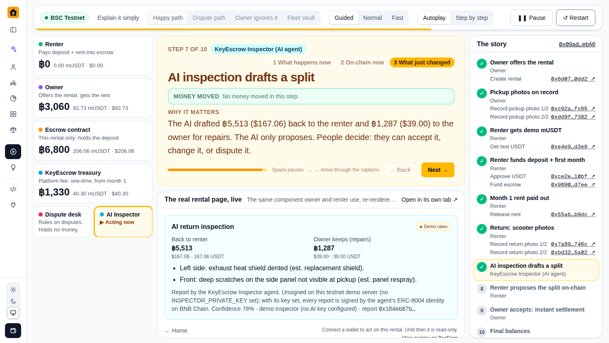
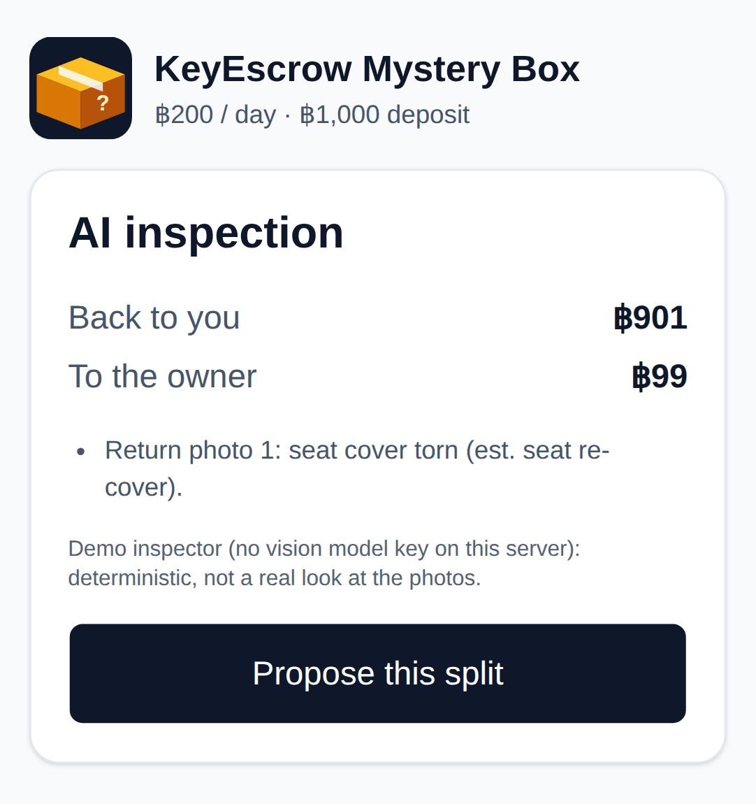
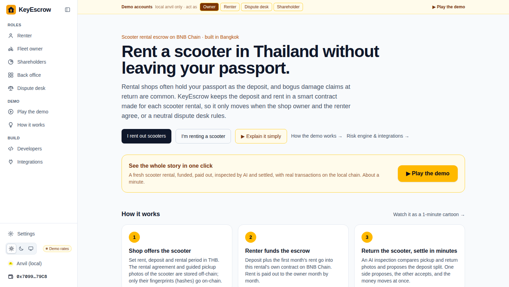
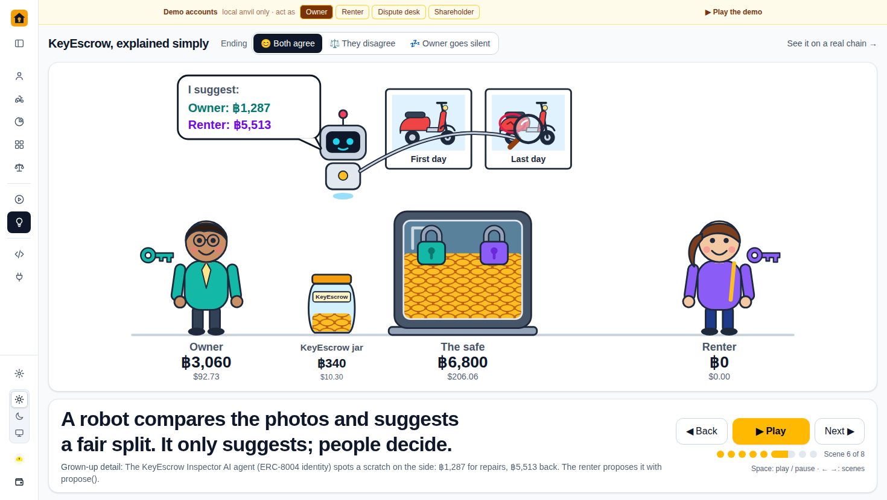
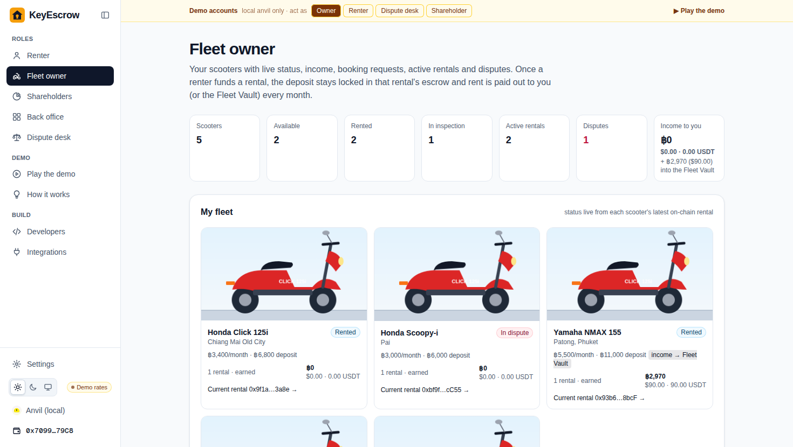
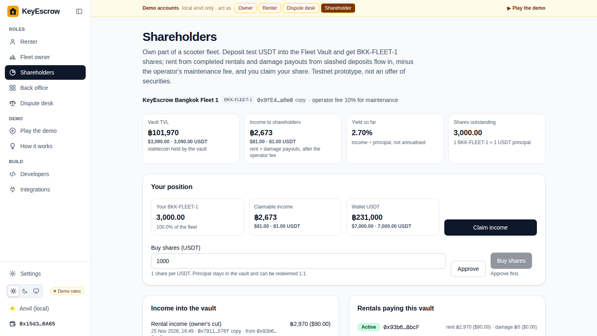
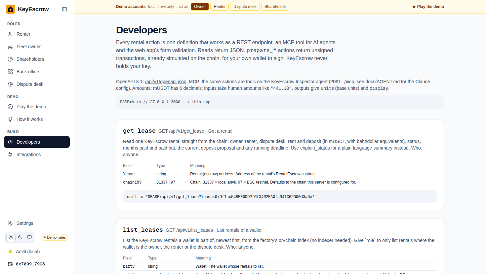

English | [简体中文](README.zh-CN.md)

# KeyScrow

KeyScrow (formerly KeyEscrow during the build: the live URLs and some screenshots still say keyescrow).

[](https://github.com/midego1/bnb-hackathon/actions/workflows/ci.yml)
[](LICENSE)
<!-- coverage:start -->


<!-- coverage:end -->
[](#bsc-testnet-contracts-chain-97)

**Rent a scooter in Thailand without leaving your passport.**

Scooter shops in Thailand usually keep the tourist's passport as the deposit, and the shop alone decides what each
scratch costs at return. KeyScrow replaces the passport with a deposit held in a small smart contract on BNB Chain,
one contract per rental. Rent is paid out to the shop month by month. At return, an AI inspector compares the pickup
and return photos and drafts a deposit split. One side proposes it on-chain, the other accepts, and the money moves at
once. If they disagree, a neutral dispute desk rules. Neither party can move the deposit alone, and timeouts protect
the renter. Every amount is shown in baht first.

Built for BNB Bangkok 2026 (Developer Track, CoinMarketCap x Atlas). Open source (MIT), BSC testnet only, no token.

## For judges

**In 30 seconds.** Open <https://keyescrow-web.mdgooijer.workers.dev> and pick one of three ways in:

1. **[/demo](https://keyescrow-web.mdgooijer.workers.dev/demo)**: one click plays a whole scooter rental with real
   BSC testnet transactions. No wallet needed; every step links to BscScan.
2. **[/stage/mystery-box](https://keyescrow-web.mdgooijer.workers.dev/stage/mystery-box)** on a big screen and
   **[/r/mystery-box](https://keyescrow-web.mdgooijer.workers.dev/r/mystery-box)** on your phone (scan the QR): you
   rent our physical Mystery Box with a guest wallet, take pickup and return photos, get the AI split and settle.
3. **[/pitch](https://keyescrow-web.mdgooijer.workers.dev/pitch)**: the 3-minute pitch as an animated storyboard.

The AI inspector is ERC-8004 agent **#2921** on BSC testnet:
[agent card](https://keyescrow-agent.mdgooijer.workers.dev/.well-known/agent-card.json). The contracts are in
[one table below](#bsc-testnet-contracts-chain-97).

**Real on-chain vs mocked**

| Real (BSC testnet, chain 97) | Test stand-in or mocked, and labelled in the UI |
| --- | --- |
| One escrow contract per rental; creating, funding, rent payouts, evidence hashes, proposals and settlements in `/demo` and `/stage` are real transactions | The money is MockUSDT test money with no value; `/demo` and `/stage` sign with throwaway server-side demo wallets and a guest wallet |
| ERC-8004 registration of agent #2921 in the Identity Registry | The AI inspection on the live site is a deterministic *demo inspector* (no model key set); with a key, a vision LLM returns the same JSON |
| The contracts, verified on BscScan | Prices show *Demo rates* (no CoinMarketCap key yet; the Atlas feeds are published but not configured on the live site yet); Cournot and Living Brain are built but not live ([state per sponsor](#sponsor-integrations)) |
| Photo and document fingerprints (SHA-256) | The photos themselves are off-chain; the *Pay with PromptPay* page is a simulation that mints test USDT |

| `/demo`, mid-run | `/stage` big screen, settled | `/r` on the judge's phone |
| --- | --- | --- |
|  |  |  |

The screenshots come from a local run of the same build (hence `127.0.0.1` under the QR code).

**Where each judging criterion is answered**

| Criterion | Read |
| --- | --- |
| Design and usability | [docs/DESIGN.md](docs/DESIGN.md); amounts in baht first; EN, 中文 and EN+中文 ([languages](docs/ARCHITECTURE.md#languages-en--中文--en中文)); the [1-minute cartoon](https://keyescrow-web.mdgooijer.workers.dev/how-it-works) |
| Scalability | [ARCHITECTURE.md §11](docs/ARCHITECTURE.md#11-scalability) and [§7 Cloudflare](docs/ARCHITECTURE.md#7-cloudflare-deployment) |
| Innovation | The AI drafts, people decide, timeouts protect the renter ([how it works](#how-it-works)); one escrow per rental; every action as REST, MCP and A2A ([docs/AGENT.md](docs/AGENT.md)) |
| Open-source quality | MIT; [tests and CI](#tests-and-ci); [security review](docs/SECURITY.md); [CONTRIBUTING.md](CONTRIBUTING.md) |
| BNB Chain integration | [What makes it BNB-native](#what-makes-it-bnb-native): ERC-8004 #2921, BSC testnet, opBNB-ready, BNB Greenfield evidence |
| CoinMarketCap x Atlas track | [docs/WRITEUP.md](docs/WRITEUP.md) and [sponsor integrations](#sponsor-integrations) |
| Business model and roadmap | [docs/BUSINESS.md](docs/BUSINESS.md): the 10 % one-time fee, dispute desk, Fleet Vault, subscriptions (weekly, every 2 weeks, monthly), the capped mainnet pilot, asset pools (roadmap, no token) |

### All links

| What | Link |
| --- | --- |
| **Web app** (BSC testnet, chain 97) | <https://keyescrow-web.mdgooijer.workers.dev> |
| **Live testnet demo**: one click plays a whole rental with real BSC testnet transactions, no wallet needed | <https://keyescrow-web.mdgooijer.workers.dev/demo> |
| **Judge demo**: rent the Mystery Box from your phone | [/stage/mystery-box](https://keyescrow-web.mdgooijer.workers.dev/stage/mystery-box) · [/r/mystery-box](https://keyescrow-web.mdgooijer.workers.dev/r/mystery-box) · [listing](https://keyescrow-web.mdgooijer.workers.dev/app/listings/mystery-box) |
| Pitch storyboard (3 minutes) | <https://keyescrow-web.mdgooijer.workers.dev/pitch> |
| How it works, as a 1-minute cartoon | <https://keyescrow-web.mdgooijer.workers.dev/how-it-works> |
| Developers: every rental action as REST + MCP, OpenAPI 3.1 | [/developers](https://keyescrow-web.mdgooijer.workers.dev/developers) · [/api/v1/openapi.json](https://keyescrow-web.mdgooijer.workers.dev/api/v1/openapi.json) |
| **AI inspector agent** (ERC-8004 agent #2921) | <https://keyescrow-agent.mdgooijer.workers.dev> |
| Agent card (A2A) | [/.well-known/agent-card.json](https://keyescrow-agent.mdgooijer.workers.dev/.well-known/agent-card.json) · ERC-8004 registration file: [/.well-known/agent-registration.json](https://keyescrow-agent.mdgooijer.workers.dev/.well-known/agent-registration.json) |
| MCP server (Streamable HTTP, 17 tools) | `POST https://keyescrow-agent.mdgooijer.workers.dev/mcp` |
| 3-minute pitch script | [docs/DEMO.md](docs/DEMO.md) |
| Submission kit: videos, pitch deck, HackQuest fields, screenshots | [docs/submission](docs/submission/README.md) |

The live `/demo` runs on throwaway demo wallets whose keys stay on the server: it creates a fresh rental, funds it,
pays out month 1, runs the AI inspection and settles. You can open every step on BscScan. It allows one run at a
time, with a gas cap per run (2.5M gas at 1 gwei, so at most 0.0025 tBNB). The *Happy path* and *Dispute path* stories
run live. *Owner ignores it* needs 7 real days, so it only runs on a local chain.

Try the MCP server from a terminal:

```bash
curl -s -X POST https://keyescrow-agent.mdgooijer.workers.dev/mcp \
  -H 'content-type: application/json' -H 'accept: application/json, text/event-stream' \
  -d '{"jsonrpc":"2.0","id":1,"method":"tools/list"}'
```

### BSC testnet contracts (chain 97)

From [contracts/deployments/97.json](contracts/deployments/97.json) (start block 144891362). This table is the one
place in the docs with these addresses; every other document links here. These are **contract v2** (per-rental rent
periods of 7, 14 or 30 days, pilot caps, audit fixes), deployed Thu 26 Nov 2026.

| Contract | Address |
| --- | --- |
| `EscrowFactory` | [`0x04D7dDCb72802aF82296110A90526342C1249315`](https://testnet.bscscan.com/address/0x04D7dDCb72802aF82296110A90526342C1249315) |
| `RentalEscrow` implementation (cloned per rental) | [`0xEAaDe62c3255dAc5EB38952a80fa375618c34E53`](https://testnet.bscscan.com/address/0xEAaDe62c3255dAc5EB38952a80fa375618c34E53) |
| `FleetVault` (`BKK-FLEET-1` shares, 10 % operator fee) | [`0x2EB2CDAc4868798Af22e64ad70D433f28E422eA4`](https://testnet.bscscan.com/address/0x2EB2CDAc4868798Af22e64ad70D433f28E422eA4) |
| `MockUSDT` (mUSDT, 6 decimals, test stablecoin) | [`0x7aF0035c254bC760231BCcFF3403A714611c35B1`](https://testnet.bscscan.com/address/0x7aF0035c254bC760231BCcFF3403A714611c35B1) |
| ERC-8004 Identity Registry (agent #2921, the KeyScrow Inspector) | [`0x8004A818BFB912233c491871b3d84c89A494BD9e`](https://testnet.bscscan.com/address/0x8004A818BFB912233c491871b3d84c89A494BD9e) · [registration tx](https://testnet.bscscan.com/tx/0x40c7cf2008857eabb197df1453e33b3b45760fdec8e7f846ac23a4c2e73328c0) |
| Deployer, factory owner, fee recipient and default dispute desk | [`0xf8A49f0E08F1EeC5AC0543FFc7145D9f50ddBe0D`](https://testnet.bscscan.com/address/0xf8A49f0E08F1EeC5AC0543FFc7145D9f50ddBe0D) |

### What makes it BNB-native

- **One escrow per rental.** `EscrowFactory` deploys an EIP-1167 clone of `RentalEscrow` for every rental. Each
  rental's funds are isolated in their own contract. No admin key can touch them, and nothing is upgradeable. The
  factory also indexes rentals by owner, renter and dispute desk, so the app needs no backend database to list them.
- **An on-chain AI agent.** The KeyScrow Inspector is ERC-8004 agent **#2921** in the Identity Registry on BSC
  testnet. It was registered with the [BNB Agent SDK](https://github.com/bnb-chain/bnbagent-sdk) (v0.6.1). Its
  agent id goes into every report hash that a party passes to `RentalEscrow.propose()`. With the signer key set, the
  report is also signed by the agent's registered `reportSigner`. It speaks A2A and MCP ([docs/AGENT.md](docs/AGENT.md)).
- **Real-world assets.** Scooters earn rent. With `createLeaseWithPayee`, a rental pays the owner's rent and any
  damage claim into the `FleetVault`, where `BKK-FLEET-1` shareholders claim their part after the operator's
  maintenance fee. This is a testnet prototype, not an offer of securities.
- **Evidence on BNB Greenfield.** The rental agreement and the photos are stored off-chain. Only their SHA-256 hashes
  go on-chain. The Greenfield store (`@bnb-chain/greenfield-js-sdk`, delegated upload) is used when `GREENFIELD_*` is
  set on a Node server. Without it, a local folder takes its place. The Cloudflare deploy uses R2 or hashes the files
  in the browser (see [ARCHITECTURE.md](docs/ARCHITECTURE.md#6-off-chain-services)).
- **Ready for opBNB.** The contracts are plain Solidity, so the same bytecode deploys to opBNB. The deploy guard
  accepts opBNB testnet (5611) and the web app lists it. Monthly rent releases cost little on an L2, which matters
  for a fleet. Not deployed on opBNB yet.

### Screenshots

Local build with the demo accounts bar (the yellow strip at the top), 1470×830. More in
[docs/screenshots](docs/screenshots/README.md).

| Home | Guided demo, mid-run (AI inspection) |
| --- | --- |
|  |  |
| **How it works (ELI5)** | **Fleet owner** |
|  |  |
| **Shareholders (Fleet Vault)** | **One rental** |
|  |  |
| **Developers** | **Dispute desk** |
|  |  |

### Quick start (local, no wallet or keys)

Requirements: [Foundry](https://book.getfoundry.sh/getting-started/installation), Node 22, pnpm.

```bash
git clone --recursive https://github.com/midego1/bnb-hackathon.git && cd bnb-hackathon && pnpm run setup
pnpm chain:anvil                                     # terminal 1: anvil on 127.0.0.1:8545
pnpm chain:deploy && pnpm chain:seed                 # terminal 2: contracts, demo accounts, three demo rentals
echo "NEXT_PUBLIC_DEV_ACCOUNTS=1" > web/.env.local   # the Demo accounts bar: act as owner / renter / dispute desk / shareholder
pnpm dev                                             # http://localhost:3000/app, then ▶ Play the demo (/ is the marketing page)
```

Every sponsor integration falls back to a labelled mock when its key is missing (*Demo rates*, *demo inspector*),
so this calls no paid API. To turn one on, set its variables (names in [.env.example](.env.example)) in
`web/.env.local`. The server routes are in [docs/API.md](docs/API.md).

### Tests and CI

[GitHub Actions](.github/workflows/ci.yml) runs four jobs on every push and pull request, with no secrets, no testnet
and no deploys: contracts, web (lint, unit tests, build), agent, and end-to-end (`e2e:chain` + Playwright on a
throwaway anvil). The contracts, web and agent jobs print their coverage summary and upload the lcov report as an
artifact; `pnpm coverage` measures all three locally and rewrites the coverage badges above (line coverage; the web
number covers `lib/` and the API routes, the pages are covered by Playwright).

```bash
cd contracts && forge build && forge test   # 305 tests (unit, fuzz, invariants): factory, escrow, Fleet Vault, MockUSDT
pnpm -C web lint && pnpm -C web test        # eslint + 393 vitest tests in 30 files (server routes, actions, demo, sponsors, i18n; offline)
pnpm -C web build                           # production build
pnpm agent:test                             # 21 tests: agent card, A2A, MCP, Worker, prepare -> sign on anvil
pnpm e2e:chain                              # every settlement path with real txs + time travel, own anvil :28545
cd web && npx playwright test               # 108 browser tests in 20 files, 2 workers; own anvil :28546 + server :3150
pnpm coverage                               # forge coverage + vitest v8 coverage, lcov in <part>/coverage/
pnpm cf:build && pnpm cf:size                # after one pnpm cf:preview: web Worker 2.70 MiB gzip (Free limit 3 MiB), agent 0.75 MiB
```

Counts and sizes as of 26 Nov 2026 (main).

---

## How it works

1. **The shop offers the scooter.** The owner sets the monthly rent, the deposit and the rental period in THB. The
   rental agreement and the guided pickup photos (front, back, left, right, plate close-up) stay off-chain. Only
   their SHA-256 fingerprints go on-chain.
2. **The renter funds the escrow.** The deposit plus the first month's rent go into that rental's own contract,
   instead of a passport left at the counter. Rent is paid out to the owner month by month.
3. **Return the scooter, settle in minutes.** An AI inspection compares the pickup and return photos and proposes a
   split. One side proposes it, the other accepts, and the money moves at once. If they disagree, the dispute desk
   rules. If the owner stays silent for 7 days, or the desk misses its 14-day deadline, the full deposit goes back to
   the renter.

**Fee:** 10 % of one month's rent, once per rental, taken from the owner's first rent payout and never from the
deposit. A scooter at 3,400 THB a month pays ฿340, once. See [docs/BUSINESS.md](docs/BUSINESS.md).

> **Naming:** the UI and docs say rental shop *owner*, *renter*, *scooter rental*, *pickup* and *return*. The
> contracts, ABIs and APIs keep their original identifiers: `landlord` = owner, `tenant` = renter, `lease` = rental,
> `CheckIn` / `CheckOut` = pickup / return, `MoveOut` = return proposal.

## Features

- **One escrow per rental.** Covered above. Rental creation is one 45-byte proxy plus `initialize`.
- **Scheduled rent.** Rent is released on a fixed 30-day schedule. Anyone can trigger a release once it is due, so a
  keeper can automate it, and the renter can release early. Prepaid rent that is not yet due goes back to the renter
  at settlement.
- **AI return inspection.** A vision LLM compares pickup and return photos and returns
  `{tenantRefund, landlordClaim, reasons[], confidence}`. It only drafts a proposal: a party submits it with their
  own wallet and the other party accepts. Before judging it recalls the scooter's earlier inspections, so old damage
  is not charged twice.
- **Neutral arbitration.** The KeyScrow dispute desk is the default arbiter. The owner may name another neutral
  arbiter, and the renter sees it before funding.
- **Renter-protecting timeouts.** If the owner ignores a proposal for 7 days, or the arbiter does not rule within
  14 days, the full deposit goes back to the renter. Both windows can be set per rental.
- **Roles in one app.** A left sidebar switches between Renter, Fleet owner, Shareholders, Back office and Dispute
  desk. On the local chain the *Demo accounts* bar switches the signing account with it.
- **One action layer, three faces.** Each rental action (`get_lease`, `prepare_fund`, `prepare_propose_settlement`,
  …) is defined once in `web/lib/actions` and served as REST (`/api/v1/<action>`, with an OpenAPI 3.1 spec), as MCP
  tools on the agent, and as the app's form validation. `prepare_*` actions return unsigned transactions that are
  already simulated. KeyScrow never holds a user key.
- **Prices in baht.** Every amount is shown THB first, then USD and the exact USDT. The rate comes from the Atlas
  on-chain feed or the CoinMarketCap Pro API, both called server-side only and cached. A badge always names the
  source: *Atlas feed*, *Live CoinMarketCap* or *Demo rates*.
- **No token.** KeyScrow has no token of its own. MockUSDT stands in for a stablecoin on testnet.

## Sponsor integrations

Open **`/integrations`** in the app. It shows the risk engine on a sample deposit, the state of each integration
(*Live*, *Not configured*, *Blocked*, *Live calls off*), the env var names it needs, and its recent calls (endpoint,
time, HTTP status, never a key). The same risk panel appears on the owner's create form and on the renter's funding
card. All sponsor calls are **server-side only** (`web/app/api/*`) and are logged to
`web/.sponsor-logs/<sponsor>.jsonl` (gitignored). On Workers, which have no disk, the log is kept in memory. Tests
never call a sponsor: they replay fixtures in `web/tests/fixtures/`.

| Sponsor | What it does in KeyScrow | Turn it on | State on the live site (25 Nov) |
|---|---|---|---|
| CoinMarketCap | Volatility of USDT/BNB (`quotes/latest`) sets the deposit buffer. THB quotes convert and display every amount | `CMC_API_KEY` | Built; no key on the live site yet, so it shows *Demo rates* |
| Cournot | The probability that BNB breaks the deposit's coverage floor before the return date scales the buffer | `COURNOT_LIVE=1` | Built; live calls off, no probability call made yet |
| Atlas | `latestRoundData()` with a staleness check is the first price source; push feed + Pull API consensus guard Pay with BNB; signed report = settlement price proof | `ATLAS_RPC_URL`, `ATLAS_FEED_*`, `ATLAS_API_KEY` | Built and tested (mocked API); feed addresses known, not yet set on the live site |
| Living Brain | The AI inspector recalls a scooter's earlier inspections before judging; the web app stores each new one for a rental it verified on-chain; dispute memory per wallet for the dispute desk | `LIVING_BRAIN_API_KEY`, `LIVING_BRAIN_SUBJECT_ID`, `LIVING_BRAIN_BRAIN_ID` | Built; a local memory file stands in until it is configured |

### CoinMarketCap

- `GET /api/risk?depositThb=3000&days=30` calls `GET /v2/cryptocurrency/quotes/latest?symbol=USDT,BNB&convert=USD`
  and `convert=THB` (1 credit each, cached for `RISK_CACHE_TTL_SECONDS`, default 120 s). Daily volatility is the
  largest of `|24h|`, `|7d|/√7` and `|30d|/√30`. The buffer is `1.28 × σ × √days` (days capped at 30): 0 below 2 %
  (a stablecoin), and the token is rejected above 60 %. Code: `web/lib/risk.ts`, `web/lib/server/risk/index.ts`,
  `web/lib/server/sponsors/cmc.ts`.
- `GET /api/price` uses the same client for the THB/USD display.
- Without `CMC_API_KEY` the risk panel says *CoinMarketCap is not configured* and shows no buffer.
- Evidence: `web/.sponsor-logs/cmc.jsonl`, for example
  `{"sponsor":"cmc","endpoint":"GET /v2/cryptocurrency/quotes/latest?symbol=USDT,BNB&convert=USD","status":200,"ok":true,"note":"credits=1",...}`.

### Atlas

`web/lib/server/price/index.ts` reads Atlas SingleFeed proxies (`decimals()` + `latestRoundData()`, compatible with
AggregatorV3). It rejects answers that were never updated (`answer == 0` / `updatedAt == 0`), negative answers and
stale answers (`now - updatedAt > ATLAS_MAX_AGE_SECONDS`, default 3600; the USDT/USD feed, which updates rarely,
`ATLAS_USDT_MAX_AGE_SECONDS`, default 2 days), as in Atlas's example code. When `ATLAS_RPC_URL`,
`ATLAS_FEED_USDT_USD` and `ATLAS_FEED_BNB_USD` are set, it is the first price source for every THB/USD amount. BSC
testnet feeds: BNB/USD `0x3957d289ee9c38272377786787ea34f9dd29788d`, USDT/USD `0x9dfd7992952bb9e8fb4bc6065fdc3518addc4e8b`
(mainnet: `0x9c0517f5b4c8657c7f18d68d2d79e2b3b1cd6438`, `0x9fc000fc9c17578b49853278a517e357201d01e4`).

`web/lib/server/price/atlas.ts` adds the Atlas Pull API (`POST https://api.atlasoracle.io/report/v1/price/latest`,
feeds 633 BNB/USD and 649 USDT/USD, `ATLAS_API_KEY` server-side only): the signed report is verified against the
official signer `0x59eD4701224fD9e2a85Ef2946c2ab828C1dDC600` and its consensus per feed is read. Together they guard
**Pay with BNB** on the funding panel (amountOutMin = 99 % of the Atlas value; refused on a feed older than 2x its
heartbeat, a consensus other than HEALTHY/DEGRADED, or a swap quote more than 2 % off Atlas), show the badge "Priced by
Atlas · updated N s ago · consensus 0.94 HEALTHY", and attach the signed report as the price proof of an AI settlement
that charges damage. Details: [docs/ARCHITECTURE.md](docs/ARCHITECTURE.md#atlas-guard-pay-with-bnb-and-price-proof).

### Living Brain (ChatAndBuild)

`web/lib/server/sponsors/livingbrain.ts`: before judging, the AI inspector (`POST /api/settlement` and the agent)
searches the scooter's brain (`POST /v1/brains/{brainId}/search`) for its earlier inspections ("damage listed here
already existed: do not charge again"). After judging, `POST /api/settlement` stores the new inspection
(`POST /v1/brains/{brainId}/captures`, `originRef` = report hash for idempotency), only for a rental it verified
on-chain and under that rental's scooter, at most 20 writes an hour per IP. The agent's public faces only read.
Living Brain also keeps the **dispute memory per wallet**: after each settled rental the web app writes one factual
entry per party (label `wallet:<address>`, `originRef` = settling transaction + wallet), and the dispute desk, Ask AI
and the `wallet_history` action read it back next to the on-chain facts. Calls are budgeted: at most
`LIVING_BRAIN_DAILY_CALLS` (default 200) a day, reads cached 10 minutes per wallet, never from CI or e2e. Wallet addresses only, factual entries only
([privacy](docs/ARCHITECTURE.md#dispute-memory-per-wallet)). The recalled history is part of the hashed report and is shown under the
AI proposal as "Scooter memory". Without `LIVING_BRAIN_*`, a local file (`web/.sponsor-logs/inspections.jsonl`)
stands in, labelled as such.

One-time setup once you have a key (it creates the brain; put the returned `id` in `LIVING_BRAIN_BRAIN_ID`):

```bash
curl -s -X POST https://api.livingbrain.com/v1/brains -H "x-api-key: $LIVING_BRAIN_API_KEY" \
  -H "x-subject-id: $LIVING_BRAIN_SUBJECT_ID" -H 'content-type: application/json' -d '{"name":"KeyScrow scooters"}'
```

## Cournot Integration

- **Where and how we call it.** `web/lib/server/sponsors/cournot.ts` calls the official Cournot Intelligence Oracle
  the same way the [Cournot skill's](https://github.com/Cournot-AI/cournot-skills) client does. First
  `POST https://interface.cournot.ai/intelligence/v1/resolve` `{message, limit}` finds the reference market (free),
  then `POST /intelligence/v1/probability` `{message, market_ids}` asks for the probability. The first 3 probability
  calls per IP need no API key or wallet. After that Cournot answers HTTP 402 (x402/b402 payment), which we show to the
  user and never pay. Live calls run only when the server has `COURNOT_LIVE=1`, at most `COURNOT_MAX_LIVE_CALLS`
  times (default 3), and only from an explicit click (with a confirm step) or this command:

  ```bash
  # web/.env.local: COURNOT_LIVE=1, then with the app running:
  curl -s -X POST http://localhost:3000/api/cournot -H 'content-type: application/json' \
    -d '{"claim":"Will BNB fall below $450 at any time before 2026-12-26 00:00 UTC?","confirm":true}'
  ```

  Every answer is stored (`web/.sponsor-logs/cournot-results.json`; answers worth keeping as proof go in
  `web/data/cournot-results.json`) and reused, so the same claim is never asked twice.
- **The claim.** Each rental builds its claim from live data: *"Will BNB fall below $<coverage floor> at any time
  before <return date> 00:00 UTC?"*. The floor is the BNB price at which the buffered deposit stops covering the THB
  deposit.
- **How the probability is used.** BNB buffer = CMC volatility buffer × (1 + p). The deposit card shows it as, for
  example, "CMC 17 % + Cournot 2.1 %".
- **Where users see the claim and evidence.** In the *Cournot Intelligence Oracle* box of the deposit risk panel
  (`/integrations`, the owner's create form, the renter's funding card). It shows the exact claim sent, the returned
  probability, the `result` fields, the full `basis` evidence verbatim and the request id (Cournot's `x-trace-id`).
  A separate box labelled **"Explanation added by KeyScrow (not from Cournot)"** holds our own explanation.
- **Proof of a successful call.** _Pending: no probability call has been made yet (the owner decides when to spend
  one of the 3 free calls)._ One `resolve` call (free) succeeded on 2026-11-25 12:44:29 UTC, `x-trace-id`
  `4dbc8496d005d7971986d3123fe7dadd`. Its response is `web/tests/fixtures/cournot/resolve.recorded-2026-11-25.json`.

## Networks

| Network | Chain ID | Use |
| --- | --- | --- |
| Anvil (local) | 31337 | development, the local `/demo`, scripted end-to-end tests |
| BSC testnet | 97 | the live deployment ([contracts above](#bsc-testnet-contracts-chain-97)) |
| opBNB testnet | 5611 | accepted by the deploy guard and listed in the frontend; not deployed |

Mainnets (56, 204, 1) are always refused by the deploy scripts. See [docs/DEPLOY.md](docs/DEPLOY.md).

## Repo layout

```
contracts/                 Foundry project
  src/EscrowFactory.sol      clones one RentalEscrow per rental (EIP-1167), indexes rentals, protocol fee config
  src/RentalEscrow.sol       per-rental escrow: deposit, rent schedule, evidence hashes, settlement, timeouts
  src/FleetVault.sol         BKK-FLEET-1 shares: rental income in, operator fee out, pro-rata claims
  src/mocks/MockUSDT.sol     testnet-only 6-decimal stablecoin with a capped faucet
  deployments/97.json        the BSC testnet addresses
web/                       Next.js (App Router) + TypeScript + Tailwind + shadcn/ui + wagmi/viem + RainbowKit
  app/                       / (marketing page) /app (app home) /tenant /landlord /shareholders /backoffice /arbiter /lease/[address]
                             /demo /how-it-works /developers /integrations /settings/secrets (local only)
  app/api/                   settlement (AI), price, risk, cournot, evidence, fleet, integrations,
                             v1/[action] (REST actions + openapi.json), demo-testnet/* (live demo runner)
  lib/actions/               the rental actions: one definition -> REST, OpenAPI, MCP tools, form validation
  lib/server/                server-only services: settlement, price, evidence, sponsors, shared state, demo runner
  cloudflare/                Worker entry + the KeyEscrowState Durable Object
  e2e/                       Playwright tests
agent/                     KeyScrow Inspector: ERC-8004 agent #2921, A2A + MCP (Node server and Cloudflare Worker)
docs/                      architecture, business model, demo script, API, deploy, agent, screenshots
```

## Docs

| Document | What it covers |
| --- | --- |
| [ARCHITECTURE.md](docs/ARCHITECTURE.md) | Components, Cloudflare, the rental state machine, money flows (funding, settlement, dispute, timeout), scalability. Mermaid diagrams. |
| [DEMO.md](docs/DEMO.md) | The 3-minute pitch script on the live site, a 30-second offline backup, the local setup. |
| [BUSINESS.md](docs/BUSINESS.md) | The problem, users, the fee model with a THB example, dispute desk and Fleet Vault revenue, roadmap, risks. |
| [AGENT.md](docs/AGENT.md) | The KeyScrow Inspector: ERC-8004 identity, A2A + MCP, signed reports. |
| [API.md](docs/API.md) | The server routes and their fallbacks. |
| [WRITEUP.md](docs/WRITEUP.md) | The one-page CoinMarketCap x Atlas write-up. |
| [DEPLOY.md](docs/DEPLOY.md) · [CLOUDFLARE.md](docs/CLOUDFLARE.md) | The BSC testnet deploy, and the web app + agent on Cloudflare Workers. |
| [PRODUCT.md](docs/PRODUCT.md) · [ACCEPTANCE.md](docs/ACCEPTANCE.md) · [SPONSORS.md](docs/SPONSORS.md) | Product spec, definition of done, sponsor requirements. |
| [contracts/README.md](contracts/README.md) | The contracts in detail. |

## Run locally (details)

Everything runs against a local [anvil](https://book.getfoundry.sh/anvil/) node. No keys or accounts are needed.

```bash
pnpm chain:anvil          # terminal 1: anvil on 127.0.0.1:8545 (ANVIL_PORT=... to change)
pnpm chain:deploy         # MockUSDT + EscrowFactory + FleetVault -> contracts/deployments/31337.json
pnpm chain:seed           # demo balances and rentals -> contracts/deployments/31337.demo.json
```

To use another local node, set `RPC_URL=http://host:port` for both commands. The deploy script refuses any chain
other than 31337 unless `ALLOW_NON_LOCAL_BROADCAST=true` is set (and then `PRIVATE_KEY` is required). Known mainnets
are always refused. On a fresh anvil the addresses are deterministic (`contracts/deployments/31337.example.json`
and `31337.demo.example.json`), and the app has them baked in.

The demo roles are anvil's default accounts: #0 is the deployer, factory owner and KeyScrow treasury (fee recipient),
#1 the owner (`landlord`), #2 the renter (`tenant`), #3 the KeyScrow dispute desk (default arbiter) and #4 the
Fleet Vault shareholder. The seed creates three rentals on the same terms, modelled on a Honda Click 125i from a shop
in Chiang Mai: 100 mUSDT a month (3,400 THB at ~34 THB/USDT), a 2-month deposit and a 3-month rental period. One is
active, one is in dispute, and one pays the Fleet Vault.

To check every settlement path against a throwaway anvil (port 28545, started and stopped by the runner):

```bash
pnpm e2e:chain            # deploy, seed, happy path, dispute, owner timeout, arbiter fallback
```

## Contributing

Setup, tests, branch and commit style, and how to add an Ask AI tool: [CONTRIBUTING.md](CONTRIBUTING.md). Please follow
the [Code of Conduct](CODE_OF_CONDUCT.md), and report vulnerabilities privately as described in [SECURITY.md](SECURITY.md).

## License

[MIT](LICENSE)
