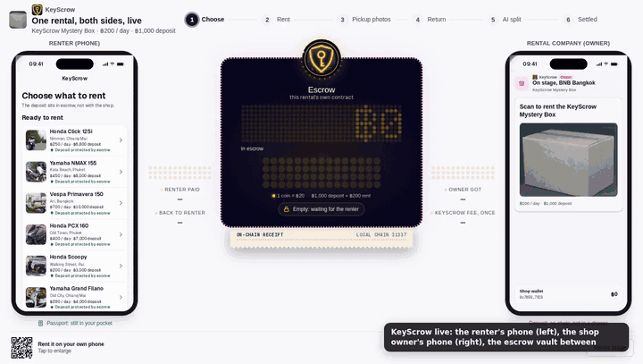
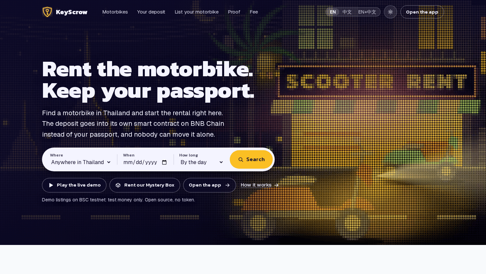
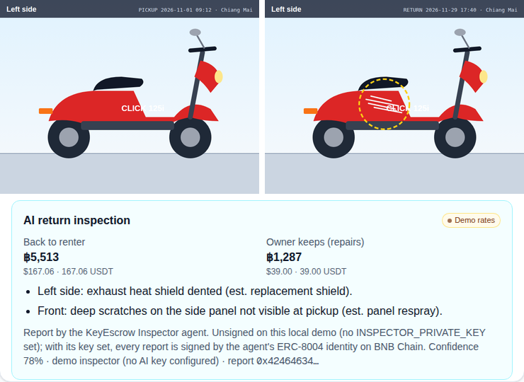
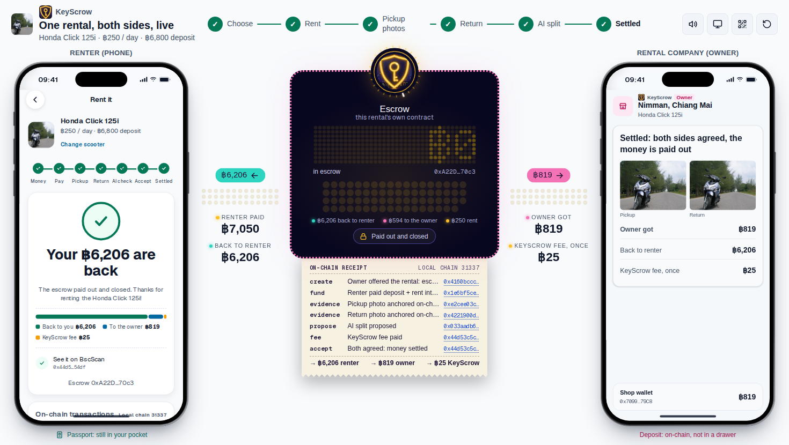
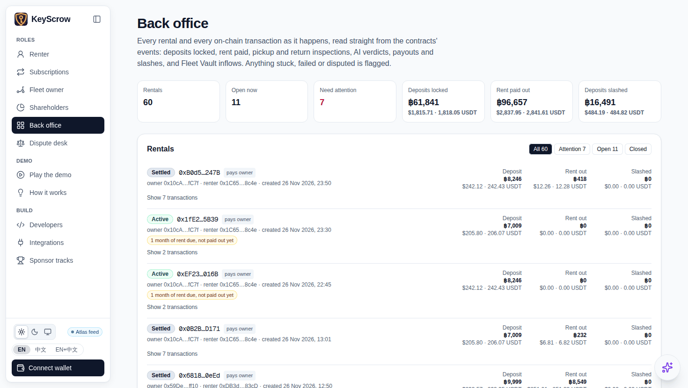
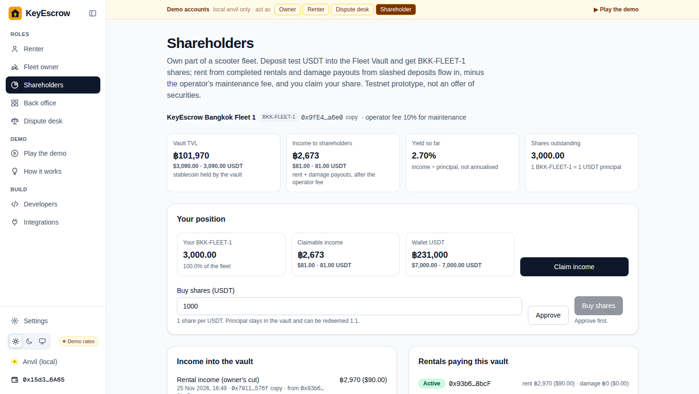
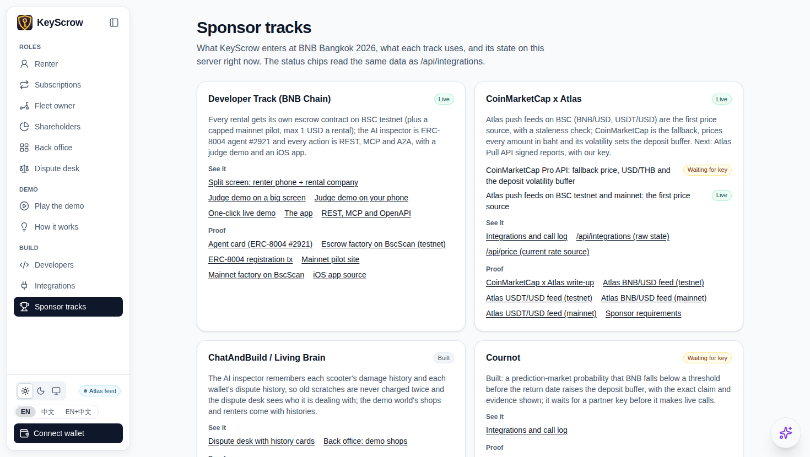
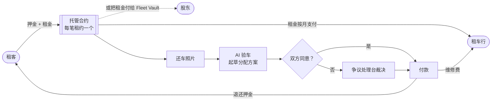
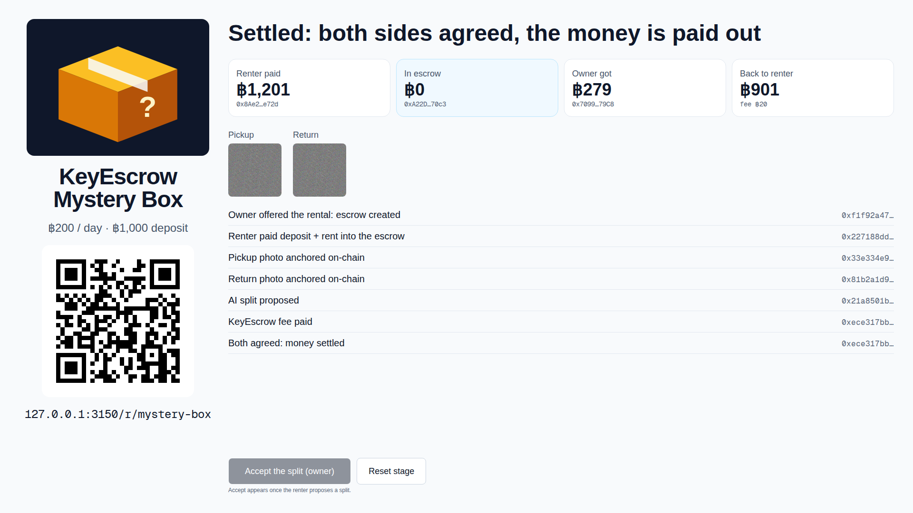
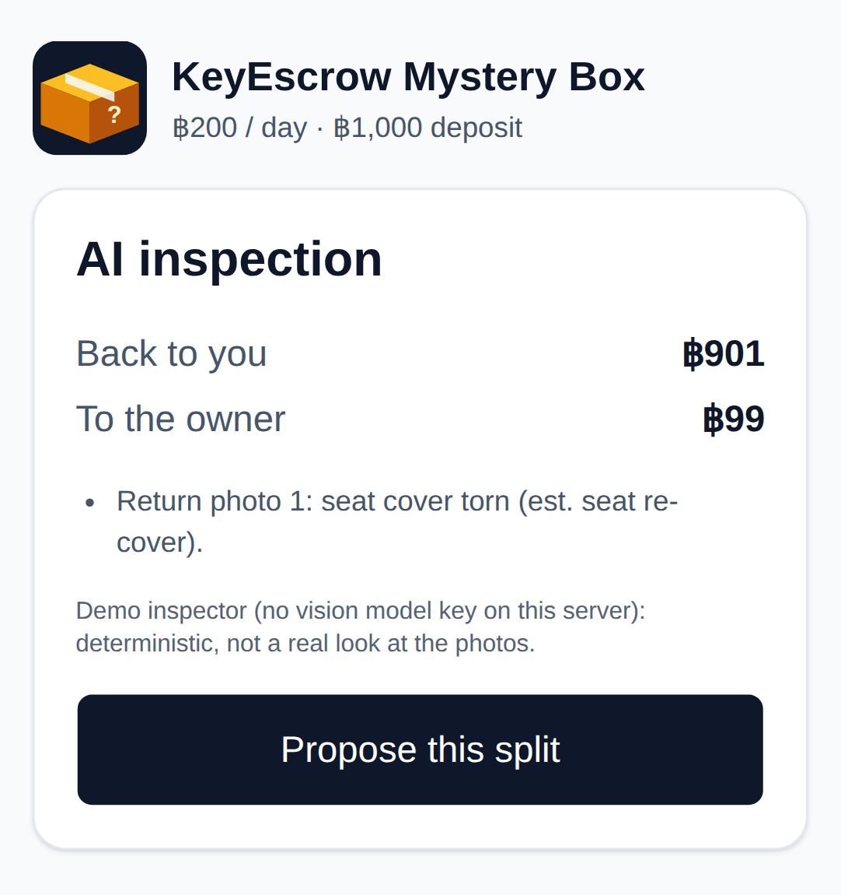

[English](README.md) | 简体中文

# KeyScrow

KeyScrow（开发期间曾名 KeyEscrow：代理网址、iOS 项目目录和部分旧截图中仍为 keyescrow）。

[](https://github.com/midego1/bnb-hackathon/actions/workflows/ci.yml)
[](LICENSE)
[](README.md#bsc-testnet-contracts-chain-97)

**在泰国租摩托车，不必再押护照。**

在泰国，摩托车租车行通常把游客的护照扣下当押金，还车时每道划痕赔多少钱，全由车行说了算。KeyScrow
用 BNB Chain 上的一个小型智能合约来托管押金，取代护照：每笔租约一个独立合约。租金按月支付给车主。还车时，
AI 验车会对比取车和还车的照片，起草一份押金分配方案。一方在链上提出，另一方接受，资金立即到账。若双方谈不拢，
由中立的争议处理台裁决。任何一方都无法单独动用押金，超时规则保护租客。所有金额都优先以泰铢显示。

为 BNB Bangkok 2026 黑客松打造（Developer Track、CoinMarketCap x Atlas、ChatAndBuild / Living Brain、Cournot、AWS 路演：
[/sponsors 每个赛道一张卡片](https://keyscrow.app/sponsors)）。MIT 开源，BSC 测试网加一个有上限的主网试点，不发币。

## 图解 KeyScrow

<p align="center">
  <a href="docs/submission/duo.mp4"></a><br>
  <sub>60 秒看完一整笔租约：左边是租客手机，右边是租车行（<a href="docs/submission/duo.mp4">完整视频</a>）。</sub>
</p>

<table>
  <tr>
    <td width="50%" valign="top"><a href="docs/submission/screenshots/01-landing.png"></a><br><b>1.</b> 找到一辆摩托车并预订：押金和租金存进这笔租约自己的托管合约，不再押护照。</td>
    <td width="50%" valign="top"><a href="docs/submission/inspection.png"></a><br><b>2.</b> 还车时，AI 验车对比取车和还车照片，起草押金分配方案。</td>
  </tr>
  <tr>
    <td width="50%" valign="top"><a href="docs/submission/screenshots/02-duo.png"></a><br><b>3.</b> 租客提出方案，车行接受，资金立即到账，每一步都能在 BscScan 上查到。</td>
    <td width="50%" valign="top"><a href="docs/submission/screenshots/05-backoffice.png"></a><br><b>4.</b> 车行后台：每笔租约、押金和租金支付，都直接从链上读取。</td>
  </tr>
  <tr>
    <td width="50%" valign="top"><a href="docs/screenshots/shareholders.png"></a><br><b>5.</b> Fleet Vault：股东出资组建车队，并领取车队租金中属于自己的份额。</td>
    <td width="50%" valign="top"><a href="docs/submission/screenshots/08-sponsors.png"></a><br><b>6.</b> <a href="https://keyscrow.app/sponsors">/sponsors</a>：每个赞助赛道一张卡片，显示实时状态。</td>
  </tr>
</table>

### 一张图看懂流程



## 评委速览

**30 秒了解。** 打开 <https://keyscrow.app>，选一种方式体验：

1. **[/demo](https://keyscrow.app/demo)**：一键跑完一整笔摩托车租约，全部是真实的 BSC
   测试网交易。无需钱包，每一步都链接到 BscScan。
2. **[/stage/mystery-box](https://keyscrow.app/stage/mystery-box)** 放在大屏上，
   **[/r/mystery-box](https://keyscrow.app/r/mystery-box)** 在手机上打开（扫大屏上的二维码）：
   你用访客钱包租下我们现场的实物神秘盒子，拍取件和归还照片，拿到 AI 分配方案并完成结算。
3. **[/duo/mystery-box](https://keyscrow.app/duo/mystery-box)**：同一笔租约的分屏视图，左边租客手机，
   右边租车公司（[主视频](docs/submission/duo.mp4)）。
4. **[/pitch](https://keyscrow.app/pitch)**：3 分钟路演的动画分镜。

**评委信息**

| | |
| --- | --- |
| 在线应用（BSC 测试网，chain 97） | <https://keyscrow.app>（与 `keyscrow.app` 是同一个应用） |
| 主网试点（BSC 主网，chain 56） | <https://mainnet.keyscrow.app>：工厂合约 [`0x8d70…2d3E`](https://bscscan.com/address/0x8d708713C2a9da93450F224f35eF7FA15c0a2d3E)，真实 BSC-USD，链上上限：押金 0.70 + 每期租金 0.30（每笔租约最多 1 美元），所有未结租约合计 5 美元 |
| 赞助商赛道与实时状态 | [/sponsors](https://keyscrow.app/sponsors)（状态来自 `/api/integrations`；技术细节见 [/integrations](https://keyscrow.app/integrations)） |
| 视频（本地链，已填充演示世界） | [duo](docs/submission/duo.mp4)（59 秒）· [引导式 /demo](docs/submission/demo-guided.mp4)（90 秒）· [ELI5](docs/submission/eli5.mp4)（71 秒）· [应用导览](docs/submission/tour.mp4)（77 秒）· [路演幻灯片](docs/submission/deck.pdf) |
| 测试（11 月 26 日） | Foundry 314 · vitest 558（40 个文件）· 代理 24 · Playwright 154（27 个 spec 文件） |
| 规模 | 约 74,000 行代码 + 约 5,300 行 Markdown 文档（已跟踪文件；不含锁文件、`contracts/lib`、生成的 ABI、JSON 数据和二进制文件） |
| 构建方式 | Claude Code：共 24.7 亿 token（输出 813 万），paseo-box + 10 台 boat 虚拟机，按 11 月 26 日约 15:50（泰国时间）的 Claude Code 记录统计 |

AI 验车员是 BSC 测试网上的 ERC-8004 代理 **#2921**：
[代理名片](https://agent.keyscrow.app/.well-known/agent-card.json)。合约地址只在一处列出：
[英文 README 的合约表](README.md#bsc-testnet-contracts-chain-97)。

**哪些是真实上链的，哪些是模拟的**

| 真实（BSC 测试网，chain 97） | 测试替身或模拟，界面上都有标注 |
| --- | --- |
| 每笔租约一个托管合约；`/demo` 和 `/stage` 里的创建、注资、租金发放、凭证哈希、提议和结算都是真实交易 | 资金是没有价值的 MockUSDT 测试币；`/demo` 和 `/stage` 用服务器上的一次性演示钱包和访客钱包签名 |
| 代理 #2921 在 ERC-8004 Identity Registry 中的注册 | 在线站点的 AI 验车是确定性的*演示验车员*（未配置模型密钥）；配置密钥后，视觉大模型返回同样格式的 JSON |
| 合约本身，已在 BscScan 验证 | 价格已上线：Atlas 推送式喂价为首选来源，CoinMarketCap 作为备用来源并提供泰铢汇率；Cournot 已实现，等待合作方密钥 |
| 照片和文件的指纹（SHA-256） | 照片本身存在链下；*PromptPay 支付*页面是模拟，只会发放测试 USDT |

| `/duo`：左边租客手机，右边租车公司 | `/stage` 大屏，已结算 | 评委手机上的 `/r` |
| --- | --- | --- |
|  |  |  |

截图来自同一版本的本地运行（因此二维码下方显示 `127.0.0.1`）。

**每项评审标准对应的说明**

| 评审标准 | 参阅 |
| --- | --- |
| 设计与易用性 | [docs/DESIGN.md](docs/DESIGN.md)；金额优先以泰铢显示；支持 EN、中文和 EN+中文；[一分钟动画](https://keyscrow.app/how-it-works) |
| 可扩展性 | [ARCHITECTURE.md 第 11 节](docs/ARCHITECTURE.md#11-scalability) 和 [第 7 节 Cloudflare](docs/ARCHITECTURE.md#7-cloudflare-deployment) |
| 创新性 | AI 起草、人来决定、超时规则保护租客；每笔租约一个托管合约；每个操作都以 REST、MCP 和 A2A 提供（[docs/AGENT.md](docs/AGENT.md)） |
| 开源质量 | MIT；[测试与 CI](#测试与-ci)；[安全评审](docs/SECURITY.md)；[CONTRIBUTING.md](CONTRIBUTING.md) |
| BNB Chain 集成 | [为什么说它是 BNB 原生的](#为什么说它是-bnb-原生的)：ERC-8004 #2921、BSC 测试网、可部署到 opBNB、BNB Greenfield 凭证存储 |
| CoinMarketCap x Atlas 赛道 | [docs/WRITEUP.zh-CN.md](docs/WRITEUP.zh-CN.md) |
| 商业模式与路线图 | [docs/BUSINESS.md](docs/BUSINESS.md)：一次性 10 % 手续费、争议处理台、Fleet Vault、订阅（每周、每两周、每月）、有上限的主网试点 |

### 全部链接

| 内容 | 链接 |
| --- | --- |
| **Web 应用**（BSC 测试网，chain 97） | <https://keyscrow.app> |
| **测试网实时演示**：一键跑完一整笔租约，全部是真实的 BSC 测试网交易，无需钱包 | <https://keyscrow.app/demo> |
| **评委演示**：用手机租下神秘盒子 | [/stage/mystery-box](https://keyscrow.app/stage/mystery-box) · [/r/mystery-box](https://keyscrow.app/r/mystery-box) |
| 路演分镜（3 分钟） | <https://keyscrow.app/pitch> |
| 一分钟动画：它是怎么运作的 | <https://keyscrow.app/how-it-works> |
| 开发者：每个租约操作都提供 REST + MCP 接口，OpenAPI 3.1 | [/developers](https://keyscrow.app/developers) · [/api/v1/openapi.json](https://keyscrow.app/api/v1/openapi.json) |
| **AI 验车代理**（ERC-8004 agent #2921） | <https://agent.keyscrow.app> |
| 代理名片（A2A） | [/.well-known/agent-card.json](https://agent.keyscrow.app/.well-known/agent-card.json) · ERC-8004 注册文件：[/.well-known/agent-registration.json](https://agent.keyscrow.app/.well-known/agent-registration.json) |
| MCP 服务器（Streamable HTTP，17 个工具） | `POST https://agent.keyscrow.app/mcp` |
| 3 分钟路演脚本（英文） | [docs/DEMO.md](docs/DEMO.md) |
| CoinMarketCap x Atlas 赛道说明（中文） | [docs/WRITEUP.zh-CN.md](docs/WRITEUP.zh-CN.md) |

在线 `/demo` 使用一次性的演示钱包，私钥只保存在服务器上：它会新建一笔租约、注资、支付第 1 个月租金、运行 AI
验车并完成结算，每一步都能在 BscScan 上查看。同一时间只允许运行一次，每次运行有 gas 上限（2.5M gas、1 gwei，
即最多 0.0025 tBNB）。*Happy path*（顺利还车）和 *Dispute path*（发生争议）两个场景在线实时运行；*Owner ignores it*
（车主不回应）需要真实等待 7 天，所以只在本地链上运行。

在终端里试一下 MCP 服务器：

```bash
curl -s -X POST https://agent.keyscrow.app/mcp \
  -H 'content-type: application/json' -H 'accept: application/json, text/event-stream' \
  -d '{"jsonrpc":"2.0","id":1,"method":"tools/list"}'
```

### BSC 测试网合约（chain 97）

地址只列在一处：[英文 README 的合约表](README.md#bsc-testnet-contracts-chain-97)（数据来自
[contracts/deployments/97.json](contracts/deployments/97.json)）。现在是 **合约 v2**（按租约设定的租期周期：7、14 或 30 天；试点上限；审计修复），于 2026 年 11 月 26 日（周四）部署。

### 为什么说它是 BNB 原生的

- **每笔租约一个托管合约。** `EscrowFactory` 为每笔租约部署一个 `RentalEscrow` 的 EIP-1167 克隆。每笔租约的资金
  都隔离在自己的合约里，没有任何管理员密钥能动用，合约也不可升级。工厂合约还按车主、租客和争议处理台为租约建立索引，
  因此应用不需要后端数据库就能列出租约。
- **链上 AI 代理。** KeyScrow Inspector 是 BSC 测试网 Identity Registry 中的 ERC-8004 agent **#2921**，通过
  [BNB Agent SDK](https://github.com/bnb-chain/bnbagent-sdk)（v0.6.1）注册。当事方提交给 `RentalEscrow.propose()`
  的每份报告哈希都包含它的 agent id；配置签名密钥后，报告还会由该代理注册的 `reportSigner` 签名。它支持 A2A 和 MCP
  （[docs/AGENT.md](docs/AGENT.md)）。
- **现实世界资产（RWA）。** 摩托车能赚租金。通过 `createLeaseWithPayee`，租约把车主的租金和任何损坏赔偿都付进车队金库
  `FleetVault`，`BKK-FLEET-1` 股东在扣除运营方的维护费后领取各自的份额。这是测试网原型，不构成证券发行。
- **证据存放在 BNB Greenfield。** 租赁协议和照片存放在链下，只有它们的 SHA-256 哈希上链。在 Node 服务器上设置
  `GREENFIELD_*` 后启用 Greenfield 存储（`@bnb-chain/greenfield-js-sdk`，委托上传）；未设置时用本地文件夹代替。
  Cloudflare 部署使用 R2，或直接在浏览器里计算文件哈希（见 [ARCHITECTURE.md](docs/ARCHITECTURE.md#6-off-chain-services)）。
- **可直接上 opBNB。** 合约是纯 Solidity，同一份字节码可部署到 opBNB。部署脚本的网络检查接受 opBNB 测试网（5611），
  Web 应用也已列出该网络。在 L2 上按月释放租金成本很低，这对车队很重要。目前尚未部署到 opBNB。

### 快速开始（本地运行，无需钱包或密钥）

环境要求：[Foundry](https://book.getfoundry.sh/getting-started/installation)、Node 22、pnpm。

```bash
git clone --recursive https://github.com/midego1/bnb-hackathon.git && cd bnb-hackathon && pnpm run setup
pnpm chain:anvil                                     # 终端 1：在 127.0.0.1:8545 启动 anvil
pnpm chain:deploy && pnpm chain:seed                 # 终端 2：部署合约，创建演示账户和三笔演示租约
echo "NEXT_PUBLIC_DEV_ACCOUNTS=1" > web/.env.local   # 打开演示账户栏：切换为车主 / 租客 / 争议处理台 / 股东
pnpm dev                                             # 打开 http://localhost:3000/app，点击 ▶ Play the demo（/ 是营销首页）
```

每个赞助商集成在缺少密钥时都会退回到带标签的模拟数据（*Demo rates*、*demo inspector*），因此本地运行不会调用任何
付费 API。要启用某个集成，在 `web/.env.local` 中设置对应变量（变量名见 [.env.example](.env.example)）。服务端路由见
[docs/API.md](docs/API.md)。

### 测试与 CI

[GitHub Actions](.github/workflows/ci.yml) 在每次 push 和 pull request 时运行四个任务，不用任何密钥、不连测试网、
不做部署：合约、Web（lint、单元测试、构建）、代理，以及端到端测试（`e2e:chain` + 在临时 anvil 上跑 Playwright）。

```bash
cd contracts && forge build && forge test   # 314 个测试（单元、模糊、不变量测试）：工厂、托管、Fleet Vault、MockUSDT、AtlasSwapGuard
pnpm -C web lint && pnpm -C web test        # eslint + 40 个文件共 558 个 vitest 测试（服务端路由、操作、演示、赞助商、多语言；离线）
pnpm -C web build                           # 生产构建
pnpm agent:test                             # 24 个测试：代理名片、A2A、MCP、Worker、在 anvil 上 prepare -> sign
pnpm e2e:chain                              # 用真实交易 + 时间快进跑完每条结算路径，独立 anvil :28545
cd web && npx playwright test               # 27 个文件共 154 个浏览器测试，2 个 worker；独立 anvil :28546 + 服务器 :3150
```

数字与体积截至 2026 年 11 月 26 日（main）。Cloudflare Web Worker 为 2.89 MiB gzip（免费版上限 3 MiB），代理 Worker 为 0.75 MiB（`pnpm cf:build`、运行一次 `pnpm cf:preview` 后 `pnpm cf:size`）。

---

## 运作方式

1. **车行发布摩托车。** 车主以泰铢设定月租金、押金和租期。租赁协议和引导式取车照片（正面、背面、左侧、右侧、车牌特写）
   保存在链下，只有它们的 SHA-256 指纹上链。
2. **租客向托管合约注资。** 押金加第一个月租金存入这笔租约专属的合约，而不是把护照留在柜台。租金按月支付给车主。
3. **还车，几分钟内完成结算。** AI 验车对比取车和还车照片，提出押金分配方案。一方提出，另一方接受，资金立即到账。
   若双方不同意，由争议处理台裁决。
4. **超时保护租客。** 如果车主 7 天内不回应，或争议处理台错过 14 天的裁决期限，全部押金退还给租客。两个期限都可以按租约单独设置。

## 商业模式

**手续费：** 每笔租约收取一个月租金的 10 %，无论租多久都只收一次。手续费从车主的第一笔租金中扣除，租客无需额外付费，
也**绝不从押金中扣**。例如月租 3,400 THB 的摩托车，只付一次 ฿340；3 个月的租约下，手续费约占总租金的 3.3 %。
费率（`feeBps`）在 `EscrowFactory` 中硬性封顶 10 %，测试网已按此上限运行，并已上线。

其他收入来源：争议处理台作为服务（争议处理台本身已上线；转人工的争议按次收费和付费仲裁工具仍在路线图中），以及
Fleet Vault 车队金库的运营方费用（运营方从进入金库的每笔收入中抽取固定比例作为维护费，测试网金库为 10 %）。KeyScrow 不拿押金去生息，也不发币。
详见 [docs/BUSINESS.md](docs/BUSINESS.md)（英文）。

> **命名说明：** 界面和文档使用 *owner*（车主）、*renter*（租客）、*scooter rental*（摩托车租约）、*pickup*（取车）
> 和 *return*（还车）。合约、ABI 和 API 保留原始标识符：`landlord` = 车主，`tenant` = 租客，`lease` = 租约，
> `CheckIn` / `CheckOut` = 取车 / 还车，`MoveOut` = 还车结算提议。

## 路线图

| 阶段 | 时间 | 内容 |
| --- | --- | --- |
| **1. 黑客松 MVP（已完成）** | 2026 年 11 月，BNB Bangkok | 合约已在 BSC 测试网上线并验证。Web 应用和代理部署在 Cloudflare Workers。提供车主、租客、争议处理台、后台和股东视图。由 ERC-8004 代理（#2921）完成 AI 验车。引导式实时演示。REST + MCP + A2A 操作接口。 |
| **2. 测试网试点** | 2027 年第一季度 | 与清迈和普吉岛的合作车行进行 10–20 笔真实摩托车租赁，使用测试网资金。用真实的取车和还车照片调优验车模型。为争议处理台配备人员。提供泰语和英语的租客指南。证据正式存放在 BNB Greenfield。对合约进行独立安全审计。 |
| **3. 上线 BNB Chain 和 opBNB 主网** | 2027 年第二至第三季度 | 在 BSC 主网和 opBNB（按月付款更便宜）上部署，使用广泛持有的稳定币。为非加密用户提供钱包引导（嵌入式钱包、Binance Web3 Wallet）。按泰国法律审查托管、争议处理台和金库各角色的合规性。上线按月释放租金的 keeper。 |
| **4. 车行与合作伙伴** | 2027 年起 | 以 B2B 订阅形式提供车行入驻和多车管理工具（批量上架、会计导出）。由租车行业协会担任指定仲裁方。通过 MCP / REST 接口与订车网站和 AI 旅行代理集成。 |
| **5. 保险** | 主网上线后 | 合作保险公司承保超出押金的损坏，并根据每辆车的验车历史定价。保险公司也可以担任指定仲裁方。 |
| **6. 资产池（v3）** | 主网上线并有持牌发行渠道之后 | 股东通过资产池共同持有一件更大的资产（例如普吉岛的一辆法拉利）并分享租金：未募满全额自动退款，每人最多 10 %，仅限 KYC 持有人，份额一次性固定铸造。仅为路线图：不发币，链上不做任何改动。 |

存在同样“押护照”问题的其他市场（巴厘岛、越南）将在泰国跑通之后再拓展。

---

其余内容（功能列表、赞助商集成细节、网络、代码结构、本地运行细节）见英文版 [README.md](README.md)。

## 许可证

[MIT](LICENSE)
