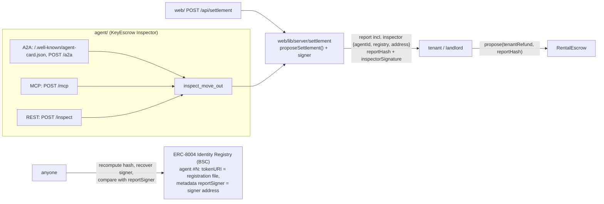

# KeyEscrow Inspector: the AI inspection as a BNB Chain agent

KeyEscrow Inspector is the move-out inspection from `POST /api/settlement`, run as an agent that other software can
find and call. It has an on-chain identity on BNB Chain (ERC-8004), it exposes one skill over A2A and MCP, and it
signs every report it produces. The on-chain proposal therefore names the agent that made it: the tenant or
landlord passes `reportHash` to `RentalEscrow.propose()`, and that hash covers the inspector's ERC-8004 agent id.
The UI shows this as "Signed by KeyEscrow Inspector, ERC-8004 agent #N".

It is built on the [BNB Agent SDK](https://github.com/bnb-chain/bnbagent-sdk) (`@bnbagent/sdk`, MIT), the same SDK
that [BNB Agent Studio](https://www.bnbchain.org/en/bnb-agent-studio) generates agents from. Its two faces use the
same libraries a Studio-generated agent uses: `@a2a-js/sdk` for A2A and `@modelcontextprotocol/sdk` for MCP.

**Status:** on this branch, the agent (`agent/`), signed reports in the web app, the ERC-8004 registration script
and the local rehearsal all work and are tested. The BSC testnet registration is prepared but has **not been
sent**. It runs together with the contracts' testnet deploy ([below](#register-on-bsc-testnet)). Payments per
inspection (ERC-8183 / x402) are on the [roadmap](#roadmap-pay-per-inspection-erc-8183--x402) and are not built.

## Contents

- [How it fits together](#how-it-fits-together)
- [Run it locally](#run-it-locally)
- [The skill](#the-skill)
- [ERC-8004 identity and signed reports](#erc-8004-identity-and-signed-reports)
- [Register on BSC testnet](#register-on-bsc-testnet)
- [Local rehearsal](#local-rehearsal)
- [Why the SDK rather than a generated Studio project](#why-the-sdk-rather-than-a-generated-studio-project)
- [Roadmap: pay per inspection (ERC-8183 / x402)](#roadmap-pay-per-inspection-erc-8183--x402)
- [Tests](#tests)

## How it fits together



- **One implementation.** The agent imports `proposeSettlement` and the schema from `web/lib/server/settlement`
  instead of copying them. The agent and the web app return the same JSON with the same `reportHash` for the same
  input; a test checks this.
- **Provider-agnostic, offline by default.** The same `VISION_LLM_PROVIDER` / `ANTHROPIC_API_KEY` /
  `VISION_LLM_MODEL` switches apply. Without a key, the deterministic mock runs. The agent never calls Pieverse or
  any paid LLM gateway.
- **Off-chain link, no contract change.** The identity goes into the hashed report, so `RentalEscrow` stays as it
  is. The only Solidity added is a test-only registry stand-in for the rehearsal
  (`contracts/test/mocks/MockIdentityRegistry.sol`).

## Run it locally

Needs `pnpm -C web install` (the agent loads the settlement code and its dependencies from `web/`) and
`pnpm -C agent install`. `pnpm setup` installs both.

```bash
pnpm agent:dev                # A2A + MCP + REST on http://127.0.0.1:8790 (AGENT_HOST / AGENT_PORT to change)
pnpm agent:call:mcp           # sample MCP client: tools/list, inspect_move_out, verify_report
pnpm agent:call:a2a           # sample A2A client: resolve the card, message/send with a data part
pnpm agent:card               # print the agent card and the ERC-8004 registration file
```

Output in mock mode, without a signer key (trimmed):

```text
$ pnpm agent:dev
KeyEscrow Inspector listening on http://127.0.0.1:8790
  A2A card      http://127.0.0.1:8790/.well-known/agent-card.json  (JSON-RPC http://127.0.0.1:8790/a2a)
  MCP           http://127.0.0.1:8790/mcp
  REST          http://127.0.0.1:8790/inspect
  ERC-8004 file http://127.0.0.1:8790/.well-known/agent-registration.json
  provider      mock (deterministic, no key)
  identity      none: reports are unsigned (set INSPECTOR_PRIVATE_KEY, see docs/AGENT.md)

$ pnpm agent:call:mcp
MCP http://127.0.0.1:8790/mcp tools: inspect_move_out, verify_report, inspector_identity
{
  "tenantRefund": "450000000",
  "landlordClaim": "50000000",
  "reasons": ["Kitchen: appliance not cleaned; grease build-up visible (est. cleaning)."],
  "confidence": 0.62,
  "deposit": "500000000", "decimals": 6, "currency": "USDT",
  "mock": true, "provider": "mock", "repairs": [],
  "checkIn": […], "checkOut": […],
  "createdAt": "2026-11-25T10:49:41.513Z",
  "reportHash": "0x…"
}
verify_report: {"hashValid":true,"signer":null,"signatureValid":false}
```

With a signer and an ERC-8004 identity set (here from the [local rehearsal](#local-rehearsal), agent #0 on a
chainId-97 anvil), every result also carries:

```json
"inspector": {
  "name": "KeyEscrow Inspector",
  "address": "0x738A4b557D1d41AA56D74d7B573fD68826b3B4C2",
  "agentId": "0",
  "agentRegistry": "eip155:97:0x8004A818BFB912233c491871b3d84c89A494BD9e"
},
"reportHash": "0x86bb56ce…f0e1",
"inspectorSignature": "0x79c7668f…5381b"
```

Agent env (all server-side; names are also in `.env.example`):

| Variable | Meaning |
| --- | --- |
| `AGENT_HOST`, `AGENT_PORT` | Listen address, default `127.0.0.1:8790` |
| `AGENT_PUBLIC_URL` | Base URL in the agent card and registration file (default `http://<host>:<port>`) |
| `INSPECTOR_PRIVATE_KEY` | Report-signing key. Unset: reports are unsigned. Never `NEXT_PUBLIC_`. |
| `INSPECTOR_AGENT_ID`, `INSPECTOR_AGENT_REGISTRY` | ERC-8004 agent id and `eip155:97:<registry>`. If unset, they are read from `agent/deployments/97.json` (`INSPECTOR_DEPLOYMENT` overrides the path). The agent refuses to start when the key is not that record's `reportSigner`. |
| `VISION_LLM_PROVIDER`, `ANTHROPIC_API_KEY`, `VISION_LLM_MODEL` | Same as the web app; mock without a key |
| `EVIDENCE_DIR` | Evidence store for photos given by hash in live mode (default `web/.evidence`, shared with the web app) |

The web app signs too: set the same `INSPECTOR_PRIVATE_KEY`, `INSPECTOR_AGENT_ID` and `INSPECTOR_AGENT_REGISTRY`
in `web/.env.local`, and `POST /api/settlement` returns signed reports. The move-out panel then shows "Signed by
KeyEscrow Inspector, ERC-8004 agent #N" under the inspector's suggestion.

## The skill

`inspect_move_out` takes the same body as [`POST /api/settlement`](API.md#post-apisettlement) and returns the same
result. The input is validated with the same zod schema, and `tenantRefund + landlordClaim == deposit` always holds.

| Face | How to call it |
| --- | --- |
| A2A (protocol 0.3.0, JSON-RPC) | Card at `/.well-known/agent-card.json`. Send `message/send` to `/a2a` with one data part: the request object. An optional `"skill": "inspect_move_out"` key is accepted. The reply is one agent message with a data part: the result, or `{error, details?, status}`. |
| MCP (Streamable HTTP, stateless) | `POST /mcp`. Tools: `inspect_move_out` (result in `structuredContent`), `verify_report` (recompute the hash, recover the signer), `inspector_identity`. Errors come back as `isError: true` with `{error, details?}`. |
| REST | `POST /inspect`: 200 with the result, 400 for invalid input, 502 when the model fails. |

## ERC-8004 identity and signed reports

[ERC-8004](https://eips.ethereum.org/EIPS/eip-8004) gives an agent an on-chain identity: an NFT in an Identity
Registry whose `tokenURI` is a registration file listing the agent's name and endpoints. The BNB Agent SDK ships the
BSC registry addresses (testnet `0x8004A818BFB912233c491871b3d84c89A494BD9e`).

KeyEscrow ties a settlement report to that identity in three steps:

1. **Registration.** `pnpm agent:register` calls the SDK's `ERC8004Agent.registerAgent` with a data-URI
   registration file (built by the SDK's `AgentURIGenerator`). The file lists the A2A card and the MCP endpoint and
   points back at `eip155:97:<registry>` with the new agent id. The registration also stores one metadata entry,
   `reportSigner`, the 20-byte address of the server key that signs reports. The owner key (the deployer) is kept
   apart from the signing key, which is the only key the server holds.
2. **Report.** `proposeSettlement` adds `inspector: {name, address, agentId, agentRegistry}` to the report
   *before* hashing. `reportHash` is still the sha256 of the canonical JSON (sorted keys), now without
   `reportHash` and `inspectorSignature`. The signer then signs `reportHash` (EIP-191 `personal_sign` over the 32
   bytes) as `inspectorSignature`. A report for another agent id gives another hash, so the hash submitted on-chain
   pins the agent.
3. **Verification.** Anyone holding the report recomputes the hash, recovers the signer from
   `inspectorSignature`, and checks that the signer equals `getMetadata(agentId, "reportSigner")` on the registry
   named in the report. `pnpm agent:verify` does all of this. `verifyInspectorReport()` in
   `web/lib/server/settlement/inspector.ts` and the MCP tool `verify_report` do the offline half.

```text
$ BSC_TESTNET_RPC_URL=http://127.0.0.1:28560 AGENT_URL=http://127.0.0.1:28563 pnpm agent:verify
report 0x3afa…76dd: tenantRefund 450000000, landlordClaim 50000000
  ✓ reportHash = sha256(canonical JSON of the report)
  ✓ inspectorSignature recovers to the report's inspector 0x738A…B4C2
  ✓ report names ERC-8004 agent #0 in eip155:97:0x8004A818BFB912233c491871b3d84c89A494BD9e
  ✓ RPC chainId 97 matches the registry reference
  ✓ agent #0 exists, owner 0xA7CE…D59E
  ✓ on-chain reportSigner 0x738A…B4C2 signed this report
  ✓ tokenURI registration file names "KeyEscrow Inspector"
  ✓ registration file points back at this agent id and registry
VERIFIED: signed by KeyEscrow Inspector, ERC-8004 agent #0
```

When no signer is configured, reports have no `inspector` field and hash exactly as before, so nothing changes for
existing leases or tests.

## Register on BSC testnet

This step is for the coordinator. It runs together with the contracts' testnet deploy ([DEPLOY.md](DEPLOY.md)) and
uses the same env and keystore approach as `contracts/script/testnet.sh`. It is never run automatically.

```bash
# names in .env (values never committed): BSC_TESTNET_RPC_URL, DEPLOYER_ADDRESS, DEPLOYER_ACCOUNT (or
# DEPLOYER_KEYSTORE / PRIVATE_KEY), DEPLOYER_PASSWORD_FILE, INSPECTOR_SIGNER_ADDRESS, AGENT_PUBLIC_URL
pnpm agent:register:check                                   # preflight, sends nothing
ALLOW_NON_LOCAL_BROADCAST=true pnpm agent:register          # asks you to type "register"; `-- --yes` skips it
```

- **Preflight** checks that the RPC answers chainId 97 (chainId 56 is refused outright, exit 2), that the registry
  has code, that exactly one wallet is configured and matches `DEPLOYER_ADDRESS`, that the balance covers
  `register` + `setAgentURI` (1.5M gas at the current gas price, with headroom), and that `AGENT_PUBLIC_URL` is set. Anvil's public dev
  accounts are refused as deployer or signer, and so is a second registration while `agent/deployments/97.json`
  exists (`FORCE_REREGISTER=true` overrides).
- **Wallet.** The keystore is decrypted in memory and handed to the SDK's `EVMWalletProvider` with a throwaway
  wallets dir in the OS temp dir, removed afterwards. Nothing is written to `~/.bnbagent`. MegaFuel sponsorship is
  off: the deployer pays its own gas, and no third-party relay is contacted.
- **Result.** `agent/deployments/97.json` holds the agent id, registry, owner, `reportSigner`, `agentURI` and tx
  hash. Commit it. The script then prints the server env to set: `INSPECTOR_AGENT_ID`,
  `INSPECTOR_AGENT_REGISTRY` and `INSPECTOR_PRIVATE_KEY` (the key of `INSPECTOR_SIGNER_ADDRESS`).
- **Endpoint.** The registration file lists `AGENT_PUBLIC_URL` as the A2A and MCP endpoint. Until the agent runs
  somewhere public, other agents cannot reach that URL, but the identity, the `reportSigner` and the signed reports
  still verify. If the URL changes later, the owner can call `setAgentURI` with a new file.

## Local rehearsal

```bash
pnpm agent:rehearse
```

`agent/scripts/rehearse.sh` runs the whole registration path against throwaway anvil nodes on 127.0.0.1 (ports
28560-28569): one started with `--chain-id 97` and one with `--chain-id 56`. The SDK has no local registry, so the
script compiles `contracts/test/mocks/MockIdentityRegistry.sol` (the subset of the reference IdentityRegistry ABI
the SDK uses, with the same events; 6 forge tests) and places it with `anvil_setCode` at the canonical testnet
registry address. `register.ts` then runs unchanged: same chainId, same registry address, only the RPC URL differs.
The deployer is a fresh keystore in a temp dir, funded with `anvil_setBalance`.

It checks 23 things: preflight failures (nothing set, unreachable RPC, chainId 56, anvil account, two wallets,
unfunded), that preflight sends nothing, refusal without `ALLOW_NON_LOCAL_BROADCAST` and without confirmation, the
registration itself (agent #0, `97.json`, an on-chain `tokenURI` with `registrations[]`), refusal to register twice,
the agent starting with that identity, the MCP and A2A calls, `pnpm agent:verify` against the registry, the agent
refusing a key that is not the registered `reportSigner`, and an unchanged git status. Everything is removed on exit.

## Why the SDK rather than a generated Studio project

We spent a timeboxed spike on BNB Agent Studio first, with every tool project-local (no global install, no
`bag skills install`, HOME pointed at a scratch dir):

- `pnpm dlx @bnbagent/studio-cli@0.0.16 init inspector --llm-provider none --protocols A2A,MCP --rails 8183
  --seller-price-usd 0 --destination self --storage-provider local --no-onboard --no-install` scaffolds offline
  with no sign-up. It writes `~/.bnbagent-studio/projects.toml`, which is why HOME has to be redirected.
- The generated agent is an ERC-8183 seller. Its A2A/MCP skills are `negotiate` (signed quote) and
  `notify_funded`, and its work hook runs only after a buyer has funded an ERC-8183 job on BSC testnet or mainnet.
  It also carries AgentCore/Azure deploy descriptors, x402/B402 rails and Pieverse LLM wiring. A local demo of our
  skill would need a funded testnet job, which this project does not do, and `bag dev`/`bag deploy` lead towards
  the managed trial or a cloud account.
- `@bnbagent/sdk` itself runs fully locally. It accepts an explicit `NetworkConfig` (our RPC, our registry, paymaster
  off) and a `walletsDir` override. Its ERC-8004 module (`ERC8004Agent`, `AgentURIGenerator`, `AgentEndpoint`) is
  everything the identity needs.

So the agent uses the SDK directly for identity, and the same A2A and MCP libraries as a Studio project for its
faces, with our own skill. A generated Studio project can be added later for paid jobs (next section) without
changing the identity: ERC-8183 jobs reference the same ERC-8004 agent.

SDK rough edges we hit: metadata values are encoded with viem `toBytes`, so an address string is stored as raw 20
bytes and the SDK's `getMetadata` (UTF-8 decode) reads it back as garbage. We read `reportSigner` ourselves
(`decodeReportSigner`). The bsc-testnet preset also turns MegaFuel sponsorship on by default, so we pass an explicit
`NetworkConfig` with `usePaymaster: false`.

## Roadmap: pay per inspection (ERC-8183 / x402)

Not built. This is how payments would plug in without changing the identity or the escrow:

- **ERC-8183 (escrowed job), for landlords and property managers.** The landlord (or tenant) creates a job for
  KeyEscrow Inspector's agent id and funds a fixed price, for example 2 USDT, into the ERC-8183 escrow. The agent
  checks the funded job, runs `inspect_move_out`, and submits the signed report as the deliverable. The job settles
  after the dispute window. The `negotiate` + `notify_funded` skills from a Studio-generated seller wrap our skill
  unchanged. A rejected job (for example, a report that ignores the photos) refunds the payer, which gives the
  agent an on-chain track record that ERC-8004 reputation can build on.
- **x402 (pay per HTTP request), for integrations.** `POST /inspect` returns `402 Payment Required` with a quote. A
  client such as a property-management system pays per call over x402 and retries. This suits high-volume
  partners that do not need escrow.
- **Who pays.** By default the fee is folded into the KeyEscrow lease fee ([BUSINESS.md](BUSINESS.md)), so tenants
  and landlords never pay the agent directly. Pay-per-inspection is for third parties that use the inspector
  outside KeyEscrow leases.
- **Prerequisites.** The agent must be hosted at its registered public endpoint. Pricing must stay in fixed code,
  never chosen by the model. Mainnet needs a funded payout wallet. None of this is part of the hackathon build: no
  live payments, no Pieverse, no managed trial.

## Tests

```bash
pnpm agent:test                          # vitest: card + registration file, config, the skill, A2A/MCP/REST over HTTP
pnpm -C web test                         # includes web/tests/inspector.test.ts (signing, hash binding, tamper checks)
cd contracts && forge test --match-contract MockIdentityRegistry
pnpm agent:rehearse                      # the ERC-8004 registration path on local anvil (23 checks)
```

Agent tests run offline. Provider keys are unset, `fetch` can only reach 127.0.0.1, and the HTTP tests start the
agent on a free port in 3170-3199.
