# Architecture

KeyEscrow holds scooter rental deposits and rent in Thailand on BNB Chain (case study and scope:
[PRODUCT.md](PRODUCT.md)). One `EscrowFactory` creates a small, non-upgradeable `RentalEscrow` contract for every
rental. The escrow holds the renter's deposit and prepaid rent in a stablecoin. MockUSDT stands in for that
stablecoin on testnet. KeyEscrow has no token of its own. A `FleetVault` can receive a rental's income on behalf of
the shareholders of a scooter fleet.

Documents and photos stay off-chain; only their content hashes go on-chain. An AI inspector (a vision LLM behind
an ERC-8004 agent identity) compares pickup and return photos and *drafts* a deposit split. The parties settle that
draft on-chain themselves.

> **Naming.** The docs and UI say rental shop *owner*, *renter*, *scooter rental*, *pickup* and *return*. The
> contracts and ABIs keep their original identifiers: `landlord` = owner, `tenant` = renter, `lease` = rental,
> `CheckIn` / `CheckOut` = pickup / return photos, `MoveOut` = a return (deposit) proposal is open.

> **Status lines.** Each section says what is on `main` and live. Anything else is marked **Roadmap**.

Contents: [1. System](#1-system) · [2. Contracts](#2-contracts) · [3. Web app](#3-web-app) ·
[4. Actions: REST, OpenAPI, MCP, A2A](#4-actions-rest-openapi-mcp-a2a) · [5. Agent](#5-agent-keyescrow-inspector) ·
[6. Off-chain services](#6-off-chain-services) · [7. Cloudflare](#7-cloudflare-deployment) ·
[8. Roles and trust](#8-roles-and-trust-model) · [9. State machine](#9-rental-state-machine) ·
[10. Data flows](#10-data-flows) · [11. Scalability](#11-scalability) · [12. Testing](#12-testing)

## 1. System

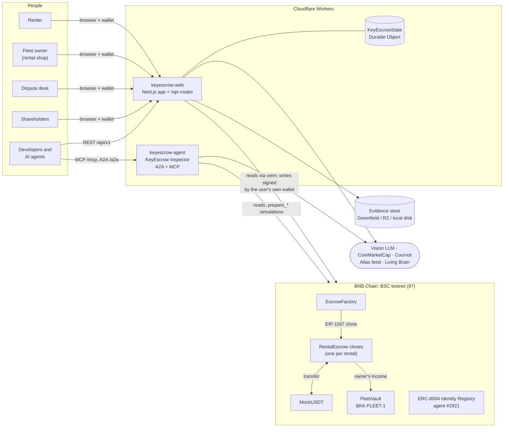

The web app never holds a user key: a user's own wallet (RainbowKit) signs every write. The two exceptions are both
demos. On the local anvil chain, the *Demo accounts* bar signs with anvil's public dev keys. On the live testnet
`/demo`, a server-side runner signs with throwaway demo wallets ([§3](#the-demo-runner)).

**Status:** live. The contracts are on BSC testnet (addresses in the [README](../README.md#bsc-testnet-contracts-chain-97)),
the web app runs at <https://keyescrow-web.mdgooijer.workers.dev>, and the agent at
<https://keyescrow-agent.mdgooijer.workers.dev>.

## 2. Contracts

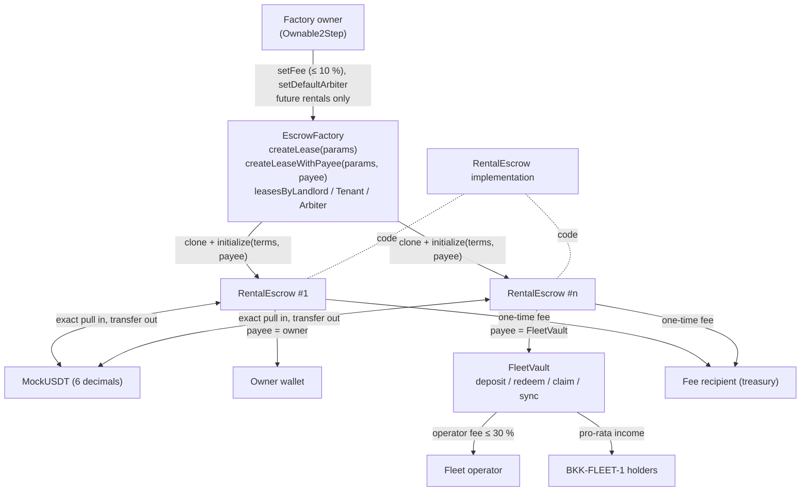

| Contract | Where | Responsibility |
| --- | --- | --- |
| `EscrowFactory` | `contracts/src/EscrowFactory.sol` | Checks the rental parameters (term 1–60 months, reply window 1–60 days, dispute deadline 1–90 days, three different parties) and clones one `RentalEscrow` per rental (EIP-1167). Indexes rentals by owner, renter and arbiter, plus a paginated list. Holds the fee setting (`feeBps`, hard cap `MAX_FEE_BPS = 1000`) and the default arbiter for **future** rentals. |
| `RentalEscrow` | `contracts/src/RentalEscrow.sol` | Holds one rental's deposit and rent. Releases rent on a fixed 30-day schedule, charges the one-time fee on the first rent payout, anchors evidence hashes, and settles the deposit by agreement, ruling or timeout. Initialised once, not upgradeable, no admin functions. |
| `FleetVault` | `contracts/src/FleetVault.sol` | Testnet prototype. Investors deposit the stablecoin and get ERC-20 fleet shares 1:1 (`BKK-FLEET-1`). Rentals created with `createLeaseWithPayee(params, vault)` pay the owner's rent and any deposit claim into it. `sync()` splits new income into the operator fee (immutable, max 30 %; 10 % on testnet) and a per-share accumulator that holders `claim()`. Shares redeem 1:1. |
| `MockUSDT` | `contracts/src/mocks/MockUSDT.sol` | Testnet-only stablecoin: 6 decimals, faucet capped at 10,000 per call. Not a project token. |

Safety properties enforced in code:

- **Checks-effects-interactions** everywhere, and every move of funds sits behind `ReentrancyGuardTransient`.
- **Exact pull:** `_pull` compares the escrow's balance before and after `transferFrom` and reverts on a shortfall, so a
  fee-on-transfer token cannot under-fund an escrow.
- **Fixed recipients:** funds only go to the payee, the renter or the fee recipient, all fixed at creation. No
  function takes a recipient address.
- **Isolated terms:** each escrow copies the fee, the arbiter and both windows at creation. Later factory changes
  never reach an existing rental.

**Status:** on `main` and deployed on BSC testnet (verified on BscScan). 105 Foundry tests (unit + fuzz), see
[§12](#12-testing).

## 3. Web app

`web/` is a Next.js 16 App Router app (React 19, TypeScript, Tailwind, wagmi + viem + RainbowKit). One shell
(`components/shell/AppShell.tsx`) holds a left sidebar that collapses to an icon rail, the theme switch, the price
source badge and the wallet button.

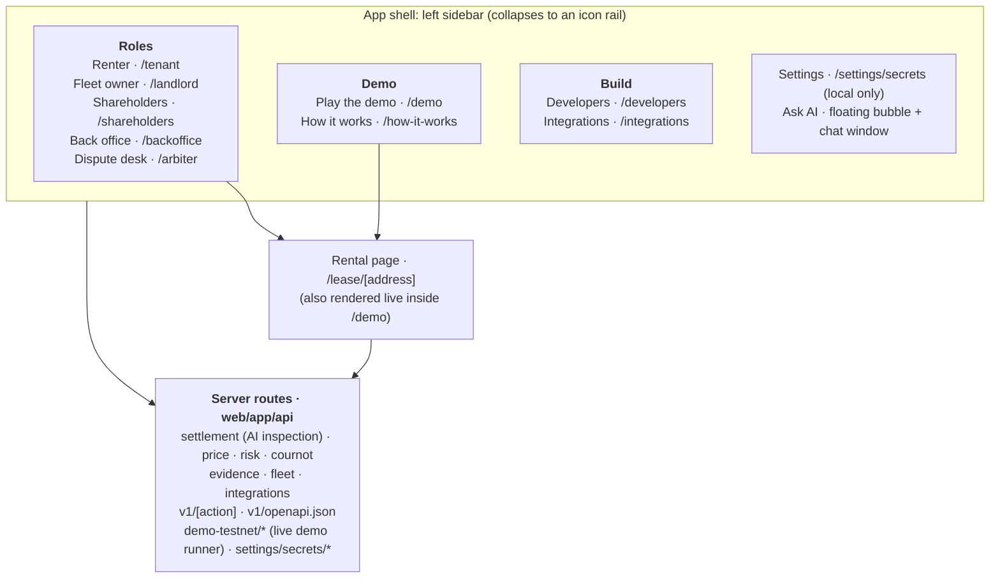

| Area | What it does |
| --- | --- |
| **Role views** | `/tenant`: find and book a scooter, follow your rentals. `/landlord`: the fleet with each scooter's status read live from its latest on-chain rental, income in THB, booking requests, disputes. `/shareholders`: Fleet Vault TVL, income, yield, your position, buy shares, claim. `/backoffice`: every rental of the factory and a live transaction feed from chain events, with flags for anything stuck or disputed. `/arbiter`: the dispute queue and the ruling form. On the local chain the role links also switch the demo account. |
| **Subscriptions** | `/app/subscriptions`: monthly plans (off-chain plan on a listing) and the renter's subscriptions with *Pay month N* (`payRent(1)`) and *Cancel* (the normal return flow). The owner offers plans and sees MRR on `/landlord`; shareholders see vault MRR. Current contract, no change; see [BUSINESS.md](BUSINESS.md#4-monthly-subscriptions-recurring-rent). |
| **Rental page** | `/lease/[address]`: rent schedule, what is in escrow, documents and photos, the AI return inspection, proposals, the ruling and an on-chain timeline. The same `LeaseDetail` component runs inside `/demo`. |
| **`/how-it-works`** | A 1-minute cartoon (ELI5) with no wallet and no chain: three endings (both agree, they disagree, the owner goes silent). |
| **`/developers`** | Docs for every `/api/v1` action, generated from the action definitions ([§4](#4-actions-rest-openapi-mcp-a2a)). |
| **`/integrations`** | The sponsor integrations' state, the deposit risk engine and recent sponsor calls. |
| **`/settings/secrets`** | A write-only page for setting API keys on the team's own box. It is on only when the server has `SETTINGS_SECRETS_ENABLED=1`, answers only local or tailnet clients on a non-public host, needs a passcode, and never shows a value back. A Cloudflare build with the flag fails, and Workers ignore it at runtime. See [SETUP.md](SETUP.md). |
| **Ask AI** | A bubble bottom right of every app page (and Ctrl/Cmd+J) opens a floating chat window: reads, approval cards signed by your wallet, follow along. See [ASSISTANT.md](ASSISTANT.md). |

Listing data (the scooter catalogue and booking requests, `/api/fleet`) is off-chain and demo-grade: it is a file
under Node and the Durable Object on Cloudflare. Rental money and state live only in the escrows; a listing links to
its rentals by escrow address.

### The demo runner

`/demo` plays the whole story in one screen: owner offers, pickup photos, renter funds, month 1 is paid out, return
photos, AI inspection, proposal, then settlement. Each run creates a **new** rental. *Guided* speed narrates every
step in three beats (what happens now, the transaction, what just changed). *Step by step* waits for a click. The
real `LeaseDetail` page renders live underneath. The same story script (`lib/demo/script.ts`) runs in two builds:

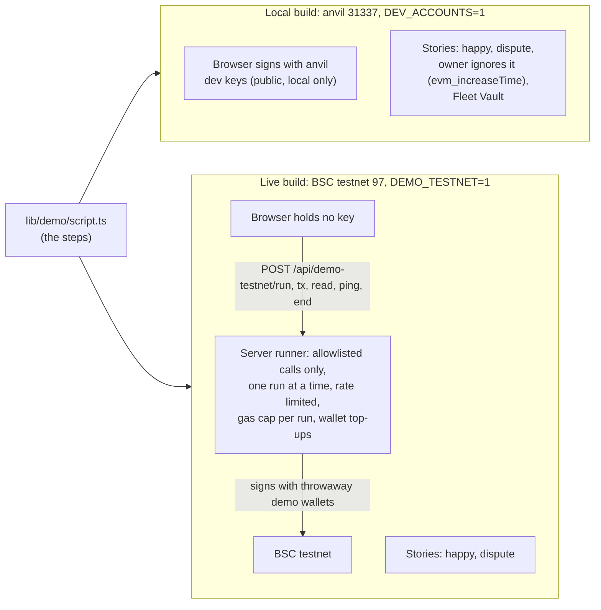

The testnet runner (`lib/server/demoTestnet/`) vets every call against an allowlist of factory, escrow and MockUSDT
functions (`guards.ts`) before it signs, keeps the run lock in the Durable Object, and never puts a key in a response
or a log. Other builds compile the demo out, and `/demo` answers 404.

**Status:** live, Ask AI included.

### Languages (EN / 中文 / EN+中文)

`web/lib/i18n`: the mode is the `ke_lang` cookie (`en` default, `zh`, `both`), read once per request in the root
layout, which sets `<html lang>` and hands the client provider only the active dictionary (plus the Chinese headlines
in `both`). Server components call `getDictionary()`, client components `useT()`; both give `t(key)`, `t.h(key)` for
headlines (EN+中文 puts the Chinese line under the English, body text stays English), `t.of(module)` and
`t.head(module, pick)` for the localized data modules (`*.zh.ts` next to the English: demo copy and script, the
guided narration, the ELI5 cartoon, the landing copy, `lib/errors.zh.ts`). The app screens' strings are in the
dictionary itself, one file per group (`web/lib/i18n/dictionaries/{en,zh}/{shell,roles,rental,more,subs,stage}.ts`, a `body` and a
`head` for headlines and the big status sentences), so the browser only ever gets the active language. Shared lib
sentences the API also returns stay English there and are mapped for the UI (`fieldErrorIn`, the rental flags'
`code` + `vars`, `describeEvent(e, money, t)`, the stage feed's `eventLabel(e, t)`). The switch sits in the landing header and footer and the sidebar
footer. A missing Chinese key falls back to English;
`web/tests/i18n.test.ts` lists any. `?bilingual=1` switches to `both`. Fixed terms: [i18n-glossary.md](i18n-glossary.md).

## 4. Actions: REST, OpenAPI, MCP, A2A

Every rental action is **one definition** in `web/lib/actions/definitions.ts`: a zod input schema with titles and
units, the roles and rental states it needs, and either a read or a `build` that returns contract calls.

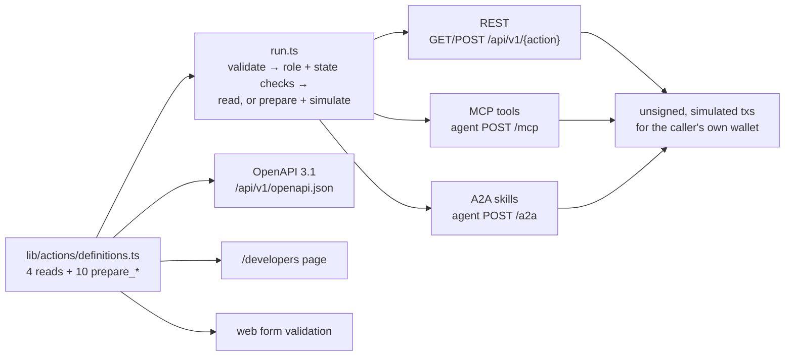

- Reads: `get_lease`, `list_leases`, `explain_status` (where the deposit is, in plain words, and what the viewer can
  do), `quote` (THB / USD / mUSDT).
- Prepare: `prepare_create_lease`, `prepare_fund`, `prepare_release_rent`, `prepare_add_evidence`,
  `prepare_propose_settlement`, `prepare_accept`, `prepare_dispute`, `prepare_resolve`, `prepare_claim_timeout`,
  `prepare_cancel`. Each returns the transactions (including any `approve`) already simulated against the chain,
  plus a plain-language summary. A wrong role or state returns HTTP 409 with the reason.
- The REST handler (`lib/actions/rest.ts`) uses only the standard `Request`/`Response`, so the same code runs under
  `next start`, on Workers and inside the agent.

**Status:** live on both Workers: 14 REST routes on the web app, and the same 14 plus 3 inspector tools (17) on the
agent's MCP server.

## 5. Agent: KeyEscrow Inspector

`agent/` runs the AI inspection as an agent that other software can find and call. It has two entry points: a Node
server (`src/server.ts`, Express) and a Cloudflare Worker (`src/worker.ts`). Details: [AGENT.md](AGENT.md).

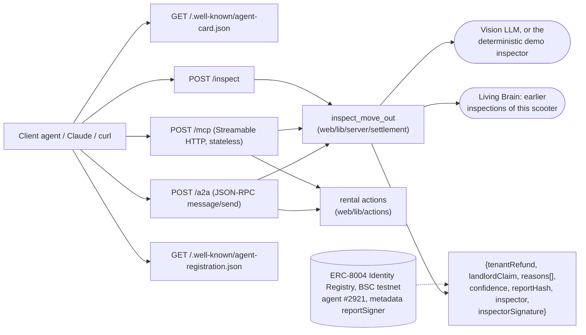

- **One implementation.** The agent imports the inspector and the actions from `web/lib`, so the agent and the web
  app return the same JSON and the same `reportHash` for the same input.
- **Identity in the hash.** The report includes `{name, agentId: 2921, agentRegistry, address}`, so the `reportHash`
  a party passes to `RentalEscrow.propose()` commits to the agent. With `INSPECTOR_PRIVATE_KEY` set, the report is
  also signed (EIP-191 over the hash) by the `reportSigner` recorded on the identity, and anyone can verify it with
  the `verify_report` tool.
- **It never signs a transaction.** The agent only drafts; a party proposes and the other accepts.

**Status:** live at <https://keyescrow-agent.mdgooijer.workers.dev>. Registered on BSC testnet as agent #2921
([tx](https://testnet.bscscan.com/tx/0x40c7cf2008857eabb197df1453e33b3b45760fdec8e7f846ac23a4c2e73328c0)).
Reports are signed only where `INSPECTOR_PRIVATE_KEY` is set; otherwise they are labelled unsigned. Pay per
inspection (ERC-8183 / x402) is roadmap.

## 6. Off-chain services

| Service | Route | In → out | Secrets (server env only) | Fallback |
| --- | --- | --- | --- | --- |
| AI inspection | `POST /api/settlement` (web), `inspect_move_out` (agent) | pickup + return photo sets and the deposit → `{tenantRefund, landlordClaim, reasons[], confidence}` and `reportHash` | `ANTHROPIC_API_KEY`, `VISION_LLM_MODEL`, `INSPECTOR_PRIVATE_KEY` | Deterministic demo inspector, labelled in the UI |
| Scooter memory | inside the inspection | earlier inspections of the scooter → "do not charge again" notes in the report | `LIVING_BRAIN_*` | Local file `web/.sponsor-logs/inspections.jsonl` (none on Workers) |
| Price | `GET /api/price` | → THB and USD per USDT and BNB, with source and time | `CMC_API_KEY`; `ATLAS_RPC_URL`, `ATLAS_FEED_*` | Atlas feed → CoinMarketCap → last good quote (marked stale) → *Demo rates* |
| Deposit risk | `GET /api/risk`, `POST /api/cournot` | deposit, days → buffer from CMC volatility × (1 + Cournot p) | `CMC_API_KEY`, `COURNOT_LIVE` | "not configured", no buffer shown |
| Evidence | `POST /api/evidence`, `GET /api/evidence/<hash>` | file → SHA-256 `contentHash` (bytes32) + a stored copy | `GREENFIELD_*` | Node: local `web/.evidence/`. Workers: R2 bucket `EVIDENCE` if bound, else small photos (≤ 256 KB, 500 files, 7 days) in the Durable Object |
| Listings | `GET/POST /api/fleet` | scooter catalogue and booking requests | none | Node: `web/.fleet/<chainId>.json`. Workers: the Durable Object |
| Actions | `/api/v1/<action>`, `/api/v1/openapi.json` | see [§4](#4-actions-rest-openapi-mcp-a2a) | none (public RPC) | none |
| Live demo | `/api/demo-testnet/*` | see [§3](#the-demo-runner) | `DEMO_TESTNET_KEYS`, `DEMO_TESTNET_FUNDER_KEY` | off: 404 |
| Live judge demo | `/api/stage/<slug>`, pages `/stage/<slug>`, `/r/<slug>` | test money for a phone, the owner's offer, presenter accept/reset; status polled every 2 s ([DEMO.md](DEMO.md#live-judge-demo-a-judge-rents-a-real-box-stage)) | `DEMO_TESTNET_*` (owner, desk, funder), `STAGE_PRESENTER_CODE` | off unless `STAGE_DEMO=1`: 404 |
| PromptPay demo on-ramp | `POST /api/demo-testnet/onramp` | `{lease}` → test mUSDT minted to its renter for what is due (`/app/pay/<rental>`; no real payment) | none on 31337 (anvil signs); 97: the live demo's wallets | 31337/97 only, capped at 10,000 mUSDT, rate-limited; 97 without the live demo: 404 |

Design rules:

- **Hashes on-chain, data off-chain.** The rental agreement hash is `leaseHash`. Photo sets are `checkInHash`,
  `checkOutHash` and `EvidenceAdded` events. The report or ruling behind a settlement is `reportHash`, which becomes
  the `basis` of the `Settled` event. Anyone holding the files can check them against these hashes.
- **The AI output is a proposal, not an oracle.** It follows a strict JSON schema, its amounts never exceed the
  deposit, and its reasons cite the photos. A person on each side still decides.
- **Prices are for display and fair value only.** The contracts work in token units and never read a price, so a
  price outage cannot block a rental ([WRITEUP.md](WRITEUP.md)).
- **Secrets stay on the server.** No secret uses a `NEXT_PUBLIC_` variable. Every sponsor call is server-side and
  logged without its key.

**Greenfield status:** the Greenfield store (`lib/server/evidence/greenfield.ts`, `@bnb-chain/greenfield-js-sdk`,
delegated upload) is built and is used on a Node server with `GREENFIELD_*` set. The live Cloudflare deploy cannot
load that SDK and has no R2 bucket bound yet, so its evidence is hashed in the browser. The demo's photos are static
files.

## 7. Cloudflare deployment

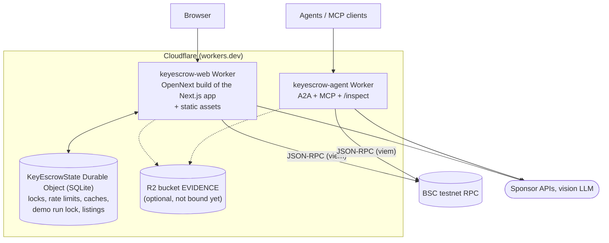

- **keyescrow-web** (`web/wrangler.jsonc`, entry `web/cloudflare/worker.ts`): the OpenNext handler plus the
  `KeyEscrowState` Durable Object class. The build is chain 97 only and refuses `NEXT_PUBLIC_DEV_ACCOUNTS=1`.
- **KeyEscrowState** (`web/cloudflare/state.ts`): one SQLite-backed instance holds everything that would otherwise
  live in process memory across requests. It offers a versioned compare-and-set with TTLs and an alarm that sweeps
  expired entries. `lib/server/state` falls back to an in-process map under Node.
- **keyescrow-agent** (`agent/wrangler.jsonc`, entry `agent/src/worker.ts`): the agent's three faces on Web-standard
  `Request`/`Response`. Its card and registration file use the URL each request came in on.
- Secrets are set with `wrangler secret put` and are never in the repo. Names and the deploy steps are in
  [CLOUDFLARE.md](CLOUDFLARE.md).

## 8. Roles and trust model

| Role | Can do | Cannot do |
| --- | --- | --- |
| Owner | Create a rental offer, cancel it while unfunded, add evidence, propose or accept a split, raise a dispute | Take the deposit or prepaid rent alone |
| Renter | Fund, prepay rent, release rent early, add evidence, propose or accept a split, raise a dispute | Take back the deposit or rent alone (except through the owner-silence timeout) |
| Arbiter (dispute desk) | Rule on a disputed rental (`resolve`) before its deadline | Act on a rental that is not disputed; send funds anywhere except to the payee and the renter |
| Anyone (keeper) | Release rent that is due; trigger a timeout once it has expired | Change any amount or recipient |
| Factory owner | Change the fee (up to the hard cap) and the default arbiter for **future** rentals | Touch existing escrows |
| Shareholder | Deposit into the Fleet Vault, redeem shares 1:1, claim income | Move rental funds; income reaches the vault only from escrows that name it as payee |

**Default arbiter.** The KeyEscrow dispute desk is the default arbiter. An owner may name another neutral arbiter,
such as a local rental association or a mediator. The arbiter is part of the rental terms (`terms().arbiter`). The
renter sees it on the funding screen and agrees to it by funding. The factory rejects a rental in which owner, renter
and arbiter are not three different addresses.

## 9. Rental state machine

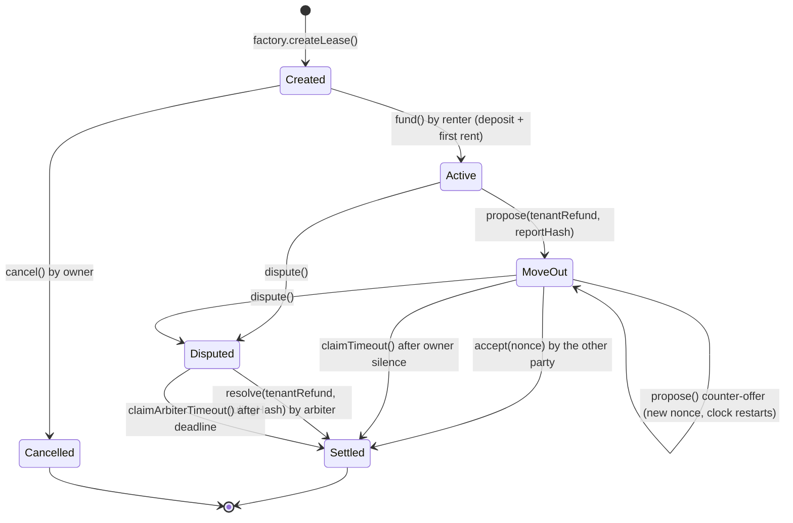

- `releaseRent()` and `addEvidence()` do not change the state. Rent can be released in `Active`, `MoveOut` and
  `Disputed`. Evidence can be added in any state except `Settled` and `Cancelled`.
- Every proposal increments a `nonce`. `accept(nonce)` reverts if the proposal changed after the caller reviewed it,
  so a last-second replacement cannot be accepted by mistake. The proposer cannot accept their own proposal.
- **Owner-silence timeout:** only when the renter made the latest proposal. If the owner does not accept,
  counter-propose or dispute within `responseWindow` (default 7 days, 1–60 allowed), anyone can call
  `claimTimeout()`. The full deposit then goes to the renter.
- **Arbiter deadline:** `resolve()` stops working at `disputedAt + arbiterWindow` (default 14 days, 1–90 allowed).
  From then on anyone can call `claimArbiterTimeout()`, which returns the full deposit to the renter. The arbiter
  cannot rule after the deadline, so the outcome cannot be raced.
- The burden of proof is on the owner. The owner never holds the funds and must actively claim damages.

## 10. Data flows

All amounts are in the factory's stablecoin (MockUSDT on testnet, 6 decimals). "Payee" is the owner, or the
`FleetVault` for a rental created with `createLeaseWithPayee`.

| Flow | Trigger | Money |
| --- | --- | --- |
| Funding | `fund()` by the renter | `depositAmount + rentAmount` into the escrow; starts the 30-day rent clock |
| Prepay | `payRent(months)` by the renter | `months × rentAmount`, never past the term |
| Rent release | `releaseRent()`: anyone once a month is due, or the renter early | due months to the payee; the **first** payout pays the one-time fee (`rentAmount × feeBps / 10000`) to the fee recipient |
| Settlement | `accept`, `resolve` or a timeout | deposit: `tenantRefund` to the renter, `landlordClaim` to the payee (always summing to the deposit); rent: due months to the payee, prepaid months not yet due back to the renter |
| Cancel | `cancel()` by the owner, only while unfunded | nothing moves |
| Fleet income | `sync()` (also run by `deposit`, `redeem`, `claim`) | anything above principal and reserved income: operator fee out, the rest claimable pro rata |

### Funding

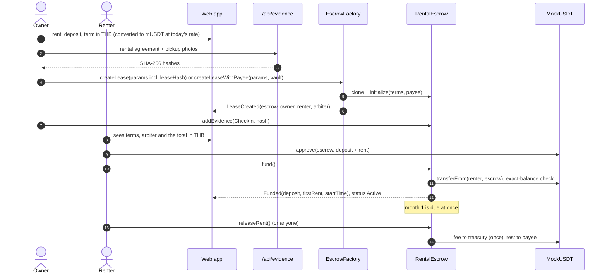

### Settlement by agreement

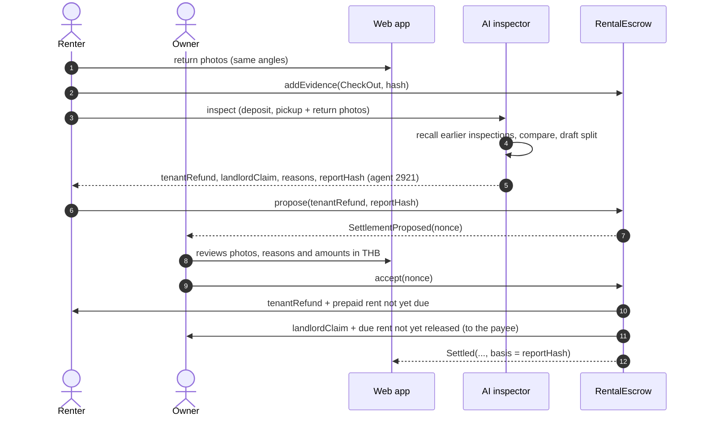

Either side may propose first, and the other may counter-propose (new nonce) instead of accepting.

### Dispute

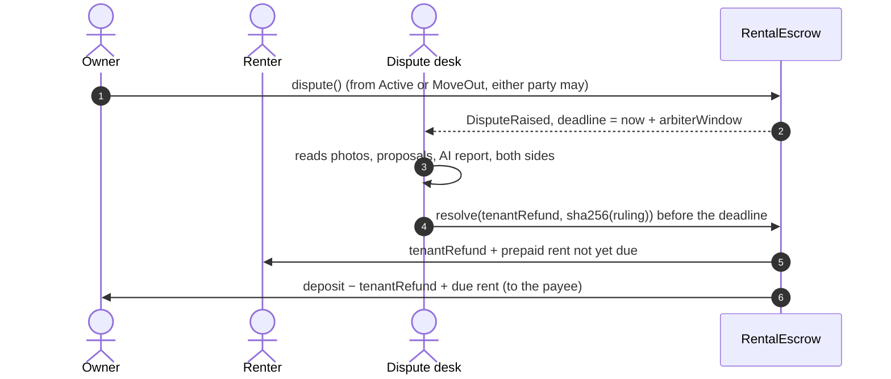

### Timeouts

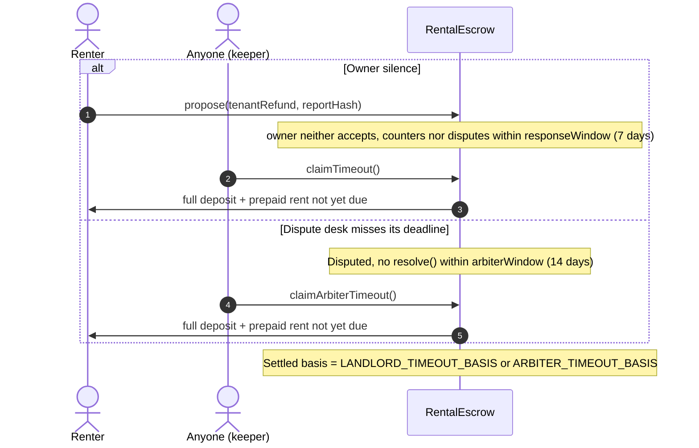

## 11. Scalability

- **Factory and minimal proxies.** Each rental is a 45-byte EIP-1167 proxy plus one `initialize` call, not a full
  contract deployment. Rental creation is cheap, and a bug or a dispute in one rental cannot touch another's funds.
- **No admin keys over funds.** Escrows are not upgradeable and copy their terms at creation. Every possible fund
  movement is in one short contract, which keeps audits small.
- **Indexing.** For the MVP the factory keeps on-chain indexes (`leasesByLandlord`, `leasesByTenant`,
  `leasesByArbiter`, paginated `leases(offset, limit)`), so no backend is needed to list rentals. At scale, every state
  change already emits an event (`LeaseCreated`, `Funded`, `RentReleased`, `SettlementProposed`, `DisputeRaised`,
  `Settled`, …) for a subgraph or a small event worker. Nothing would change on-chain.
- **Keeper-friendly.** `releaseRent()`, `claimTimeout()` and `claimArbiterTimeout()` are permissionless and can only pay
  the parties, so any keeper can automate them without being trusted.
- **Stateless servers.** The web app and the agent run as Workers. The only cross-request state is in one Durable
  Object, and the chain is the source of truth.
- **One action layer for people and agents.** Machines get the same validated actions as the UI (REST, MCP, A2A), so
  an integration does not need its own backend.
- **opBNB path.** Plain Solidity with no BSC-specific opcodes, so the same bytecode deploys to opBNB, BNB Chain's L2.
  The deploy wrapper, its rehearsal and the web app all take chainId 5611 (`pnpm deploy:opbnb:check`, see
  [DEPLOY.md](DEPLOY.md#opbnb-testnet-chainid-5611-prepared-not-deployed)); it is prepared, not deployed. One factory
  per chain keeps the indexes local. Cost per rental, from the rehearsal: one rental from creation to settlement
  (create, approve, fund, pickup and return photo hashes, settlement proposal, accept) is 7 transactions and
  1,023,737 gas on either chain. At the gas prices of 25 Nov 2026 that is **0.00010 tBNB on BSC testnet**
  (0.1 gwei) and **0.0000011 tBNB on opBNB testnet** (0.001 gwei plus about 0.00000009 tBNB L1 data fee), about 90×
  cheaper. Each extra month adds a `payRent` and a `releaseRent`, so long fleet rentals and frequent evidence
  anchoring gain the most. The whole deploy (5,072,948 gas) is 0.00051 tBNB on BSC and 0.0000070 tBNB on opBNB.
- **Greenfield for bulk data.** Photo sets are megabytes per rental; on-chain they stay 32 bytes per set.

## 12. Testing

| Suite | Command | Count (25 Nov 2026) |
| --- | --- | --- |
| Contracts: unit + fuzz (factory, escrow lifecycle, rent schedule, fee, settlement, timeouts, access control, Fleet Vault solvency, MockUSDT) | `cd contracts && forge test` | 105 |
| Web: server routes, actions, risk, sponsors, demo script and guards, secrets page (offline, no keys) | `pnpm -C web test` | 241 |
| Agent: card, A2A, MCP, Worker, prepare → sign → state change on anvil | `pnpm agent:test` | 20 |
| Chain end-to-end: happy path, dispute, owner timeout, arbiter fallback with real txs and time travel | `pnpm e2e:chain` | every path, balances asserted |
| Browser (Playwright): rental flow, guided demo (all stories), demo fits one screen, role views, ELI5, `/api/v1`, theme, secrets page | `cd web && npx playwright test` | 50 tests in 11 files |

CI ([.github/workflows/ci.yml](../.github/workflows/ci.yml)) runs all of them on every push and pull request with no
secrets, no testnet and no deploys; the chain tests use a throwaway local anvil.
