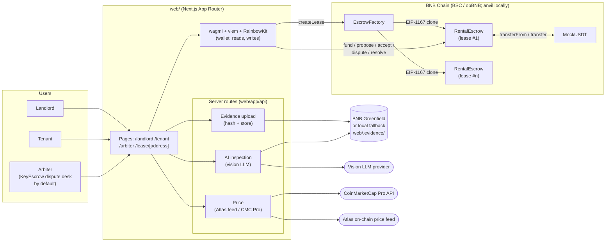
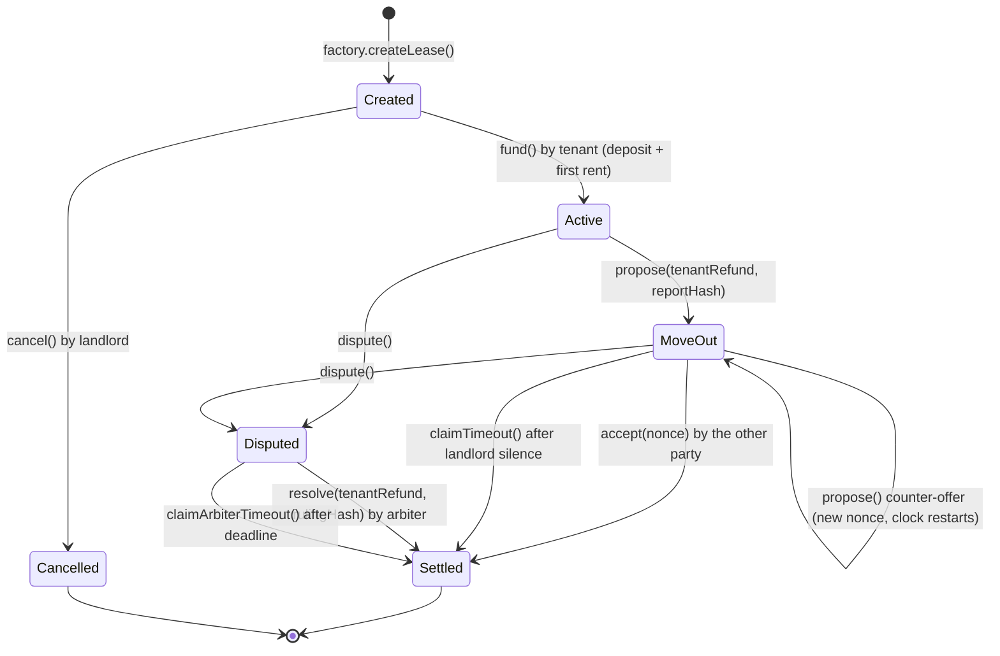
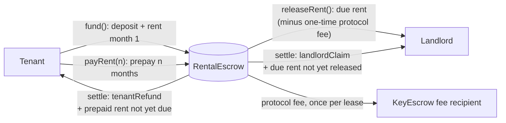
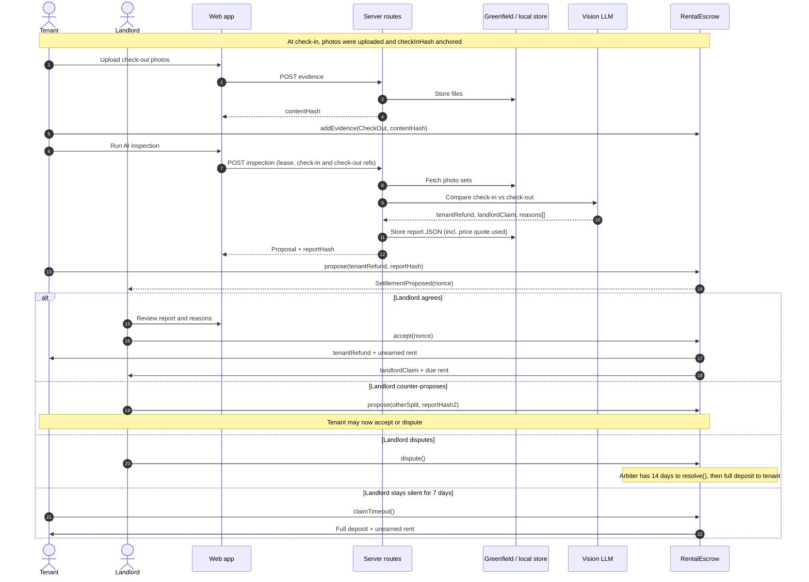

# Architecture

KeyEscrow is a platform for rental deposits and rent on BNB Chain. One `EscrowFactory` creates a small,
non-upgradeable `RentalEscrow` contract for every lease. The escrow holds the tenant's deposit and prepaid
rent in a stablecoin. MockUSDT stands in for that stablecoin on testnet. KeyEscrow has no token of its own.

Documents and photos stay off-chain, on BNB Greenfield, or in a local folder when Greenfield is not
configured. Only their content hashes go on-chain. A vision LLM compares check-in and check-out photos and
proposes how to split the deposit. The parties settle that proposal on-chain themselves.

> **How to read the Status lines.** Each section says what is on `main` today. Anything not on `main` yet is
> marked **Roadmap**; do not treat it as done.

## 1. Components

| Component | Where | Responsibility |
| --- | --- | --- |
| `EscrowFactory` | `contracts/src/EscrowFactory.sol` | Checks lease parameters and clones one `RentalEscrow` per lease (EIP-1167). Indexes leases by landlord, tenant and arbiter. Holds the protocol fee setting for future leases (`Ownable2Step`). |
| `RentalEscrow` | `contracts/src/RentalEscrow.sol` | Holds the deposit and rent for one lease. Releases rent on a fixed 30-day schedule. Anchors evidence hashes. Settles the deposit by mutual agreement, arbiter ruling or timeout. Initialised once, never upgradeable. |
| `MockUSDT` | `contracts/src/mocks/MockUSDT.sol` | Testnet-only stablecoin: 6 decimals, faucet capped at 10,000 per call. Not a project token. |
| Web app | `web/` | Role-based UI with a wallet connection (RainbowKit). Shows amounts in THB and USD. Links every lease to the block explorer. |
| Server routes | `web/app/api/*` | Hold every secret: the AI inspection call, price lookups, evidence upload to Greenfield. Nothing secret uses a `NEXT_PUBLIC_` variable. |
| Evidence store | BNB Greenfield (fallback `web/.evidence/`, git-ignored) | Stores the lease PDF, check-in and check-out photos, the inspection report and the arbiter's ruling. The chain stores only `bytes32` hashes. |

**Status:**

All on `main`: the three contracts and 80 Foundry tests (100 % line and branch coverage), the local anvil
deploy and seed scripts with a scripted chain end-to-end run, the server routes for AI, price and evidence, the
BSC testnet deploy path (prepared, see [DEPLOY.md](DEPLOY.md)), and the web app wired to the contracts:
landlord, tenant, dispute desk and lease pages on anvil (31337) or BSC testnet (97), with a Playwright
end-to-end test of the full lease flow.

## 2. Roles and trust model

| Role | Can do | Cannot do |
| --- | --- | --- |
| Landlord | Create a lease offer, cancel it while unfunded, add evidence, propose or accept a split, raise a dispute | Take the deposit or prepaid rent alone |
| Tenant | Fund, prepay rent, release rent early, add evidence, propose or accept a split, raise a dispute | Take back the deposit or rent alone (except through the landlord-silence timeout) |
| Arbiter | Rule on a disputed lease (`resolve`) before its deadline | Act on a lease that is not disputed. Send funds anywhere except to landlord and tenant |
| Anyone (keeper) | Release rent that is due. Trigger a timeout once it has expired | Change any amount or recipient |
| Factory owner | Change the protocol fee for **future** leases, up to a hard cap | Touch existing escrows. They copy their fee at creation and have no admin functions |

**Default arbiter.** The KeyEscrow dispute desk is the default arbiter. A landlord may name another neutral
arbiter instead, such as a condo juristic office or a mediator. The arbiter is part of the lease terms
(`terms().arbiter`). The tenant sees it in the funding screen and agrees to it by funding. The factory
rejects a lease in which landlord, tenant and arbiter are not three different addresses.

## 3. Lease state machine

Notes:

- `releaseRent()` and `addEvidence()` do not change the state. Rent can be released in `Active`, `MoveOut`
  and `Disputed`. Evidence can be added in any state except `Settled` and `Cancelled`.
- Every proposal increments a `nonce`. `accept(nonce)` reverts if the proposal changed after the caller
  reviewed it, so a last-second replacement cannot be accepted by mistake. The proposer cannot accept
  their own proposal.
- **Landlord-silence timeout:** if the tenant made the latest proposal and the landlord does not accept,
  counter-propose or dispute within `responseWindow` (default **7 days**), anyone can call
  `claimTimeout()`. The **full deposit** then goes to the tenant.
- **Arbiter deadline:** if the arbiter has not ruled within `arbiterWindow` (default **14 days**) of the
  dispute, `resolve()` stops working. Anyone can then call `claimArbiterTimeout()`, which returns the
  **full deposit** to the tenant. The outcome cannot be raced, because the arbiter cannot rule after the
  deadline.
- The burden of proof is on the landlord. The landlord never holds the funds and must actively claim
  damages.

**Status:**

Implemented as described: both windows are set per lease (0 selects the 7-day / 14-day default;
`responseWindow` 1-60 days, `arbiterWindow` 1-90 days). The `Settled` event's `basis` is
`LANDLORD_TIMEOUT_BASIS` or `ARBITER_TIMEOUT_BASIS` for the two timeouts. To change the policy, edit the
amounts passed to `_settle` in `claimTimeout()` / `claimArbiterTimeout()`.

## 4. Money flows

All amounts are in the factory's stablecoin (MockUSDT on testnet, 6 decimals).

| Flow | Trigger | Amount |
| --- | --- | --- |
| Funding | `fund()` by tenant | `depositAmount + rentAmount`. Starts the 30-day rent clock (`startTime`). |
| Prepay | `payRent(months)` by tenant | `months × rentAmount`, never more than the term. |
| Rent release | `releaseRent()`: anyone once a month is due, or the tenant early | Funded months that are due go to the landlord. The protocol fee is taken here. |
| Settlement | `accept`, `resolve`, or a timeout | Deposit: `tenantRefund` to the tenant and `landlordClaim` to the landlord (the two always add up to the deposit). Rent: funded months that are due go to the landlord, and prepaid months that are not yet due go back to the tenant. |
| Cancel | `cancel()` by landlord, only while unfunded | Nothing moves. |

**Protocol fee (design):**

- The fee is **10 % of one month's rent**, charged **once per lease**.
- It is deducted from the **first rent release to the landlord**. It is never taken from the deposit and
  never charged to the tenant on top of the rent.
- The rate is owner-configurable for future leases and hard-capped in the factory. Each escrow copies the
  rate at creation, so later changes do not affect existing leases.
- Example: rent 750 mUSDT means a fee of 75 mUSDT, so the landlord receives 675 for month 1 and 750 for
  every month after. See [BUSINESS.md](BUSINESS.md#fee-model) for a THB example.

Implemented as `feeBps` (default 1000, `MAX_FEE_BPS = 1000`) and `feeRecipient` on the factory, snapshotted
into each lease's terms; the escrow emits `ProtocolFeePaid` when it takes the fee, and rounds it down.

Safety properties enforced in code:

- **Checks-effects-interactions:** the escrow writes its state before any transfer, and every move of
  funds is wrapped in `ReentrancyGuardTransient`.
- **Exact pull:** `_pull` compares the balance before and after the transfer and reverts on any shortfall,
  so a fee-on-transfer token cannot under-fund an escrow.
- **Fixed recipients:** funds only ever go to the landlord, the tenant or the fee recipient that were set
  at creation. No function takes a recipient address.

## 5. Move-out settlement sequence

The AI does not hold keys and does not sign transactions. It only drafts a proposal. A party has to
submit that proposal with their own wallet, and the other party has to accept it.

## 6. Off-chain services

| Service | Route | Inputs → outputs | Secrets (server env only) | Fallback |
| --- | --- | --- | --- | --- |
| Evidence | `POST /api/evidence`, `GET /api/evidence/<hash>` | Files → `contentHash` (bytes32) and a storage reference | `GREENFIELD_*` | Local `web/.evidence/` directory |
| AI inspection | `POST /api/settlement` | Check-in and check-out photo sets plus the deposit → `{tenantRefund, landlordClaim, reasons[]}` and `reportHash` | `ANTHROPIC_API_KEY`, `VISION_LLM_MODEL` | Deterministic demo inspector, labelled as such in the UI |
| Price | `GET /api/price` | → THB and USD per USDT and BNB, with source and timestamp | `CMC_API_KEY`; Atlas: `ATLAS_RPC_URL`, `ATLAS_FEED_*` | Last good live quote (marked stale), then static rates labelled "Demo rates" |

Design rules:

- **Hashes on-chain, data off-chain.** The hash of the lease PDF is `leaseHash`. Evidence sets are stored
  as `checkInHash`, `checkOutHash` and `EvidenceAdded` events. The report or ruling behind a settlement is
  stored as `reportHash`, and it becomes the `basis` of the `Settled` event. Anyone holding the files can
  check them against these hashes.
- **The AI output is a proposal, not an oracle.** It follows a strict JSON schema, and its amounts never
  exceed the deposit. Its reasons cite the matching photo pairs. A human on each side still decides.
- **Prices for display and fair value only.** The contracts use token units and never read a price. See
  [WRITEUP.md](WRITEUP.md).
- **Secrets stay on the server.** Every key is read from the environment by server routes.
  `.env.example` lists the variable names only.

**Status:** on `main`. The request and response shapes are in [API.md](API.md); the variable names are in
`.env.example`.

## 7. Scalability

- **Factory and minimal proxies.** Each lease is an EIP-1167 clone of one implementation: a 45-byte proxy
  plus one `initialize` call, instead of a full contract deployment. This makes lease creation cheap, and
  every escrow is isolated, so a bug or a dispute in one lease cannot touch the funds of another.
- **No admin keys over funds.** Escrows are not upgradeable and copy their terms at creation. This keeps
  contracts small and audits simple: the full set of possible fund movements is in one short contract.
- **Indexing.**
  - For the MVP, the factory keeps on-chain indexes (`leasesByLandlord`, `leasesByTenant`,
    `leasesByArbiter`, and paginated `leases(offset, limit)`), so the frontend needs no backend to list a
    user's leases.
  - At scale, every state change emits an event (`LeaseCreated`, `Funded`, `RentReleased`,
    `SettlementProposed`, `DisputeRaised`, `Settled`, and so on). A standard indexer such as a subgraph,
    or a small event-sourced worker, can serve dashboards, the dispute-desk queue and analytics. Nothing
    would change on-chain.
- **Keeper-friendly.** `releaseRent()`, `claimTimeout()` and `claimArbiterTimeout()` are permissionless and
  can only move funds to the parties. Rent and timeouts can therefore be automated by any keeper, or by a
  KeyEscrow cron, without trusting it.
- **opBNB path.** The contracts are plain Solidity with no BSC-specific opcodes, so the same bytecode
  deploys to opBNB, an L2 with lower fees. Monthly rent releases and evidence anchoring then cost very
  little, which matters at condo-building scale. The frontend already lists opBNB testnet (5611) next to
  BSC testnet (97). One factory per chain keeps the indexes local to that chain.
- **Greenfield for bulk data.** Photo sets are megabytes per lease. Greenfield keeps them in the BNB
  ecosystem with access control. Moving storage there leaves the on-chain footprint at 32 bytes per
  evidence set.

## 8. Testing

- `cd contracts && forge test` runs the unit tests and a fuzz test for the factory, the escrow lifecycle,
  rent schedule, fee, settlement, timeouts and access control, plus MockUSDT.
- `pnpm e2e:chain` starts a throwaway anvil (port 28545), deploys, seeds, and drives the happy path, a
  dispute, the landlord timeout and the arbiter fallback with real transactions and anvil time travel,
  asserting every balance (exits non-zero on failure).
- `pnpm -C web test` runs the vitest suite for the server routes (offline, no keys).
- `pnpm -C web test:e2e` (Playwright) starts its own anvil (port 28546), deploys and seeds it, builds the app
  and drives landlord create → tenant fund → rent payout → AI proposal → landlord accept in a real browser.
