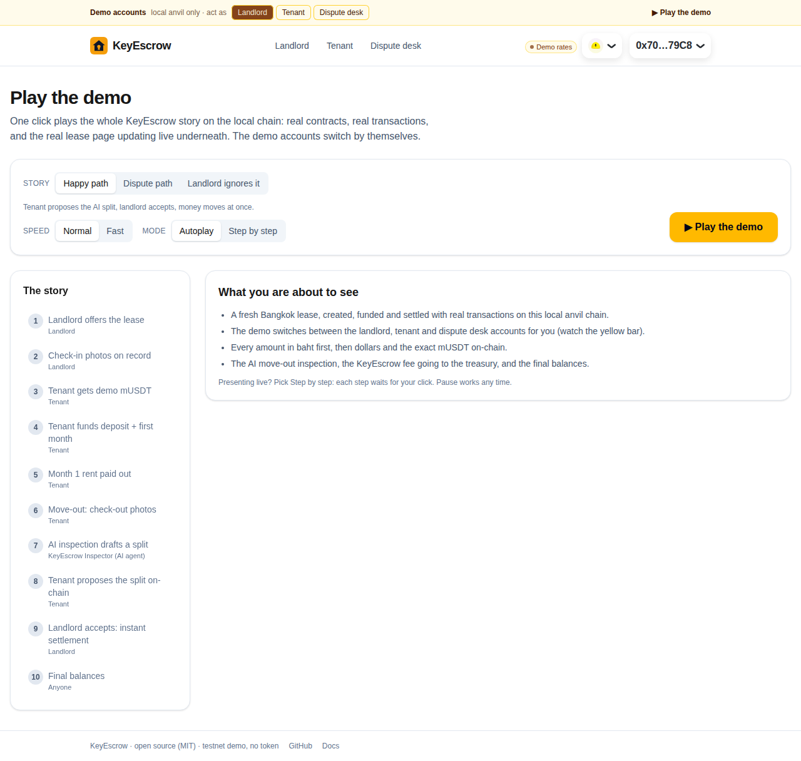

# Demo and pitch script

The pitch runs on the **live site** on BSC testnet: <https://keyescrow-web.mdgooijer.workers.dev>. No wallet is
needed for the demo: `/demo` signs with throwaway demo wallets on the server. If the network fails, use the
[30-second backup](#30-second-backup-local-mode-no-network) on a local chain.

**Storyboard of the live "Mystery Box" pitch:** [`/pitch`](https://keyescrow-web.mdgooijer.workers.dev/pitch)
(unlisted, not in the sidebar). An animated 3:00 run-through: a judge scans the QR on the big screen, rents our box with
a guest wallet, takes pickup and return photos, the AI inspector proposes a split and we accept. Each scene shows its
time mark and what we say or click, with a 3:00 timer bar. Use it to rehearse, and as the backup slide if the live demo
fails (**Space** = play / pause, **← →** = scenes). Strings and timings: `web/components/pitch/script.ts`.


## Before you go on stage (5 minutes)

1. Open these tabs, in this order, in one browser window at about 1470×830 (a 13–15" laptop, or zoom to fit):
   1. <https://keyescrow-web.mdgooijer.workers.dev> (home)
   2. <https://keyescrow-web.mdgooijer.workers.dev/how-it-works>
   3. <https://keyescrow-web.mdgooijer.workers.dev/demo>: pick **Happy path**, **Guided**, **Step by step**. Do not press
      Play yet. Reload the tab just before you start, so the first run is the Honda Click at ฿3,400 (each run in a tab
      cycles Click → Scoopy → NMAX).
   4. Fleet owner, local build: `http://localhost:3000/landlord` (Demo accounts bar on *Owner*). On the live site this
      page needs a connected wallet that owns scooters, so it is shown from a local, seeded build (setup
      [below](#local-setup)). No local build? Use the screenshot [fleet-owner.png](screenshots/fleet-owner.png).
   5. Shareholders, local build: `http://localhost:3000/shareholders` (Demo accounts bar on *Shareholder*), or
      [shareholders.png](screenshots/shareholders.png). The live testnet vault has no deposits yet, so it shows ฿0.
   6. <https://keyescrow-web.mdgooijer.workers.dev/developers>
   7. BscScan, the factory: <https://testnet.bscscan.com/address/0xd33b4dfF8C09e0079918fD987953c8f65F1363D8>
2. Check that the live demo is free: <https://keyescrow-web.mdgooijer.workers.dev/api/demo-testnet> should say
   `"enabled":true,"busy":false`. Only one live run is allowed at a time, with a 60-second gap between runs by default.
3. Know the controls: **→** (or a presenter clicker) = *Next*, **Space** = pause, **←** = back one caption.
4. Light theme, browser zoom 100 %, notifications off.

## The 3-minute script

The amounts below are for the Honda Click with no price key (*Demo rates*, 1 USDT = 33 THB), as on the live site
today. If a CoinMarketCap key is set, the baht amounts follow the live rate.

| Time | Screen | Click | Say |
| --- | --- | --- | --- |
| **0:00–0:20** | Tab 1, home | nothing | "Rent a scooter in Thailand and the shop keeps your passport as the deposit. At return, the shop alone decides what every scratch costs. Owners have the opposite problem: real damage and no proof. KeyEscrow puts the deposit in a small smart contract on BNB Chain, one per rental, that neither side can empty alone." |
| **0:20–0:40** | Tab 2, `/how-it-works` | **▶ Play**, let it run ~15 s | "The one-minute version: the deposit sits in a safe with two locks, the owner's and the renter's. A robot inspector compares the photos and *suggests* a split. People decide. If the owner goes silent, the renter gets everything back." |
| **0:40–0:50** | Tab 3, `/demo` | **▶ Play the demo** | "Now for real, on BSC testnet. No wallet: our demo owner, renter and dispute desk sign on the server. Every line on the right is a public transaction." |
| **0:50–1:15** | Steps 1–4 | **→** through the captions; wait on *On-chain now* | "The shop offers a Honda Click in Chiang Mai: ฿3,400 a month, ฿6,800 deposit. Only the SHA-256 fingerprints of the agreement and the pickup photos go on-chain. The renter funds deposit plus month one into *this rental's own* escrow, an EIP-1167 clone. Not into the shop's pocket." |
| **1:15–1:30** | Step 5 | **→** | "Month one is due right away. The owner gets ฿3,060, and our fee, ฿340, goes to the treasury. The fee is 10 % of one month's rent, once, from the owner's first payout, never from the deposit." |
| **1:30–2:00** | Steps 6–8 | **→**; pause on the AI card | "Return: new photos from the same angles. The KeyEscrow Inspector, an on-chain agent with ERC-8004 identity 2921, compares them and drafts ฿1,287 for a dented heat shield and scratches, ฿5,513 back to the renter. It drafts, it never decides. The renter proposes that split on-chain with the report hash." |
| **2:00–2:15** | Steps 9–10, end screen | **→** to *Final balances*; click **View the escrow on BscScan ↗** | "The owner accepts: one transaction pays everyone, the escrow is at zero, and the books add up. Here it is on BscScan." (It opens in a new tab: show the escrow's transactions for 3 s, then close it.) |
| **2:15–2:35** | Tab 4 Fleet owner, then Tab 5 Shareholders | nothing | "For a shop it is a fleet dashboard: every scooter's status read live from its latest rental, income in baht. A rental can pay into a Fleet Vault instead: investors hold BKK-FLEET-1 shares, rent and damage payouts flow in, 10 % goes to maintenance, the rest is claimable. Scooters as real-world assets." |
| **2:35–2:50** | Tab 6, `/developers` | scroll once | "Every action is one definition, served as REST with an OpenAPI spec and as MCP tools on our agent. They return unsigned, simulated transactions, so an AI agent or a booking site can drive a rental without us ever holding a key." |
| **2:50–3:00** | Tab 1 or back on the end screen | nothing | "Live on BSC testnet today, opBNB next for cheaper monthly payouts. We earn 10 % of one month's rent per rental, plus the dispute desk as a service. Next: a pilot with shops in Chiang Mai and Phuket. Keep your passport." |

If a judge asks "what if they disagree?": play the **Dispute path** (same tab, after the run ends). The owner
disputes, and the dispute desk rules on a split. Two timeouts protect the renter: 7 days of owner silence, or a missed
14-day desk deadline, and the full deposit goes back to the renter.

## 30-second backup (local mode, no network)

Use this if the venue network or BSC testnet fails. It needs the [local setup](#local-setup) running before you go
on stage: anvil, contracts, seed and `pnpm dev`, all on the laptop.

| Time | Click | Say |
| --- | --- | --- |
| **0:00–0:05** | Open `http://localhost:3000/demo?autoplay=1&speed=fast` | "The network is down, so here is the same contracts and app on a local chain." |
| **0:05–0:20** | nothing: the whole happy path plays in about 10 s | "The shop offers, the renter funds the escrow, month one pays out with our one-time 10 % fee, the AI inspector drafts the split, the renter proposes, the owner accepts." |
| **0:20–0:30** | the end screen | "Settled in one transaction: renter, owner and treasury in baht, the escrow at zero, and the balances add up. Neither side could have moved that deposit alone." |

## Local setup

Requirements: [Foundry](https://book.getfoundry.sh/getting-started/installation), Node 22, pnpm, and a one-time
`pnpm run setup` from the repo root.

```bash
pnpm chain:anvil                                     # terminal 1: anvil on 127.0.0.1:8545, chain id 31337
pnpm chain:deploy && pnpm chain:seed                 # terminal 2: contracts, demo accounts, three demo rentals
echo "NEXT_PUBLIC_DEV_ACCOUNTS=1" > web/.env.local   # the yellow Demo accounts bar (local chain only)
pnpm dev                                             # http://localhost:3000/app (/ is the marketing page)
```

Leave the AI, CoinMarketCap, Atlas and Greenfield variables empty. The app then uses its labelled fallbacks (the
deterministic demo inspector, *Demo rates* for THB/USD, evidence on local disk) and calls no paid API. On a fresh
anvil every address is deterministic and already baked into the app. After deploying to an anvil that was not fresh,
run `pnpm -C web sync:contracts`.

The seed uses **anvil's well-known dev accounts**. Their keys are public and only work on a local chain.

| Role | Anvil account | Address |
| --- | --- | --- |
| Deployer / factory owner / KeyEscrow treasury (fee recipient) | #0 | `0xf39Fd6e51aad88F6F4ce6aB8827279cffFb92266` |
| Owner | #1 | `0x70997970C51812dc3A010C7d01b50e0d17dc79C8` |
| Renter | #2 | `0x3C44CdDdB6a900fa2b585dd299e03d12FA4293BC` |
| KeyEscrow dispute desk (default arbiter) | #3 | `0x90F79bf6EB2c4f870365E785982E1f101E93b906` |
| Fleet Vault shareholder | #4 | `0x15d34AAf54267DB7D7c367839AAf71A00a2C6A65` |

The seed creates three rentals on the same terms (100 mUSDT a month, 2-month deposit, 3 months): `lease` (active,
month 1 due), `disputedLease` (the owner proposed keeping 50 mUSDT and the renter disputed it; the desk deadline is
60 days so it survives a +30-day jump) and `fleetLease` (pays the Fleet Vault, which starts with 3,000 shares and
income). It also mints mUSDT to the renter, the owner and the shareholder. The addresses are in
`contracts/deployments/31337.demo.json`.

## The `/demo` controls

`/demo` exists in local builds (`NEXT_PUBLIC_DEV_ACCOUNTS=1`) and in the live BSC testnet build
(`NEXT_PUBLIC_DEMO_TESTNET=1`). Every other build answers 404.

| Control | What it does |
| --- | --- |
| **Story** | *Happy path* (the renter proposes the AI split, the owner accepts), *Dispute path* (the owner disputes, the desk rules), *Owner ignores it* (a 7-day fast-forward, then the full deposit goes back to the renter; local only), *Fleet Vault* (rent and the damage payout flow into the vault; local only). |
| **Speed** | *Guided* (default) narrates every step in three beats: **What happens now**, **On-chain now** (who signs which call, then the hash) and **What just changed** (the money that moved). About 3 minutes for the happy path on autoplay. *Normal* shows one caption per step (about a minute). *Fast* runs the transactions back to back. |
| **Mode** | *Autoplay*, or *Step by step*: in Guided, every caption waits for **Next →** and **← Back** shows earlier captions. Best for a live pitch. |
| **Pause / Restart** | Pause (or Space) freezes the caption timer or holds before the next transaction. Restart begins again with a fresh rental. |
| **Retry** | A failed step shows the error in plain words with **Retry this step** and **Start over**. A retry resumes where it stopped, and nothing is sent twice. |

The live testnet run is limited to one at a time. The defaults add a 60-second gap between runs, at most 12 runs an
hour and a gas cap per run (2.5M gas at 1 gwei; `GET /api/demo-testnet` shows the live values). Each call is checked against an allowlist before the server signs it.

URL presets: `/demo?autoplay=1` starts on load; add `&path=dispute|timeout|fleet`, `&speed=guided|normal|fast` or
`&step=1`.

| Start | Mid-run (Guided, step by step) | End |
| --- | --- | --- |
|  |  |  |

## Q&A: the same story by hand (local)

1. Demo bar → **Owner** → *Fleet owner*: offer a rental to the anvil renter (rent 100, deposit 200, 3 months, attach
   `web/public/demo/lease.pdf` and a pickup photo) → *Create rental*.
2. Demo bar → **Renter**: on the rental page, *Approve* → *Fund deposit + rent*. Status **Active**.
3. *Pay out 1 month to owner*: 90 mUSDT to the owner and a 10 mUSDT fee, once.
4. *Documents & photos*: add return photos (`docs/demo-assets/` has a ready pair) → *Upload & record photos on-chain*
   → *Run AI inspection* → *Propose this split on-chain*.
5. Demo bar → **Owner** → *Accept & settle now*. Status **Settled**.
6. Demo bar → **Dispute desk** → the seeded rental *In dispute* → write a ruling → *Settle with this split*.

To show the owner-silence timeout by hand: after the renter's proposal, run
`cast rpc evm_increaseTime 604800 && cast rpc evm_mine` (+7 days), then have the renter click
*Return full deposit to renter*.

## If something goes wrong

- **Live demo says someone else is playing:** it starts by itself when the other run ends (a lock lapses after 45 s
  without a ping). Meanwhile, talk over `/how-it-works`.
- **A live step fails or BSC testnet is slow:** press **Retry this step**. If it fails twice, switch to the
  [30-second backup](#30-second-backup-local-mode-no-network).
- **AI route slow or offline:** without a key, the proposal comes from the deterministic demo inspector, labelled
  *demo inspector*. Say "this is the offline fallback; the live model returns the same JSON".
- **Price source offline:** the badge shows *Demo rates* or *stale*. The flow is unchanged, because the contracts
  never read prices.
- **Rehearse without clicking:** `cd web && npx playwright test guided-demo` plays the demo stories headless against
  its own throwaway anvil.
