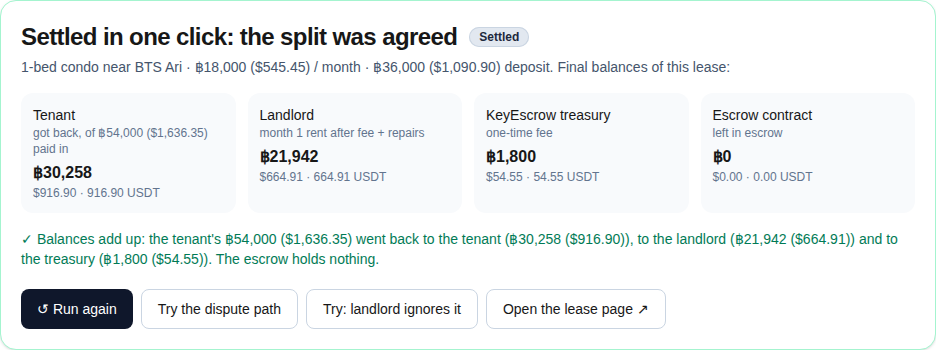
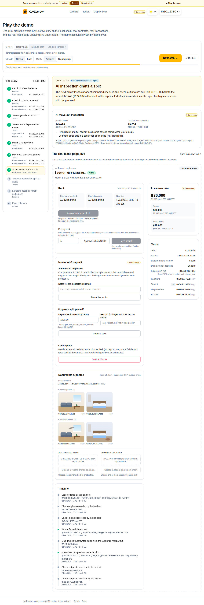

# Demo script (3 minutes)

A live walkthrough on a **local anvil chain**. No wallet extension, keys or paid APIs are needed: the app's
yellow **Demo accounts** bar lets you act as the landlord, the tenant or the KeyEscrow dispute desk.

The pitch starts with the **one-click demo**: one button plays the whole story (create, fund, pay out rent,
AI inspection, settle) with real transactions against the real contracts, switching accounts by itself, while
the real lease page updates live underneath. The manual click-through further down is the backup and the
answer to "can I try it myself?".



## Setup (before the clock starts)

Requirements: [Foundry](https://book.getfoundry.sh/getting-started/installation), Node 22, pnpm, and a one-time
`pnpm run setup` from the repo root.

### 1. Chain, contracts and demo data

```bash
pnpm chain:anvil          # terminal 1: anvil on 127.0.0.1:8545, chain id 31337
pnpm chain:deploy         # terminal 2: MockUSDT + EscrowFactory -> contracts/deployments/31337.json
pnpm chain:seed           # demo balances + two demo leases -> contracts/deployments/31337.demo.json
```

The seed uses **anvil's well-known default dev accounts**. Their keys are public and only work on a local
chain. Never use them anywhere else.

| Role | Anvil account | Address |
| --- | --- | --- |
| Deployer / factory owner / KeyEscrow treasury (fee recipient) | #0 | `0xf39Fd6e51aad88F6F4ce6aB8827279cffFb92266` |
| Landlord | #1 | `0x70997970C51812dc3A010C7d01b50e0d17dc79C8` |
| Tenant | #2 | `0x3C44CdDdB6a900fa2b585dd299e03d12FA4293BC` |
| KeyEscrow dispute desk (default arbiter) | #3 | `0x90F79bf6EB2c4f870365E785982E1f101E93b906` |

It creates two leases, both a Bangkok condo at 15,000 THB/month (441.18 mUSDT at ~34 THB/USDT), a 2-month
deposit (882.36 mUSDT) and a 12-month term, with the demo lease PDF and three check-in photos from
`web/public/demo/` attached:

| Lease | Key in `31337.demo.json` | State after seeding |
| --- | --- | --- |
| Active lease | `lease` | Funded by the tenant. Month 1 is due and ready to pay out to the landlord. |
| Disputed lease | `disputedLease` | Funded; the landlord proposed keeping 100 mUSDT for a wall repaint and the tenant opened a dispute. It uses a 60-day dispute-desk deadline so it is still open after a +30 day time jump. |

It also mints 10,000 mUSDT to the tenant and 1,000 to the landlord. On a fresh anvil every address is
deterministic (MockUSDT `0x5FbDB2315678afecb367f032d93F642f64180aa3`, EscrowFactory
`0xe7f1725E7734CE288F8367e1Bb143E90bb3F0512`, see `contracts/deployments/31337.example.json`), and the app
already has them baked in. If you deployed to an anvil that was not fresh, regenerate the app's addresses:

```bash
pnpm -C web sync:contracts   # contracts/deployments/31337.json -> web/lib/contracts/deployments.generated.json
```

### 2. Web app

```bash
echo "NEXT_PUBLIC_DEV_ACCOUNTS=1" > web/.env.local   # turns on the Demo accounts bar (local chain only)
pnpm dev                                            # http://localhost:3000
```

The app talks to `http://127.0.0.1:8545` by default; set `NEXT_PUBLIC_RPC_URL` in `web/.env.local` for another
node. Leave the AI, CoinMarketCap, Atlas and Greenfield variables empty: the app then uses its labelled
fallbacks (a deterministic demo inspector, **Demo rates** for THB/USD, evidence on local disk) and calls no
paid API.

Prefer a real wallet? Import anvil accounts #1-#3 into a wallet extension and add the network *Anvil, RPC
`http://127.0.0.1:8545`, chain id 31337*. The Demo accounts bar is not needed then.

### 3. Photos

Have two small sets of room photos ready (JPEG, PNG or WebP): a clean check-in set and a check-out set with a
visible mark. `docs/demo-assets/` has a ready-made pair. The seeded leases already show three placeholder
check-in photos.

### 4. Time travel

Rent periods (30 days) and timeouts run on block time. Advance anvil's clock with:

```bash
cast rpc evm_increaseTime 2592000 && cast rpc evm_mine      # +30 days
```

## One-click demo

Landing page → **▶ Play the demo** (or open `/demo`; the yellow Demo accounts bar links there too). It exists
only in local builds: `NEXT_PUBLIC_CHAIN_ID=31337` (the default) and `NEXT_PUBLIC_DEV_ACCOUNTS=1`. Production
and testnet builds compile it out and `/demo` returns 404.

| Control | What it does |
| --- | --- |
| **Story** | *Happy path* (tenant proposes the AI split, landlord accepts), *Dispute path* (landlord disputes, the dispute desk rules on a split), *Landlord ignores it* (7-day fast-forward, then the full deposit goes back to the tenant). |
| **Speed** | *Normal* holds each caption long enough to read aloud (about a minute for the happy path). *Fast* runs the transactions back to back (about 10 s). |
| **Mode** | *Autoplay*, or *Step by step*: each step waits for **Next step →**. Best for a live pitch, you talk, then click. |
| **Pause / Restart** | Pause takes effect after the current transaction. Restart begins again with a fresh lease. |
| **Retry** | If a step fails (node down, AI route offline, …) the error is shown in plain words with **Retry this step** and **Start over**. Retried steps resume where they stopped: nothing is sent twice. |

What it does, step by step (each run creates a **new lease**, cycling through three Bangkok rentals: a 1-bed
condo near BTS Ari at ฿18,000, a studio near BTS On Nut at ฿12,500, a 2-bed in Thonglor at ฿32,000; deposit two
months, 12-month term, KeyEscrow dispute desk as referee):

1. **Landlord offers the lease.** The demo lease PDF and two check-in photos (`web/public/demo/`) go through
   `POST /api/evidence`; their SHA-256 hashes go on-chain with `EscrowFactory.createLease`.
2. **Check-in photos on record:** one `addEvidence` per photo.
3. **Tenant gets demo mUSDT** from the MockUSDT faucet, only if short.
4. **Tenant funds** deposit + first month (approve, then `fund`).
5. **Month 1 paid out:** `releaseRent`; the landlord gets the rent minus the one-time 10 % KeyEscrow fee, which goes to the treasury.
6. **Move-out: check-out photos** (a scuffed wall, a stained floor) uploaded and anchored. No clock is faked
   here: settling the deposit does not depend on time, so the happy path needs no fast-forward.
7. **AI inspection** (`POST /api/settlement`, the offline demo inspector without a key) shows its split, one
   reason per changed photo and the *KeyEscrow Inspector* agent line (signed with its ERC-8004 identity when
   `INSPECTOR_PRIVATE_KEY` is set; unsigned otherwise, and the page says so).
8. **Tenant proposes** the split on-chain, with the inspection's report hash.
9. **Ending:** landlord accepts → settled at once · or landlord disputes → the desk rules (landlord keeps half
   again the AI estimate) · or *fast-forward 7 days (demo only)* via anvil's `evm_increaseTime` + `evm_mine`,
   then the tenant claims the timeout and gets the full deposit back.
10. **Final balances:** what the tenant paid in, got back, what the landlord and the KeyEscrow treasury
    received, and that the escrow holds nothing, in THB, USD and USDT, with a ✓ when the books add up.

Every transaction is listed under its step with a short hash linking to the lease page and its timeline. The end
screen offers **Run again**, **Try the dispute path** and **Try: landlord ignores it**. It runs the same code as
the normal UI: the `useTx` hook (simulate, send, toast), `uploadEvidence`, `runInspection` and the
`LeaseDetail` page component, rendered live under the narration.

`/demo?autoplay=1` starts on load (the landing button uses it); add `&path=dispute` or `&path=timeout`,
`&speed=fast` or `&step=1` to preset the controls.

| Start | Mid-run (step by step) | End |
| --- | --- | --- |
|  |  |  |

## Script (3 minutes)

Before the clock starts: chain and app running (Setup above), landing page open, **Step by step** if you want
to pace it by hand. Amounts show THB first; with no price key the badge reads **Demo rates** (1 USDT = 33 THB).

| Time | Who clicks | What happens on screen | What to say |
| --- | --- | --- | --- |
| **0:00-0:15** | Nobody. Landing page. | "Rental deposits that neither side can run off with." | "In Bangkok, a deposit is usually two months' rent, and at move-out the landlord holds all of it. KeyEscrow puts the deposit and the rent in a smart contract made for each lease, on BNB Chain, so neither side can move the money alone. Let me play the whole story." |
| **0:15-0:45** | **▶ Play the demo** | Steps 1-4: the landlord's lease for a ฿18,000 condo near BTS Ari with a ฿36,000 deposit; check-in photos on record; the yellow bar flips to *Tenant*; approve + fund. The lease page below goes *Awaiting funding* → **Active**. | "Every amount in baht, from CoinMarketCap or the Atlas feed, server-side. The PDF and photos are stored off-chain; only fingerprints go on-chain. Funding moves the deposit and month one into this lease's own escrow, not to the landlord." |
| **0:45-1:05** | (Next step) | Step 5: ฿16,200 to the landlord, ฿1,800 KeyEscrow fee to the treasury, in the timeline. | "Month one is due at the start. Our fee is 10 % of one month's rent, once, from the landlord's first payout. A Bangkok agent charges a full month. The deposit is never touched." |
| **1:05-1:50** | (Next step) | Steps 6-8: check-out photos with a scuff and a stain; the AI inspection card with its split and reasons and the *KeyEscrow Inspector* line; the tenant proposes on-chain. | "A vision-model agent compares check-in and check-out photos and drafts a split with reasons. It drafts; it never decides. Its signed report hash goes on-chain with the proposal." |
| **1:50-2:15** | (Next step) | Step 9-10: landlord accepts → **Settled**. End screen: tenant, landlord and treasury balances in THB/USD/USDT, ✓ balances add up, escrow ฿0. | "One transaction pays everyone out: no agent, no court, no weeks of waiting. And the books add up to the satang." |
| **2:15-2:45** | **Try the dispute path** (switch Speed to *Fast*) | Same story in ~10 s, then the landlord disputes and the dispute desk rules on a split. | "If they disagree, the KeyEscrow dispute desk rules. Two timeouts protect the tenant: if the landlord ignores a proposal for 7 days, or the desk misses its deadline, the full deposit goes back to the tenant." (Optional: **Try: landlord ignores it**, the only step that fast-forwards the local clock, clearly labelled *demo only*.) |
| **2:45-3:00** | Scroll to the lease page's *Timeline* | Every on-chain event with block numbers (BscScan links on testnet). | "It runs on BNB Chain today, opBNB is next for lower fees. One-time fee at a tenth of an agent's commission, plus dispute-desk revenue. Next step: a testnet pilot with Bangkok landlords." |

## Manual walkthrough (backup, or for Q&A)

The same story by hand, one role at a time.

Amounts show THB first, then USD and the exact mUSDT. With no price key the badge reads **Demo rates**
(1 USDT = 33 THB), so 441.18 mUSDT shows as ≈ ฿14,559.

| Time | Who clicks | What happens on screen | What to say |
| --- | --- | --- | --- |
| **0:00-0:20** | Nobody. Show the landing page. | "Rental deposits that neither side can run off with." Three steps, the fee in one line. | "In Bangkok, a deposit is usually two months' rent, and at move-out the landlord holds all of it. KeyEscrow puts the deposit and the rent in a smart contract made for each lease, on BNB Chain, so neither side can move the money alone." |
| **0:20-0:50** | Demo bar → **Landlord** → *Landlord* page | *New lease*: click *Use anvil tenant*, rent 441.18, deposit 882.36 (the form shows ≈ ฿14,559 and "2 months of rent"), 12 months. *Use the KeyEscrow dispute desk* is ticked. Attach `web/public/demo/lease.pdf` and a check-in photo → *Create lease*. | "The landlord sees every amount in baht, from CoinMarketCap or the Atlas feed, fetched on the server only. The PDF and photos are stored off-chain; only their SHA-256 fingerprints go on-chain. Each lease is its own small contract, cloned by our factory: cheap and isolated." |
| **0:50-1:20** | Demo bar → **Tenant** (same page) | Status *Awaiting funding*. *Fund the escrow* shows deposit, first month and total in THB. *Approve 1,323.54 USDT* → *Fund deposit + rent*. Status: **Active**. | "Before paying, the tenant sees the terms and who would rule in a dispute. Funding moves the deposit and month one into escrow, not to the landlord. Every disabled button says why." |
| **1:20-1:40** | Still Tenant → *Pay out 1 month to landlord* | Timeline: 397.06 mUSDT (≈ ฿13,103) to the landlord and a 44.12 mUSDT (≈ ฿1,456) KeyEscrow fee, charged once. | "Month one is due at the start. Anyone can trigger a payout once rent is due, so a keeper can automate it. Our fee is 10 % of one month's rent, once, from the landlord's first payout. A Bangkok agent charges a full month. The deposit is never touched." |
| **1:40-2:30** | **Tenant** → open the seeded active lease (*Tenant* page → card) → *Documents & photos*: add check-out photos → *Upload & record photos on-chain* → *Run AI inspection* → *Propose this split on-chain*. Then demo bar → **Landlord** → *Accept & settle now*. | Check-in thumbnails next to the check-out ones. The proposal shows the split in THB and one reason per changed photo. Status: **Move-out proposal**, then **Settled** with *Final settlement*. | "A vision model compares check-in and check-out photos and proposes a split with reasons. It drafts; it never decides. The tenant proposes on-chain and the landlord accepts: one transaction, no agent, no court, no weeks of waiting." |
| **2:30-2:50** | Demo bar → **Dispute desk** → *Dispute desk* page → the *In dispute* card | *Rule on this dispute*: the landlord's last proposal (keep 100 mUSDT), the split in THB, a deadline countdown. Write a short ruling → *Settle with this split*. Status: **Settled**. | "If they disagree, the KeyEscrow dispute desk rules; a landlord may name another neutral reviewer. Two timeouts protect the tenant: if the landlord ignores a proposal for 7 days, or the desk misses its deadline, the full deposit goes back to the tenant." |
| **2:50-3:00** | Scroll to the *Timeline* | Every on-chain event with block numbers (BscScan links on testnet). | "It runs on BNB Chain today, opBNB is next for lower fees. One-time fee at a tenth of an agent's commission, plus dispute-desk revenue. Next step: a testnet pilot with Bangkok landlords." |

## Fallbacks during the demo

- **AI route slow or offline:** without a key the proposal comes from the deterministic demo inspector,
  labelled *demo inspector (no AI key configured)*. Say "this is the offline fallback; the live model returns
  the same JSON".
- **Price source offline:** the badge shows *Demo rates* (or *stale* after a live source failed). The flow is
  unchanged, because the contracts never read prices.
- **Wallet nonce errors after a time jump** (real wallet only): reset the account's activity in the wallet
  extension, or reconnect.
- **Show the landlord-silence timeout instead:** after the tenant's proposal, run
  `cast rpc evm_increaseTime 604800 && cast rpc evm_mine` (+7 days), then have the tenant click
  *Return full deposit to tenant*. The full deposit goes back to the tenant.
- **One-click demo stuck on a step:** it shows the error in plain words; press **Retry this step**, or
  **Start over with a fresh lease**. A role switch that times out usually means the Demo accounts bar is
  hidden (build without `NEXT_PUBLIC_DEV_ACCOUNTS=1`).
- **Rehearse without clicking:** `pnpm -C web test:e2e` plays the one-click demo (happy, dispute and
  landlord-ignores-it paths, step by step with a failure + Retry) and the manual create → fund → pay out →
  AI proposal → accept flow, in a headless browser against its own throwaway anvil.
