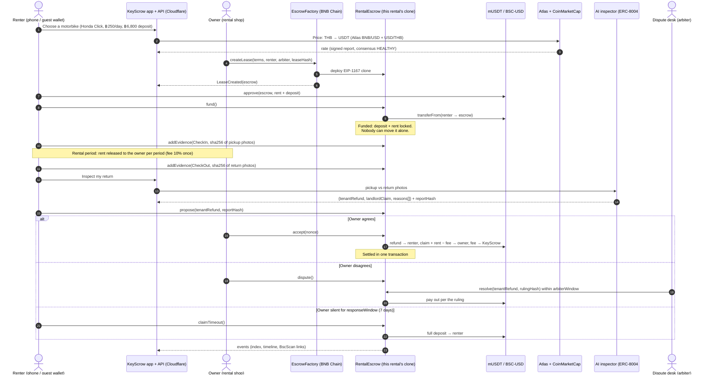

# KeyScrow: one rental as a UML sequence diagram

Renter, owner, the contracts on BNB Chain, the price feeds, the AI inspector and the dispute desk, from choosing a motorbike to the payout. Function names are the real ones in `contracts/src/`.

