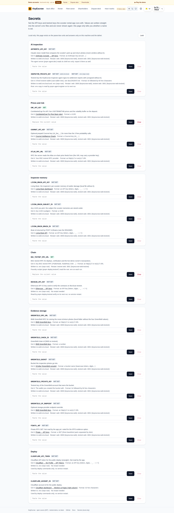
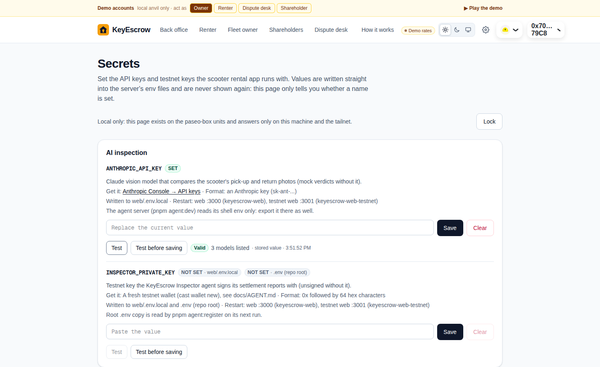

# Setup: secrets on paseo-box

**Status:** on `main`. Local only: the page runs on the paseo-box units, never on a public or Cloudflare deploy.

API keys and testnet keys go into untracked env files on the box, never into the repo or the chat. The write-only
secrets page at **`/settings/secrets`** puts them there from the browser.



## Use it

1. Open `http://<paseo-box tailnet IP>:3000/settings/secrets` (or `:3001`), or the gear in the header (wide screens)
   or **Secrets (local only)** in the footer.
2. The page asks for the admin passcode. The server generates it on first use. Read it on paseo-box:

   ```sh
   cat ~/projects/bnb-hackathon/.orca/secrets/settings-passcode
   ```

   It is never printed, logged or sent to the browser. A correct passcode gives a 15-minute session cookie (httpOnly,
   SameSite=Strict). To rotate it, delete the file: the next visit creates a new one and ends every session.
3. Paste a value, press **Save**. The input clears, the value goes to the server once, and the page shows only
   **SET** / **NOT SET** and "Saved at <time>". There is no endpoint that reads a value back. **Clear** empties it.
4. Each name says which file it goes to and which service has to restart before the new value is used. The
   **Services** card restarts `keyescrow-web` (:3000) or `keyescrow-web-testnet` (:3001) with
   `systemctl --user --no-block restart` and waits until it is back. No other unit can be restarted from the page.

## Test a key

Each name has **Test** (checks the stored value on the server) and **Test before saving** (checks the value typed in
the field without writing it). The result is **Valid**, **Invalid** or **Can't test**, with a short reason and the time,
e.g. "Valid: 3 models listed", "Invalid: 401 unauthorized", "Valid: chainId 97". The value is never in the result, a
log, an error or the audit line (`<time> NAME tested stored:valid <ip>`).

Only free, read-only calls, server-side, 10 s timeout, at most 10 tests per 5 minutes:

| Name | Check |
| --- | --- |
| `ANTHROPIC_API_KEY` | `GET api.anthropic.com/v1/models` (lists models, no tokens used) |
| `CMC_API_KEY` | `GET pro-api.coinmarketcap.com/v1/key/info`: no API credit cost per CMC's API reference (it only counts towards the per-minute rate limit); shows the credits left this month |
| `BSCSCAN_API_KEY` | Etherscan V2 `chainid=97&module=proxy&action=eth_blockNumber`; if the free plan does not cover chain 97, the key is checked with the same call on chain 1 |
| `CLOUDFLARE_API_TOKEN` | `GET /client/v4/user/tokens/verify` |
| `CLOUDFLARE_ACCOUNT_ID` | `GET /client/v4/accounts/<id>` with the stored token (save the token first) |
| `PINATA_JWT` | `GET api.pinata.cloud/data/testAuthentication` |
| `BSC_TESTNET_RPC_URL`, `ATLAS_RPC_URL` | `eth_chainId` (97 expected for the BSC one) |
| `GREENFIELD_RPC_URL`, `GREENFIELD_CHAIN_ID` | the node's Tendermint `/status` network (`greenfield_5600-1`) |
| `INSPECTOR_PRIVATE_KEY`, `GREENFIELD_PRIVATE_KEY` | no network: the address is derived locally and shown (the inspector key is compared with `INSPECTOR_SIGNER_ADDRESS` and `agent/deployments/97.json` `reportSigner`) |
| `COURNOT_API_KEY`, `LIVING_BRAIN_*`, `GREENFIELD_BUCKET`, `GREENFIELD_SP_ENDPOINT` | Can't test: no free check without spending credits (Cournot's free calls are limited, so it is never called) |



## Which file

| File | Read by | Names |
| --- | --- | --- |
| `web/.env.local` (main checkout) | the Next server: `keyescrow-web` (:3000, `next dev`) and `keyescrow-web-testnet` (:3001, `next start`), both run from that `web/` | `ANTHROPIC_API_KEY`, `CMC_API_KEY`, `COURNOT_API_KEY`, `ATLAS_RPC_URL`, `LIVING_BRAIN_*`, `GREENFIELD_*`, `PINATA_JWT`, `INSPECTOR_PRIVATE_KEY` |
| `.env` (repo root, main checkout) | Foundry scripts (`pnpm deploy:testnet*`), `pnpm agent:register`, the live demo runner on :3001 | `BSC_TESTNET_RPC_URL`, `BSCSCAN_API_KEY`, `INSPECTOR_PRIVATE_KEY`, `CLOUDFLARE_API_TOKEN`, `CLOUDFLARE_ACCOUNT_ID` |

The allowlist is `web/lib/server/secrets/registry.ts`. Nothing else can be written, and never a `NEXT_PUBLIC_*` name
(those end up in the browser bundle). `pnpm agent:dev` reads its shell env only, not a `.env` file.

Every write is atomic (temp file + rename), keeps the file at mode 600 and every other line and comment as it was, and
first copies the old file to `.orca/backup/env/` (mode 600, the newest 10 per file). An audit line (time, name,
set/cleared/restart, files, client IP; never the value) goes to `.orca/reports/secrets-audit.log`.

Values are checked before they are written: no line breaks, spaces, quotes, `$`, `#` or backslashes (every dotenv
reader in the repo must read them the same way), at most 512 characters (4096 for a JWT), and a per-name format
(`0x` + 64 hex for private keys, JWT shape for `PINATA_JWT`, a UUID for `CMC_API_KEY`, ...). An error never repeats the
value.

## Switching it on

The page and its API answer **404** unless the server runs with `SETTINGS_SECRETS_ENABLED=1`:

- `:3000` (`keyescrow-web`): `SETTINGS_SECRETS_ENABLED=1` in the main checkout's `web/.env.local`.
- `:3001` (`keyescrow-web-testnet`): `web/scripts/testnet-web.sh` passes it to the unit along with the paths
  (`SETTINGS_SECRETS=0 pnpm testnet:web` leaves it off).

| Variable (server env) | Default |
| --- | --- |
| `SETTINGS_SECRETS_ENABLED` | off; `1` switches the page on |
| `SECRETS_ENV_FILE` | `/home/orcasrv/projects/bnb-hackathon/.env` |
| `SECRETS_WEB_ENV_FILE` | `web/.env.local` next to `SECRETS_ENV_FILE` |
| `SETTINGS_SECRETS_STATE_DIR` | `.orca` next to `SECRETS_ENV_FILE` (passcode, backups, audit log) |
| `SETTINGS_SECRETS_RESTART` | on; `0` hides the restart buttons and never calls `systemctl` |
| `SETTINGS_SECRETS_AGENT_DEPLOYMENT` | `agent/deployments/97.json` next to `SECRETS_ENV_FILE` (registered report signer) |
| `SETTINGS_SECRETS_TEST_ORIGIN` | unset; e2e only: `http://127.0.0.1:<port>` stub that stands in for every key-test API |
| `SETTINGS_SECRETS_HOSTS` | extra allowed Host names, comma-separated (localhost, tailnet IPs and `*.ts.net` are always allowed) |

## Guards

- **Never on Cloudflare.** A build with `SETTINGS_SECRETS_ENABLED=1` and Cloudflare's build env (`CF_PAGES`,
  `WORKERS_CI`) fails in `next.config.ts`; at runtime the flag is ignored there too.
- **Local and tailnet only.** `proxy.ts` and every route refuse clients outside `127.0.0.1`, `::1` and Tailscale's
  `100.64.0.0/10`, a Host header that is not localhost / a tailnet IP / `*.ts.net`, and any request with CDN or proxy
  headers (`cf-connecting-ip`, `x-real-ip`, `forwarded`, `via`, more than one `x-forwarded-for` hop). Note: Next fills
  `x-forwarded-for` from the socket only when the client sent none, so the IP check is a filter; the boundaries are the
  units binding to the tailnet IP, the Host check and the passcode.
- **CSRF.** Writes need a same-origin `Origin`, JSON, and no cross-site `Sec-Fetch-Site`; the cookie is SameSite=Strict.
- **Rate limits.** 5 passcode tries per IP and 20 overall per 5 minutes; 30 writes per 5 minutes.
- **No caching, no read-back.** Every answer is `Cache-Control: no-store`; values never go into React state, logs or
  error messages.
