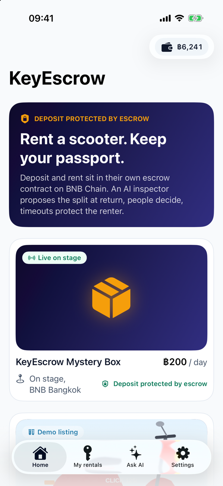
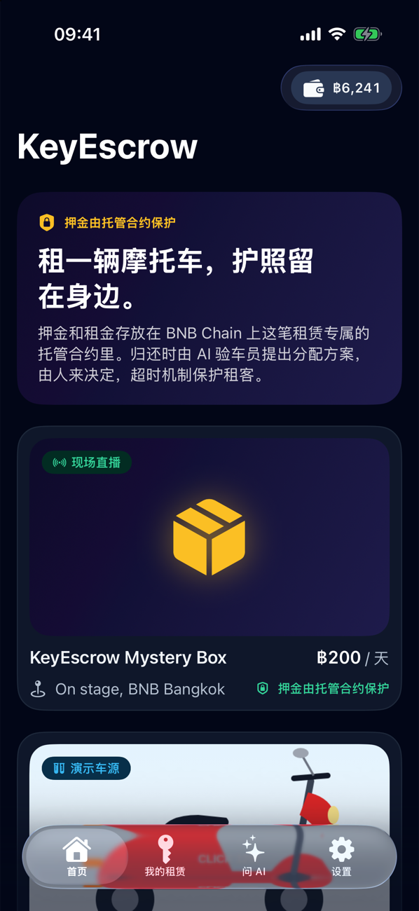
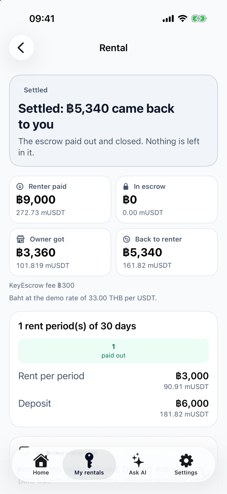
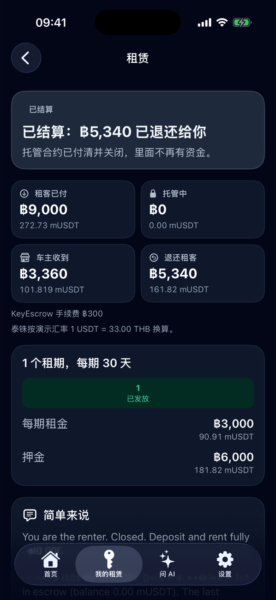
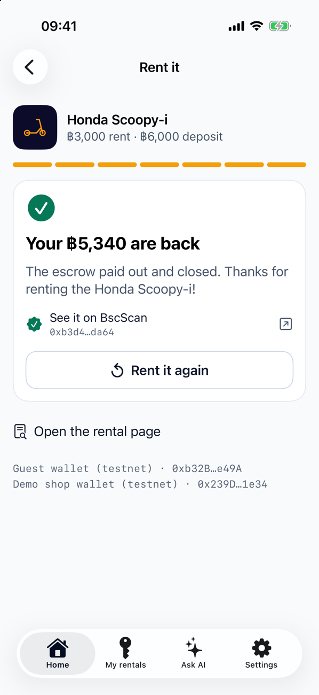
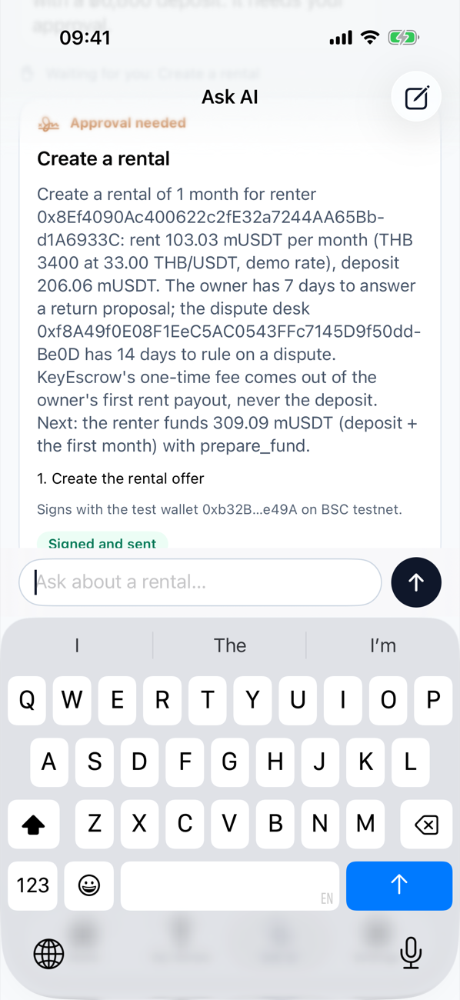

# KeyEscrow for iOS

A native SwiftUI app for KeyEscrow: rent a scooter (or the live stage Mystery Box) with the deposit and rent in their
own escrow contract on **BSC testnet**. The phone makes a testnet-only guest wallet, signs every transaction itself,
and talks to the live KeyEscrow API. Testnet only: the app refuses to sign for any chain but 97.

| Light · EN | Dark · 中文 |
| --- | --- |
|  |  |

| Rental page · light · EN | Rental page · dark · 中文 | Rent flow, settled | Ask AI approval, signed |
| --- | --- | --- | --- |
|  |  |  |  |

All screenshots (Simulator, iPhone 17, light + dark, EN + 中文) are in [`screenshots/`](screenshots). The rental shown is
a real one the E2E test made on BSC testnet: escrow
[`0x758f…4dEd`](https://testnet.bscscan.com/address/0x758fda4c2c5C1A121106ce91B15348E2a2b84dEd).

## Requirements

- macOS with Xcode 16 or newer (built and tested with Xcode 27.1, iOS 27 Simulator); iOS 17+ deployment target.
- [XcodeGen](https://github.com/yonaskolb/XcodeGen) (`brew install xcodegen`). The `.xcodeproj` is generated from
  `project.yml` and not committed.
- Network access for Swift Package Manager (one dependency, below) and for the app itself.

## Generate, build, run

```bash
cd ios
xcodegen generate
open KeyEscrow.xcodeproj            # then pick an iPhone Simulator and press Run
```

Command line:

```bash
xcodebuild -scheme KeyEscrow -destination 'platform=iOS Simulator,name=iPhone 17' build
xcodebuild -scheme KeyEscrow -destination 'platform=iOS Simulator,name=iPhone 17' test   # unit tests, offline
```

Use any installed iPhone Simulator (`xcrun simctl list devices available`); the brief named `iPhone 16`, this Mac's
Xcode ships iPhone 17 / 18 Simulators.

**On your own iPhone (free Apple ID):** open the project in Xcode, select the `KeyEscrow` target > Signing &
Capabilities, tick *Automatically manage signing*, pick your **Personal Team** and, if Xcode asks, change the bundle
id (e.g. `org.keyescrow.ios.<yourname>`). Plug in the iPhone, enable Developer Mode, Run. The free profile lasts 7
days. No paid-account features are used (no push, no App Store). Never commit your team ID: it stays in your local
Xcode settings (`xcuserdata/` is ignored).

**Live end-to-end test** (real transactions on BSC testnet, ~2 minutes, uses the drip once per fresh wallet):

```bash
xcodebuild -scheme KeyEscrowE2E -destination 'platform=iOS Simulator,name=iPhone 17' test
```

It rents a demo scooter: test money, offer, fund, pickup + return photos on-chain, AI inspection, proposal, the
demo shop accepts, settled.

## What is in the app

| Tab | What it does |
| --- | --- |
| **Home** | Airbnb-style list: the live **Mystery Box** (`GET /api/stage/mystery-box`) and the demo scooters (`GET /api/fleet`). Detail: price per day, deposit, "deposit protected by escrow", *Rent it*. |
| **Rent it** (from a listing) | The `/r` judge flow, native: get test money → the owner offers → *Pay into escrow* (`prepare_fund`) → pickup photos → return photos (SHA-256, `POST /api/evidence`, `prepare_add_evidence`) → AI inspection (`POST /api/settlement`, agent #2921) → propose the split (`prepare_propose_settlement`) → owner accepts → settled. Every transaction links to BscScan as soon as it is mined. Steps are read back from the chain, so leaving and coming back continues where it was. |
| **My rentals** | `list_leases` for the guest wallet. Rental page: status banner, money strip (renter paid / in escrow / owner got / back to renter, baht + mUSDT), period strip, `explain_status` in plain words, timeline (`/api/chain/index`) with BscScan links. Pull to refresh. |
| **Ask AI** | Chat against `POST /api/assistant` (Server-Sent Events). Approval cards show the exact unsigned steps; *Approve and sign* signs them with the guest wallet, then resumes the run with the tx hashes. The live server runs the demo model. |
| **Settings** | Test wallet (address, copy, BscScan, balances, *Get test money*, make a new wallet), demo shop wallet, language **EN / 中文**, appearance **system / light / dark**, about. |

Light and dark follow the web's colour tokens (`web/app/globals.css`); all text uses Dynamic Type text styles; tap
targets are at least 44 pt.

## What is real on-chain vs demo

| Real (BSC testnet, chain 97, contract v2 from `contracts/deployments/97.json`) | Demo |
| --- | --- |
| Every escrow the app creates or funds (`EscrowFactory` `0x04D7…9315`, MockUSDT `0x7aF0…35B1`). | Scooter listings: the off-chain, demo-grade catalogue (`/api/fleet`), labelled *Demo listing*. |
| Every transaction: signed on the phone with the guest wallet, sent through `https://bsc-testnet-rpc.publicnode.com`. | **Demo scooters' owner** is a second test key on the phone ("demo shop wallet"): it signs `createLease` (from `prepare_create_lease`) and `accept`. The guest wallet lends it 0.0004 tBNB for gas. |
| Photo fingerprints (`addEvidence`), the proposal with the inspector's `reportHash`, the settlement. | **Mystery Box owner** is the KeyEscrow server (`/api/stage` `lease`); the presenter accepts on the big screen. |
| Test money: `/api/stage` drip (tBNB + mUSDT from the team's funder, once per address) and `MockUSDT.faucet` signed by the guest wallet. | AI inspector on the live server is the deterministic demo inspector (no vision key there); the app says so. Baht use the demo rate (33 THB/USDT) when the price API is in mock mode, and says so. |
| | Simulator has no camera: *Add a sample photo* makes a time-stamped generated picture. On an iPhone it is the live camera only (no photo library, by design). |

## Safety

- **Testnet only.** `LegacyTransaction.signed` throws for any chainId but 97; `TxSender` also checks the prepared
  answer's `chainId` and the RPC's `eth_chainId` before every send, caps gas (1.5 M) and gas price (10 gwei), refuses
  value on prepared steps, and only calls MockUSDT, the factory, or an address the API confirms is a KeyEscrow rental.
- **Keys** are made on the phone (`SecRandomCopyBytes`), stored in the Keychain with
  `kSecAttrAccessibleAfterFirstUnlockThisDeviceOnly` (no iCloud sync, not in backups) and never leave it. The server
  only ever sees addresses.
- No analytics, no trackers, no third-party SDKs besides the signer library.
- Nothing secret in the repo: no keys, no team ID, no provisioning profiles (`ios/.gitignore`).

## Code map

```
ios/
  project.yml                 XcodeGen: app, unit tests, live E2E UI test
  KeyEscrow/
    Crypto/                   Keccak-256, RLP, BigUInt, EIP-155 legacy tx signing, EIP-55 addresses, tiny ABI
    Wallet/                   Keychain, WalletStore (guest + demo shop keys), TxSender (prepare_* steps -> RPC)
    Network/                  APIClient (/api/v1, stage, fleet, price, chain index, settlement, evidence), RPC, models
    Features/Home|Rent|Rentals|AskAI|Settings
    Support/                  AppSettings, L10n (EN + 中文 side by side), Money (baht / mUSDT / tBNB)
    Design/                   colour tokens, cards, pills, buttons
  KeyEscrowTests/             signer vectors (viem), API decoding (live fixtures), money + i18n
  KeyEscrowE2E/               live rent-a-scooter run on BSC testnet
```

Dependency: [`21-DOT-DEV/swift-secp256k1`](https://github.com/21-DOT-DEV/swift-secp256k1) 0.25.1 (`P256K`,
libsecp256k1: RFC 6979 + low-s, recoverable signatures). Keccak, RLP and the transaction encoding are in this repo
and checked byte for byte against viem's `signTransaction` (vectors in `KeyEscrowTests/Fixtures/README.md`).

Screenshots: `-lang en|zh`, `-appearance light|dark`, `-tab 0..3`, `-listing <id>`, `-flow <id>` and `-lease <escrow>`
launch arguments open a given state (`xcrun simctl launch booted org.keyescrow.ios -lang zh -appearance dark`).
